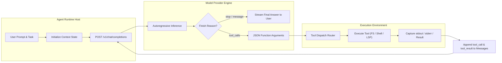

[← Back to Tech-21: Agentic Software Engineering Overview](./README.md) | [🏠 Series Catalog](../../README.md)

---

# 1. What is an Agentic Coding Loop and How Does the ReAct Engine Actually Execute? 

## 1. The Core Concept & Intuition

Traditional code generators operate as stateless, single-turn functions: an engineer inputs a prompt, the Large Language Model (LLM) streams a completion, and the process terminates. If the generated code imports a deprecated package, references a non-existent method, or introduces a syntax error, the model is entirely unaware of its failure. The human engineer bears 100% of the cognitive burden to test, debug, and reprompt.

An **Agentic Coding Loop** fundamentally shifts this paradigm by converting the model into an iterative reasoning engine embedded inside an active feedback cycle known as **ReAct (Reasoning + Acting)**. Instead of immediately returning final text, the model emits structured actions (tool calls—such as reading a file, executing a bash command, or running a test suite). The runtime environment intercepts these calls, executes them against the actual workspace, and returns the raw output as an **observation** back into the model's conversation history.

```text
Prompt -> [Thought -> Action (Tool Call) -> Observation (Tool Result)]* -> Solution
```

This closed-loop system gives the agent sensory awareness of its environment. When a build fails or a test throws an assertion error, the agent observes the stack trace directly and autonomously plans corrective action.

---

## 2. Under the Hood: The ReAct Runtime Loop & Tool Dispatch Mechanics

At the runtime level, an agent is not a continuous background neural process; it is a deterministic state machine driven by consecutive discrete HTTP calls to an LLM provider's API.



The execution loop proceeds through precise mechanical phases:

1. **Context Packaging**: The host application packages the system prompt, registered tool schemas (JSON Schema), session history, and latest user prompt into the API payload.
2. **Inference & Decision**: The model outputs tokens until it triggers a special delimiter indicating tool invocation. The API returns with `finish_reason: "tool_calls"`.
3. **Validation & Sandboxed Execution**: The runtime deserializes the tool call name and arguments against strict Zod/JSON schemas. If valid, the runtime executes the operation inside the host or container sandbox.
4. **Observation Injection**: The runtime creates a new message with `role: "tool"` (referencing the unique `tool_call_id`) containing the stdout, stderr, or JSON result.
5. **Re-Invocation**: The updated transcript is fed back into the model. The model assesses whether the objective is satisfied or whether another action is required.

### Autonomous Agent Loops vs. Traditional Code Generation

| Dimension | Traditional Single-Turn Generation | Autonomous ReAct Agent Loop |
| :--- | :--- | :--- |
| **Execution Model** | One-shot request/response stream | Multi-turn stateful feedback loop |
| **Tool Access** | None (pure text generation) | Structured JSON-RPC / API tool dispatch |
| **Error Handling** | Blind to compiler & runtime failures | Observes errors via stdout/stderr and self-corrects |
| **Context Evolution** | Static context per invocation | Dynamic transcript expansion with tool observations |
| **Halting Condition** | Generation of `<|endoftext|>` token | Model emits message without tool calls or hits step ceiling |

---

## 3. Clean Code in Action

### A. Core ReAct Runtime Loop Implementation
The following TypeScript implementation demonstrates the minimal, production-grade ReAct engine loop:

```typescript
import { OpenAI } from "openai";

interface ToolDefinition {
  schema: OpenAI.ChatCompletionTool;
  execute: (args: Record<string, unknown>) => Promise<string>;
}

export async function runAgentLoop(
  client: OpenAI,
  model: string,
  systemPrompt: string,
  userTask: string,
  tools: Map<string, ToolDefinition>,
  maxSteps = 15
): Promise<string> {
  const messages: OpenAI.ChatCompletionMessageParam[] = [
    { role: "system", content: systemPrompt },
    { role: "user", content: userTask }
  ];

  const formattedTools = Array.from(tools.values()).map(t => t.schema);

  for (let step = 0; step < maxSteps; step++) {
    const response = await client.chat.completions.create({
      model,
      messages,
      tools: formattedTools.length > 0 ? formattedTools : undefined,
      tool_choice: "auto"
    });

    const choice = response.choices[0];
    const message = choice.message;
    messages.push(message);

    // If the model did not request any tools, it has reached its conclusion
    if (!message.tool_calls || message.tool_calls.length === 0) {
      return message.content ?? "Task completed without message.";
    }

    // Execute all parallel tool calls requested by the model
    for (const toolCall of message.tool_calls) {
      const tool = tools.get(toolCall.function.name);
      let output: string;

      if (!tool) {
        output = `Error: Unknown tool "${toolCall.function.name}"`;
      } else {
        try {
          const parsedArgs = JSON.parse(toolCall.function.arguments);
          output = await tool.execute(parsedArgs);
        } catch (err: unknown) {
          const errMsg = err instanceof Error ? err.message : String(err);
          output = `Tool execution failed: ${errMsg}`;
        }
      }

      // Inject the observation back into the conversational transcript
      messages.push({
        role: "tool",
        tool_call_id: toolCall.id,
        content: output
      });
    }
  }

  throw new Error(`Agent exceeded maximum execution step limit of ${maxSteps}`);
}
```

### B. Robust Tool Dispatcher with Safe Error Boundary
In production, tool execution can throw unhandled exceptions, hang indefinitely, or emit megabytes of log spam. The dispatcher must isolate faults and sanitize tool outputs before feeding them back into context:

```typescript
import { z } from "zod";

export interface SafeTool<TArgs> {
  name: string;
  schema: z.ZodSchema<TArgs>;
  timeoutMs: number;
  maxOutputChars: number;
  handler: (args: TArgs) => Promise<string>;
}

export async function executeToolWithBoundary<TArgs>(
  tool: SafeTool<TArgs>,
  rawArgumentsJson: string
): Promise<string> {
  // 1. Safe JSON parsing & schema validation
  let validatedArgs: TArgs;
  try {
    const raw = JSON.parse(rawArgumentsJson);
    validatedArgs = tool.schema.parse(raw);
  } catch (err) {
    return `Validation Error for tool ${tool.name}: ${err instanceof Error ? err.message : String(err)}`;
  }

  // 2. Timeout-bounded execution
  const executionPromise = tool.handler(validatedArgs);
  const timeoutPromise = new Promise<never>((_, reject) => {
    setTimeout(() => reject(new Error(`Tool timeout exceeded (${tool.timeoutMs}ms)`)), tool.timeoutMs);
  });

  try {
    const result = await Promise.race([executionPromise, timeoutPromise]);
    
    // 3. Output truncation to protect the LLM context window
    if (result.length > tool.maxOutputChars) {
      const truncated = result.slice(0, tool.maxOutputChars);
      return `${truncated}\n\n[WARNING: Output truncated from ${result.length} to ${tool.maxOutputChars} characters]`;
    }
    return result;
  } catch (err) {
    return `Runtime Failure in ${tool.name}: ${err instanceof Error ? err.message : String(err)}`;
  }
}
```

---

## 4. Common Pitfalls & Interview Traps

| Trap / Misconception | Reality |
| :--- | :--- |
| **"Agents run continuously on the server until finished."** | Agents do not run continuously. They are stateless HTTP loops. An agent is entirely passive while waiting for external tool execution or API inferences. |
| **"Throwing an exception in a tool aborts the agent."** | Throwing a runtime exception crashes the host application. Robust runtimes catch all tool errors and convert them into plain-text observations so the model can read the stack trace and self-correct. |
| **"The model executes the code directly inside its neural network."** | The model executes zero code. It merely predicts the string tokens of function arguments. The host runtime executes the actual code on local host hardware or in a container. |
| **"Passing raw tool output directly into context is always safe."** | Unbounded tool outputs (such as `npm test` dumping 50,000 lines of output) will immediately saturate the context window, causing needle-in-a-haystack failures and massive token bills. |

---

## 5. 60-Second Memory Anchor

> **"An AI coding agent is not an intelligent entity living inside your code; it is a deterministic while-loop feeding tool outputs into an LLM's next inference turn until the model stops requesting tools."**

---

[← Preface](./00-preface.md) | **Next**: [Question 02 →](./02-how-do-coding-agents-index-and-navigate-codebases.md)
