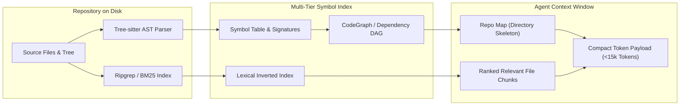

[← Back to Tech-21: Agentic Software Engineering Overview](./README.md) | [🏠 Series Catalog](../../README.md)

---

# 2. How Do Coding Agents Index, Navigate, and Understand Massive Codebases? 

## 1. The Core Concept & Intuition

When a human software engineer opens an enterprise monorepo containing millions of lines of code across thousands of files, they do not attempt to read every file sequentially. Instead, they navigate via hierarchical mental models: inspecting directory structures, leveraging Language Server Protocol (LSP) definitions ("Go to Definition", "Find References"), and searching with targeted lexical patterns (`ripgrep`).

Autonomous coding agents face the identical fundamental challenge, but under severe token and attention constraints. An agent cannot ingest a 500,000-line codebase into its prompt context window without incurring catastrophic latency, prohibitive token costs, and severe attention degradation.

To operate autonomously in large repositories, modern agents employ a multi-tiered repository navigation architecture. Rather than relying purely on vector embeddings (which frequently miss exact symbol names or cross-file call hierarchies), production-grade agents synthesize three complementary index topologies:
1. **Lexical Retrieval (BM25 / Ripgrep)**: Finding exact string literals, environment keys, and configuration constants.
2. **Structural AST Graphs (Tree-sitter / CodeGraph / Ctags)**: Mapping exact type signatures, class hierarchies, call graphs, and caller-callee relationships across dynamic dispatch boundaries.
3. **Semantic Embeddings / RAG**: Surfacing conceptually related modules when the user's terminology does not match repository symbol names.

---

## 2. Under the Hood: Codebase Navigation & Indexing Topologies

The agent codebase ingestion pipeline bridges the gap between raw disk files and compact context tokens.



Modern architectures such as Aider's `repomap` and compiler-backed CodeGraphs construct a global directed acyclic graph (DAG) of the repository. Using PageRank on the graph, the system identifies the most referenced foundational types and interfaces in the repository, outputting a high-signal "repository skeleton" that consumes under 2% of the context window.

### Codebase Indexing Strategies Compared

| Indexing Strategy | Best Used For | Latency & Compute | Major Limitation |
| :--- | :--- | :--- | :--- |
| **Vector RAG (Embeddings)** | Broad natural language questions ("How is auth handled?") | Moderate (Vector DB query) | Misses exact identifiers, cannot trace multi-hop call graphs |
| **Lexical Search (Ripgrep / BM25)** | Exact string, regex, and identifier lookup | Sub-10ms (wire-speed disk search) | No semantic understanding; floods context with irrelevant hits |
| **AST / Tree-sitter Graphs (CodeGraph)** | Precise symbol resolution, method calls, type definitions | Fast (pre-indexed graph traversal) | Language-specific AST parser grammar maintenance required |
| **Repo Skeleton (PageRank AST)** | Initial global repository mental model in system prompt | Zero runtime latency (pre-computed) | Omits method implementation bodies by design |

---

## 3. Clean Code in Action

### A. Compact AST Repository Skeleton Generator
This Node.js script parses files, extracts high-signal exported symbols, and formats a token-efficient repository skeleton:

```typescript
import * as fs from "fs";
import * as path from "path";

interface FileSkeleton {
  filePath: string;
  symbols: string[];
}

export function extractExportedSymbols(content: string): string[] {
  const symbols: string[] = [];
  // Lightweight regex matching top-level exports and declarations
  const pattern =
    "^export\\s+(?:async\\s+)?" +
    "(?:class|function|interface|type|const|enum)\\s+" +
    "([a-zA-Z0-9_$]+)";
  const exportRegex = new RegExp(pattern, "gm");
  let match: RegExpExecArray | null;

  while ((match = exportRegex.exec(content)) !== null) {
    symbols.push(match[1]);
  }
  return symbols;
}

export function generateRepoMap(
  dir: string, baseDir = dir
): FileSkeleton[] {
  const results: FileSkeleton[] = [];
  const entries = fs.readdirSync(dir, { withFileTypes: true });

  for (const entry of entries) {
    const fullPath = path.join(dir, entry.name);
    if (entry.isDirectory()) {
      const ignoreDirs = [
        "node_modules", ".git", "dist", ".build_src"
      ];
      if (!ignoreDirs.includes(entry.name)) {
        results.push(...generateRepoMap(fullPath, baseDir));
      }
    } else if (/\.(ts|js|py|go|rs)$/.test(entry.name)) {
      const relPath = path.relative(baseDir, fullPath);
      const content = fs.readFileSync(fullPath, "utf-8");
      const symbols = extractExportedSymbols(content);
      if (symbols.length > 0) {
        results.push({ filePath: relPath, symbols });
      }
    }
  }
  return results;
}

// Format the skeleton into a compact prompt string
export function formatRepoMapPrompt(
  skeletons: FileSkeleton[]
): string {
  return skeletons
    .map(s => `${s.filePath}: [${s.symbols.join(", ")}]`)
    .join("\n");
}
```

### B. Hybrid Symbol and Lexical Search Ranker
A production agent search tool that queries exact AST symbols before falling back to lexical search:

```typescript
import { execFileSync } from "child_process";

export interface SearchHit {
  file: string;
  line: number;
  snippet: string;
}

export function hybridCodeSearch(
  repoRoot: string, query: string, maxHits = 10
): SearchHit[] {
  // Step 1: Execute fast ripgrep for exact symbol matches
  try {
    const args = [
      "--json", "-m", "5", "--fixed-strings", query, repoRoot
    ];
    const stdout = execFileSync("rg", args, {
      encoding: "utf-8",
      maxBuffer: 4 * 1024 * 1024
    });

    const hits: SearchHit[] = [];
    const lines = stdout.trim().split("\n");

    for (const rawLine of lines) {
      if (!rawLine) continue;
      const parsed = JSON.parse(rawLine);
      if (parsed.type === "match") {
        hits.push({
          file: parsed.data.path.text,
          line: parsed.data.line_number,
          snippet: parsed.data.lines.text.trim()
        });
        if (hits.length >= maxHits) break;
      }
    }
    return hits;
  } catch (err: unknown) {
    // ripgrep exits with code 1 if no matches are found
    return [];
  }
}
```

---

## 4. Common Pitfalls & Interview Traps

| Trap / Misconception | Reality |
| :--- | :--- |
| **"Using Vector RAG alone solves codebase comprehension."** | Pure vector embeddings fail on code: they cannot follow `import` statements, fail on exact identifier lookups, and hallucinate connections between semantically similar but structurally isolated files. |
| **"Dumping the whole directory tree into the prompt is best."** | Dumping thousands of file paths without exported symbol signatures exhausts tokens without providing actionable information about what each file actually exports. |
| **"AST indexes eliminate the need for grep."** | AST indexes often miss raw string literals, configuration keys in YAML/JSON, and dynamically constructed method names that lexical search easily captures. |
| **"Indexing must re-run from scratch on every agent step."** | Production systems use incremental AST parsing (e.g., Tree-sitter diffing) and cache symbol tables, invalidating only files modified during the active turn. |

---

## 5. 60-Second Memory Anchor

> **"Never feed an entire codebase to an LLM; feed it a structural PageRank skeleton of exported symbols, and provide deterministic tools for the agent to pull specific implementations on demand."**

---

[← Question 01](./01-what-is-an-agentic-coding-loop.md) | **Next**: [Question 03 →](./03-how-does-context-window-degradation-impact-coding-agents.md)
