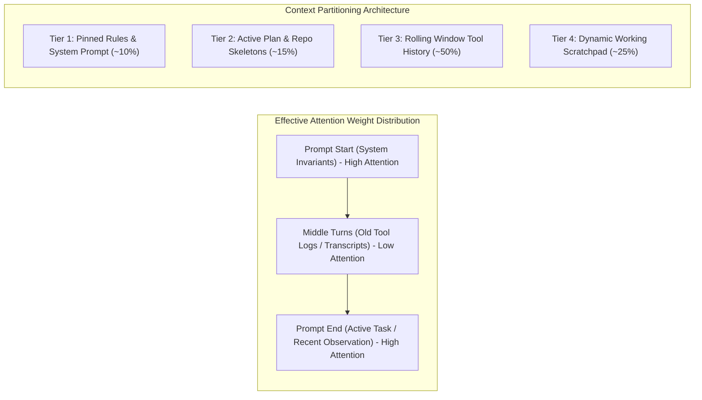

[← Back to Tech-21: Agentic Software Engineering Overview](./README.md) | [🏠 Series Catalog](../../README.md)

---

# 3. How Does Context Window Degradation and "Lost in the Middle" Impact Autonomous Coding? 

## 1. The Core Concept & Intuition

Modern foundation models boast massive context windows—ranging from 128,000 to over 1,000,000 tokens. This engineering achievement tempts developers into a dangerous trap: dumping entire files, build logs, and multi-turn debugging transcripts into the conversation history under the assumption that "if it fits in context, the model can reason across it."

Empirical reality proves otherwise. The Transformer architecture computes self-attention across tokens, but attention distribution is neither uniform nor infinite. When context scales into tens of thousands of tokens, models suffer from two primary failure modes:
1. **The "Lost in the Middle" Phenomenon**: Models retrieve information placed at the very beginning (system prompt) and the very end (latest turn) with near 100% accuracy, but retrieval fidelity degrades sharply for instructions buried in the middle 60% of the prompt.
2. **Context Poisoning**: Once an agent hallucinates a non-existent function or ingests a failed 500-line stack trace into its history, those tokens act as statistical attractors. The model fixates on the erroneous patterns in subsequent turns, causing cascading hallucination loops.

High-performance agent runtimes do not treat context windows as infinite append-only logs; they treat them as strictly budgeted, hierarchical L1 caches.

---

## 2. Under the Hood: Attention Degradation & Context Partitioning

In long-context Transformer inference, rotary position embeddings (RoPE) and self-attention weights exhibit non-linear dispersion. Critical system constraints placed in the middle of a 100,000-token prompt receive significantly lower attention weights than recent user messages or initial instructions.



To prevent context saturation, the runtime must enforce **context partitioning**:
- **Pinned Zone (Top)**: Immutable project conventions, safety guardrails, and registered tool definitions. Benefited by prompt caching.
- **Dynamic Middle (Pruned)**: Intermediate tool outputs. Raw file dumps and terminal logs are aggressively compacted, truncated, or evicted once observed.
- **Active Working Tail (Bottom)**: The latest task instruction, active plan status, and immediate tool output.

### Context Management Approaches Compared

| Strategy | Token Efficiency | Hallucination Resistance | Implementation Complexity |
| :--- | :--- | :--- | :--- |
| **Append-Only Naive Log** | Lowest (Linear growth to OOM) | Worst (High context poisoning) | Trivial (`messages.push`) |
| **Sliding Window (FIFO)** | Moderate (Drops oldest turns) | Risky (Drops original system instructions & user constraints) | Low |
| **Summarization Compaction** | High (Compresses turns into concise summaries) | High (Preserves essential state, discards verbose logs) | Moderate (Requires intermediate LLM compression turn) |
| **Hierarchical Memory (Scratchpad + Pinned)** | Highest (Keeps invariants pinned, purges raw observations) | Best (Zero log bloat, persistent state in structured artifacts) | High (State machine with file-backed scratchpads) |

---

## 3. Clean Code in Action

### A. Token-Budgeted Context Compaction Engine
This TypeScript engine monitors conversation token growth, preserves immutable system invariants, and summarizes conversational turns before attention degradation occurs:

```typescript
export interface Message {
  role: "system" | "user" | "assistant" | "tool";
  content: string;
  pinned?: boolean;
}

export class ContextBudgetManager {
  private maxTokens: number;
  private reserveTokens: number;

  constructor(maxTokens = 64000, reserveTokens = 16000) {
    this.maxTokens = maxTokens;
    this.reserveTokens = reserveTokens;
  }

  // Fast token estimation (~4 characters per token)
  public estimateTokens(text: string): number {
    return Math.ceil(text.length / 4);
  }

  public compactHistory(
    messages: Message[],
    summarizeFn: (text: string) => Promise<string>
  ): async () => Promise<Message[]> {
    return async () => {
      let totalTokens = messages.reduce(
        (sum, m) => sum + this.estimateTokens(m.content),
        0
      );

      const targetBudget = this.maxTokens - this.reserveTokens;
      if (totalTokens <= targetBudget) {
        return messages;
      }

      const pinnedMessages: Message[] = [];
      const compressibleMessages: Message[] = [];
      const recentMessages: Message[] = [];

      // Retain the last 4 turns untouched to preserve immediate conversational context
      const cutoff = Math.max(0, messages.length - 4);
      for (let i = 0; i < messages.length; i++) {
        if (messages[i].pinned || messages[i].role === "system") {
          pinnedMessages.push(messages[i]);
        } else if (i >= cutoff) {
          recentMessages.push(messages[i]);
        } else {
          compressibleMessages.push(messages[i]);
        }
      }

      if (compressibleMessages.length === 0) {
        return messages; // Cannot compact further
      }

      // Generate a structured summary of the middle conversational turns
      const rawTranscript = compressibleMessages
        .map(m => `${m.role.toUpperCase()}: ${m.content}`)
        .join("\n\n");
      const summaryText = await summarizeFn(rawTranscript);

      const summaryMessage: Message = {
        role: "user",
        content: `[Previous Context Summary]:\n${summaryText}`
      };

      return [...pinnedMessages, summaryMessage, ...recentMessages];
    };
  }
}
```

### B. Tool Output Truncation and Log Scrubber
Preventing context poisoning begins at the observation boundary. This scrubber intercepts raw shell and compiler logs, eliminating repetitive noise while retaining exact file paths and error lines:

```typescript
export function sanitizeObservationForContext(rawOutput: string, maxLines = 40): string {
  const lines = rawOutput.split("\n");
  if (lines.length <= maxLines) {
    return rawOutput;
  }

  // Filter out redundant success lines, keeping errors and stack traces
  const errorIndicators = /(error|exception|fail|warning|at\s+|line\s+\d+)/i;
  const criticalLines: string[] = [];
  const standardLines: string[] = [];

  for (const line of lines) {
    if (errorIndicators.test(line)) {
      criticalLines.push(line);
    } else {
      standardLines.push(line);
    }
  }

  // Take top 15 lines, critical error snippets, and bottom 15 lines
  const head = lines.slice(0, 15);
  const tail = lines.slice(-15);
  const highlightedErrors = criticalLines.slice(0, 10);

  return [
    ...head,
    `\n... [TRUNCATED ${lines.length - 30} lines of build logs] ...\n`,
    "--- Critical Error Snippets Detected ---",
    ...highlightedErrors,
    "--- End of Snippets ---\n",
    ...tail
  ].join("\n");
}
```

---

## 4. Common Pitfalls & Interview Traps

| Trap / Misconception | Reality |
| :--- | :--- |
| **"1M token context windows eliminate the need for memory management."** | While 1M tokens fit in RAM, attention dispersion severely degrades reasoning quality. Models fail to adhere to complex constraints when buried in 300,000 tokens of noisy logs. |
| **"Truncating messages by dropping the oldest turns is sufficient."** | Dropping the oldest turns often deletes the user's initial task requirements or foundational architecture constraints, leaving the agent adrift. |
| **"Passing entire file contents back into context after every edit."** | Ingesting a 3,000-line file into context on every single modification saturates the context window within 3 steps. Agents should inspect diffs or targeted line ranges. |
| **"Context poisoning fixes itself as the agent reasons more."** | The opposite occurs: LLMs treat their own prior text as ground truth. Once a false premise enters context, subsequent inferences reinforce the hallucination. |

---

## 5. 60-Second Memory Anchor

> **"A context window is an expensive, attention-decaying L1 cache, not an append-only archive; ruthlessly prune intermediate logs and keep core constraints pinned to the top."**

---

[← Question 02](./02-how-do-coding-agents-index-and-navigate-codebases.md)

> ### 🎓 Looking for Questions 04 through 21 & Deep-Dive Appendices?
> You have reached the end of the free sampler for **Tech-21: Agentic Software Engineering**!
> 
> The full release contains **18 additional core interview chapters** plus **2 architectural reference appendices**, memory layouts, complete edge-case tables, and production patterns.
> 
> 📖 **[Get the Full Edition (Kindle / EPUB / PDF) →](./README.md#how-to-get-the-full-edition)**

