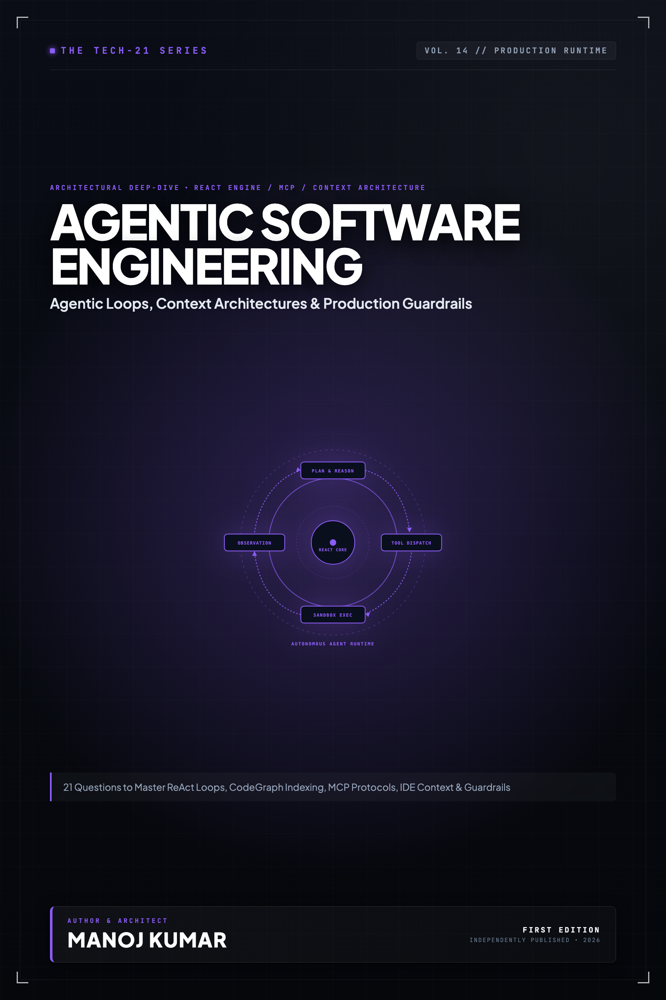

# Tech-21: Agentic Software Engineering

> **21 Questions to Master Agentic Loops, Context Architectures & Production Guardrails**  
> *Author: Manoj Kumar* • *Tech-21 Series (Vol. 14)*

  

## 📖 About This Edition

This repository contains the **free public sampler** for **Tech-21: Agentic Software Engineering**, including the **Preface and Questions 01 through 03** in their entirety. Every chapter follows the strict 5-section Tech-21 mental model framework:

1. **The Core Concept & Intuition** (High-signal problem statement & architecture)
2. **Under the Hood** (Runtime execution mechanics, memory diagrams, and comparison matrices)
3. **Clean Code in Action** (Idiomatic, production-grade implementations)
4. **Common Pitfalls & Interview Traps** (Structured bug-prevention matrices)
5. **60-Second Memory Anchor** (Permanent retention punchlines)

## 📋 Complete 21-Question Syllabus

| Chapter | Status | Title |
| :--- | :---: | :--- |
| **[00-preface](./00-preface.md)** | 🟢 **Free Sampler** | [Preface](./00-preface.md) |
| **[01-what-is-an-agentic-coding-loop](./01-what-is-an-agentic-coding-loop.md)** | 🟢 **Free Sampler** | [1. What is an Agentic Coding Loop and How Does the ReAct Engine Actually Execute?](./01-what-is-an-agentic-coding-loop.md) |
| **[02-how-do-coding-agents-index-and-navigate-codebases](./02-how-do-coding-agents-index-and-navigate-codebases.md)** | 🟢 **Free Sampler** | [2. How Do Coding Agents Index, Navigate, and Understand Massive Codebases?](./02-how-do-coding-agents-index-and-navigate-codebases.md) |
| **[03-how-does-context-window-degradation-impact-coding-agents](./03-how-does-context-window-degradation-impact-coding-agents.md)** | 🟢 **Free Sampler** | [3. How Does Context Window Degradation and "Lost in the Middle" Impact Autonomous Coding?](./03-how-does-context-window-degradation-impact-coding-agents.md) |
| **04-how-do-agents-generate-and-apply-file-modifications** | 🔒 *Full Edition* | 4. How Do Coding Agents Safely Generate, Apply, and Reconcile File Modifications? |
| **05-how-does-prompt-caching-reshape-agentic-economics** | 🔒 *Full Edition* | 5. How Does Prompt Caching and Prefix Sharing Reshape Agentic Performance and Economics? |
| **06-what-are-rules-files-and-system-prompts** | 🔒 *Full Edition* | 6. What Are Rules Files and System Prompts, and How Are Instructions Dynamically Injected? |
| **07-how-do-ide-integrated-agents-capture-editor-context** | 🔒 *Full Edition* | 7. How Do IDE-Integrated Agents Capture Active Editor State and User Intent? |
| **08-how-do-multi-agent-architectures-and-subagents-function** | 🔒 *Full Edition* | 8. How Do Multi-Agent Architectures and Subagent Delegation Topologies Function? |
| **09-how-should-memory-and-scratchpads-be-managed** | 🔒 *Full Edition* | 9. How Should Memory, Scratchpads, and State Be Managed Across Extended Agent Sessions? |
| **10-how-do-agents-interact-with-shells-and-sandboxes** | 🔒 *Full Edition* | 10. How Do Coding Agents Interact With Shells, Sandboxes, and Terminal Environments? |
| **11-how-does-human-in-the-loop-steering-work** | 🔒 *Full Edition* | 11. How Does Human-in-the-Loop Steering and Interruption Work in Agent Workflows? |
| **12-how-do-you-prevent-catastrophic-loops-and-hallucinations** | 🔒 *Full Edition* | 12. How Do You Prevent Catastrophic Agent Loops, Hallucinated APIs, and Runaway Costs? |
| **13-how-do-sandboxing-and-blast-radius-guardrails-protect-environments** | 🔒 *Full Edition* | 13. How Do Sandboxing, Blast Radius Isolation, and Security Guardrails Protect Repositories? |
| **14-how-should-coding-agents-approach-tdd-and-self-correction** | 🔒 *Full Edition* | 14. How Should Coding Agents Approach Automated Testing, TDD, and Self-Correction? |
| **15-how-do-agents-handle-compiler-linter-and-type-checker-feedback** | 🔒 *Full Edition* | 15. How Do Modern Agents Handle Compiler, Linter, and Type-Checker Feedback Loops? |
| **16-how-does-git-hygiene-and-branch-isolation-work-with-agents** | 🔒 *Full Edition* | 16. How Does Git Hygiene, Atomic Commits, and Branch Isolation Work With Autonomous Agents? |
| **17-how-do-you-build-custom-mcp-servers-and-deterministic-tooling** | 🔒 *Full Edition* | 17. How Do You Build Deterministic Tooling and Custom MCP (Model Context Protocol) Servers? |
| **18-how-do-you-structure-codebases-to-be-agent-friendly** | 🔒 *Full Edition* | 18. How Do You Structure Codebases and Architecture to Be "Agent-Friendly"? |
| **19-how-do-agents-handle-cross-file-refactoring-and-migrations** | 🔒 *Full Edition* | 19. How Do Agents Handle Cross-File Refactoring and Large-Scale Migrations Safely? |
| **20-how-do-you-benchmark-and-evaluate-coding-agents** | 🔒 *Full Edition* | 20. How Do You Benchmark and Evaluate Coding Agent Quality and Regression (SWE-bench & Beyond)? |
| **21-what-are-the-unspoken-pitfalls-in-agentic-software-development** | 🔒 *Full Edition* | 21. What Are the Unspoken Pitfalls and Anti-Patterns in Real-World Agent-Assisted Development? |
| **22-appendix-coding-agent-reference-sheet** | 🔒 *Full Edition* | Appendix A: The Coding Agent Reference Sheet & Diagnostic Matrix |
| **23-appendix-production-readiness-checklist** | 🔒 *Full Edition* | Appendix B: Enterprise Agentic Coding Production Readiness & Security Checklist |

---

## 🚀 How to Get the Full Edition

The complete edition unlocks **all 21 in-depth questions** and **both architectural reference appendices** (over 100+ pages of high-signal diagrams, memory layouts, and interview pitfall tables):

- 📱 **Kindle Edition**: Available on [Amazon Kindle](https://amazon.com)
- 📄 **Digital DRM-Free Bundle (EPUB + PDF)**: Instant download with high-res interior graphics
- 📦 **All-Access Pass**: Access all 15 volumes across the entire Tech-21 series

[← Return to Series Catalog](../../README.md)
