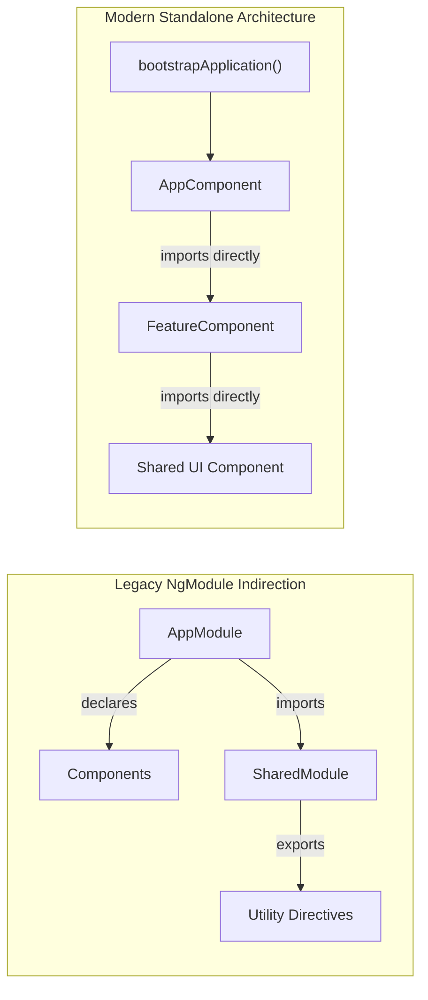

[← Back to Tech-21: Angular Core Concepts Overview](./README.md) | [🏠 Series Catalog](../../README.md)

---

# 1. What is Modern Angular Architecture and How Do Standalone Components Work? 

## 1. The Core Concept & Intuition

Historically, Angular applications relied heavily on `NgModule` containers to declare compilation context, bundle dependencies, and configure dependency injection scopes. While `NgModule` served as a necessary abstraction in Angular 2 through 13, it introduced severe friction: excessive boilerplate, complex mental overhead, bloated bundle footprints due to coarse-grained tree-shaking, and confusing indirection between imports and usages.

**Modern Angular** (Angular 14+ through Angular 17+) underwent an architectural renaissance by making **Standalone Components, Directives, and Pipes** the first-class, default primitive. In this paradigm, components declare their own template dependencies directly via the `imports: [...]` array. Bootstrapping is streamlined from the traditional `platformBrowserDynamic().bootstrapModule(AppModule)` to a lightweight, functional `bootstrapApplication(AppComponent, appConfig)` model.

---

## 2. Under the Hood: Ivy Compilation Graph & Application Root Scopes

When a standalone component is compiled by the Angular Ivy compiler, the compiler generates a static component definition (`ɵcmp`) containing its runtime instructions and a dedicated `dependencies` property. 

Unlike `NgModule` which compiled components against a shared module scope, standalone components compile against a self-contained dependency graph. This eliminates intermediate module registry structures at runtime, allowing modern bundlers (such as `esbuild` and `rollup`) to aggressively tree-shake unused components, pipes, and directives at the exact symbol level.

During bootstrap, `bootstrapApplication` initializes the **EnvironmentInjector** directly at the root, accepting an array of functional `EnvironmentProviders` (e.g., `provideRouter()`, `provideHttpClient()`) without needing module wrappers.



| Architectural Dimension | Legacy NgModule Architecture | Modern Standalone Architecture |
| :--- | :--- | :--- |
| **Dependency Scoping** | Intermediate `NgModule` imports/declarations | Direct per-component `imports: [...]` |
| **Bootstrapping** | `platformBrowserDynamic().bootstrapModule(AppModule)` | Functional `bootstrapApplication(AppComponent, appConfig)` |
| **Tree-Shaking Granularity** | Module-level (entire module pulled if one piece used) | Symbol-level (unused components completely eliminated) |
| **Lazy Loading Primitive** | `loadChildren: () => import('./mod').then(m => m.Mod)` | `loadComponent: () => import('./cmp').then(c => c.Cmp)` |
| **Mental Model & Boilerplate** | High indirection; 3-tier file organization | Crisp, self-contained single-file or localized component units |

---

## 3. Clean Code in Action

### A. Bootstrapping with Functional Application Configuration
Modern Angular configures the root application via `ApplicationConfig` and functional provider helpers:

```typescript
// app.config.ts
import { ApplicationConfig, provideZoneChangeDetection } from '@angular/core';
import { provideRouter, withComponentInputBinding } from '@angular/router';
import { provideHttpClient, withFetch, withInterceptors } from '@angular/common/http';
import { routes } from './app.routes';
import { authInterceptor } from './core/interceptors/auth.interceptor';

export const appConfig: ApplicationConfig = {
  providers: [
    provideZoneChangeDetection({ eventCoalescing: true }),
    provideRouter(routes, withComponentInputBinding()),
    provideHttpClient(
      withFetch(), // Uses modern native Fetch API under the hood
      withInterceptors([authInterceptor])
    ),
  ],
};

// main.ts
import { bootstrapApplication } from '@angular/platform-browser';
import { AppComponent } from './app/app.component';
import { appConfig } from './app.config';

bootstrapApplication(AppComponent, appConfig)
  .catch((err: unknown) => console.error('Bootstrap Error:', err));
```

### B. Self-Contained Standalone Component with Direct Imports
A clean standalone component declaring its exact template dependencies:

```typescript
// user-card.component.ts
import { Component, input, output, ChangeDetectionStrategy } from '@angular/core';
import { DatePipe, UpperCasePipe } from '@angular/common';
import { AvatarComponent } from '../ui/avatar.component';

export interface UserProfile {
  id: string;
  name: string;
  joinedAt: Date;
}

@Component({
  selector: 'app-user-card',
  standalone: true,
  imports: [DatePipe, UpperCasePipe, AvatarComponent],
  changeDetection: ChangeDetectionStrategy.OnPush,
  template: `
    <article class="user-card">
      <app-avatar [userId]="user().id" />
      <div class="user-details">
        <h3>{{ user().name | uppercase }}</h3>
        <p>Member since: {{ user().joinedAt | date:'mediumDate' }}</p>
      </div>
      <button type="button" (click)="profileSelected.emit(user().id)">
        View Profile
      </button>
    </article>
  `,
})
export class UserCardComponent {
  // Modern Signal Inputs and Outputs
  readonly user = input.required<UserProfile>();
  readonly profileSelected = output<string>();
}
```

---

## 4. Common Pitfalls & Interview Traps

| Trap / Misconception | Reality |
| :--- | :--- |
| **"Standalone components cannot use components exported from existing NgModules."** | **False!** Standalone components can freely import existing `NgModule` definitions (e.g., `imports: [ReactiveFormsModule, MatButtonModule]`) directly into their `imports` array. |
| **"Services provided in a standalone component `providers: []` are application singletons."** | **False!** Providing a service inside `@Component({ providers: [...] })` instantiates a scoped instance bound to that component's `ElementInjector`. Use `providedIn: 'root'` or `EnvironmentProviders` in `app.config.ts` for application singletons. |
| **"Standalone architecture requires one file per entire feature."** | **False!** Standalone refers to the compilation encapsulation of the component, not directory layout. You can still structure features cleanly into feature folders containing domain services, models, and UI components. |

---

## 5. 60-Second Memory Anchor

> **"Standalone components replace `NgModule` by declaring their own direct template imports, enabling fine-grained symbol tree-shaking, functional bootstrapping via `bootstrapApplication`, and a cleaner, direct compilation dependency graph."**

---

[← Preface](./00-preface.md) | **Next**: [Question 02 →](./02-component-lifecycle-and-control-flow.md)
