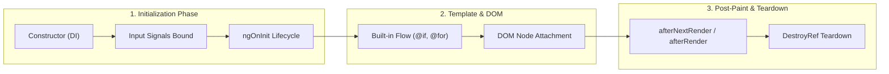

[← Back to Tech-21: Angular Core Concepts Overview](./README.md) | [🏠 Series Catalog](../../README.md)

---

# 2. How Does Component Lifecycle and Modern Built-in Control Flow Work? 

## 1. The Core Concept & Intuition

Managing rendering logic and component state transitions is central to user interface design. In legacy Angular, template branching and iteration were handled by structural directives (`*ngIf`, `*ngFor`, `*ngSwitch`) imported from `CommonModule`. These directives introduced runtime parsing overhead, awkward typing mechanics (e.g., `*ngIf="user as u; else loading"`), and subtle performance hits when tracking iteration items without explicit `trackBy` functions.

**Modern Angular** introduces **Built-in Control Flow** (`@if`, `@for`, `@switch`) directly into the template compiler syntax. In tandem with modern lifecycle APIs (`afterRender`, `afterNextRender`), Angular separates the **data initialization lifecycle** from the **browser render / DOM painting cycle**, ensuring predictable UI updates and SSR hydration safety.

---

## 2. Under the Hood: Built-in Control Flow Compilation vs Structural Directives

Legacy structural directives (`*ngFor`, `*ngIf`) required instantiating an intermediate `EmbeddedViewRef` through a `ViewContainerRef` directive instance for every branch or loop item. This created separate dependency injection contexts and added significant heap allocation overhead.

In contrast, built-in control flow compiles directly into low-level Ivy instructions (`ɵɵconditional`, `ɵɵrepeater`, `ɵɵrepeaterCreate`). 
- For `@if`, the compiler generates conditional branch instructions that switch between template blocks without directive overhead.
- For `@for`, the `track` expression is **mandatory at compile time**, completely preventing accidental $O(N)$ DOM re-creations. The repeater algorithm performs optimized key-based reconciliation directly on the DOM nodes.



| Lifecycle & Control Flow Feature | Legacy Angular (*ngIf, *ngFor) | Modern Angular (@if, @for, afterRender) |
| :--- | :--- | :--- |
| **Control Flow Mechanism** | Structural directives (`CommonModule`) | Built-in native template grammar |
| **Iteration Tracking** | Optional `trackBy` function (often forgotten) | **Mandatory** `track` expression (enforced at compile time) |
| **Empty State Handling** | Requires separate `*ngIf="items.length === 0"` | Built-in `@empty` block inside `@for` |
| **DOM Paint Timing** | `ngAfterViewInit` (runs before browser paint) | `afterNextRender` / `afterRender` (runs post-paint safely) |
| **SSR Safety** | View hooks run on server and client, causing mismatch | `afterRender` automatically skipped during SSR execution |

---

## 3. Clean Code in Action

### A. Modern Built-in Control Flow with Strict Tracking
Using `@if`, `@else if`, `@else`, `@for`, and `@switch` with zero external module imports:

```typescript
// project-board.component.ts
import { Component, signal, ChangeDetectionStrategy } from '@angular/core';

export interface TaskItem {
  id: string;
  title: string;
  status: 'todo' | 'in-progress' | 'done';
}

@Component({
  selector: 'app-project-board',
  standalone: true,
  changeDetection: ChangeDetectionStrategy.OnPush,
  template: `
    <section class="task-container">
      <h2>Project Tasks</h2>

      <!-- Modern @for with mandatory tracking and built-in @empty -->
      @for (task of tasks(); track task.id) {
        <div class="task-card">
          <span>{{ task.title }}</span>

          <!-- Modern @switch block -->
          @switch (task.status) {
            @case ('todo') {
              <span class="badge badge-gray">To Do</span>
            }
            @case ('in-progress') {
              <span class="badge badge-blue">Active</span>
            }
            @case ('done') {
              <span class="badge badge-green">Completed</span>
            }
          }
        </div>
      } @empty {
        <div class="empty-state">
          <p>No tasks found. Click "Create Task" to get started.</p>
        </div>
      }
    </section>
  `,
})
export class ProjectBoardComponent {
  readonly tasks = signal<TaskItem[]>([
    { id: 't1', title: 'Implement Signals Store', status: 'in-progress' },
    { id: 't2', title: 'Migrate to Control Flow', status: 'done' },
  ]);
}
```

### B. Safe DOM Operations with `afterNextRender` and `DestroyRef`
Replacing risky `ngAfterViewInit` DOM measurements with SSR-safe post-render hooks:

```typescript
// chart-wrapper.component.ts
import {
  Component,
  ElementRef,
  viewChild,
  afterNextRender,
  inject,
  DestroyRef,
  ChangeDetectionStrategy,
} from '@angular/core';

@Component({
  selector: 'app-chart-wrapper',
  standalone: true,
  changeDetection: ChangeDetectionStrategy.OnPush,
  template: `
    <div #canvasContainer class="canvas-container">
      <canvas #chartCanvas></canvas>
    </div>
  `,
})
export class ChartWrapperComponent {
  private readonly canvas = viewChild.required<ElementRef<HTMLCanvasElement>>('chartCanvas');
  private readonly destroyRef = inject(DestroyRef);

  constructor() {
    // afterNextRender runs only in the browser, exactly once after the initial DOM paint
    afterNextRender(() => {
      const nativeCanvas = this.canvas().nativeElement;
      const ctx = nativeCanvas.getContext('2d');
      if (!ctx) return;

      // Safe DOM dimension access without SSR crashes
      nativeCanvas.width = nativeCanvas.parentElement?.clientWidth ?? 400;
      nativeCanvas.height = 200;
      ctx.fillStyle = '#3b82f6';
      ctx.fillRect(10, 10, 100, 100);
    });

    // Modern functional cleanup
    this.destroyRef.onDestroy(() => {
      console.log('ChartWrapperComponent cleaned up successfully.');
    });
  }
}
```

---

## 4. Common Pitfalls & Interview Traps

| Trap / Misconception | Reality |
| :--- | :--- |
| **"Using `track $index` in `@for` is completely safe for dynamic arrays."** | **Dangerous Anti-Pattern!** Using `$index` as the tracking identity causes DOM nodes to be recycled by position rather than entity ID. If list items are sorted, deleted, or inserted at the beginning, internal input states and animations will corrupt. Always track unique identifiers (e.g., `track item.id`). |
| **"Performing DOM measurements in `ngAfterViewInit` is SSR safe."** | **False!** `ngAfterViewInit` executes during Server-Side Rendering where `window`, `document`, and canvas elements do not exist, causing runtime crashes. Use `afterNextRender()` which is automatically skipped on the server. |
| **"Built-in control flow requires importing `CommonModule`."** | **False!** `@if`, `@for`, and `@switch` are built into the template compiler itself. No module or directive imports are required. |

---

## 5. 60-Second Memory Anchor

> **"Built-in control flow (`@if`, `@for`, `@switch`) eliminates structural directive overhead with compile-time mandatory tracking, while `afterNextRender` ensures safe, post-paint DOM manipulation without breaking SSR."**

---

[← Question 01](./01-angular-architecture-and-standalone.md) | **Next**: [Question 03 →](./03-reactivity-with-signals.md)
