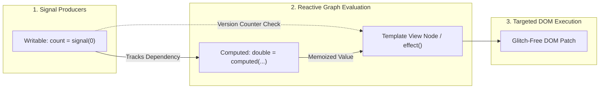

[← Back to Tech-21: Angular Core Concepts Overview](./README.md) | [🏠 Series Catalog](../../README.md)

---

# 3. What Are Angular Signals and How Does Fine-Grained Reactivity Work? 

## 1. The Core Concept & Intuition

For years, Angular relied on `Zone.js` to trigger change detection whenever an asynchronous browser event occurred (clicks, timers, HTTP responses). While convenient, Zone.js is an all-or-nothing coarse-grained mechanism: it intercepts every browser API and tells Angular to re-evaluate the entire component tree from the root down, even if only a single scalar number changed in a deeply nested leaf component.

**Angular Signals** introduce **fine-grained reactivity** to the core framework. A Signal is a zero-dependency, synchronous reactive primitive that wraps a value and notifies interested consumers when that value changes. Signals provide:
1. **Glitch-free execution**: Derived computations never see inconsistent intermediate states.
2. **Dynamic dependency tracking**: Computations automatically track which signals they read at runtime.
3. **Lazy evaluation**: Computed signals only recompute when actually accessed.

---

## 2. Under the Hood: Reactive Node Graph & Glitch-Free Push/Pull Algorithm

The Signal implementation in Angular is built upon a dual-phase **Push-Pull Reactive Graph**:

1. **Push Phase (Marking Dirty)**: When a writable signal changes via `set()` or `update()`, it does **not** synchronously recalculate all dependent nodes. Instead, it increments its internal version counter and *pushes* a `DIRTY` notification down its reactive dependency graph.
2. **Pull Phase (Lazy Memoization)**: When a consumer (like a template expression, `computed()`, or `effect()`) reads the signal value, it *pulls* from its dependencies. If the dependencies haven't changed version, the cached value is returned instantly. If dirty, it recomputes and caches the result.

This prevents the classic diamond dependency problem ("glitches") where intermediate nodes might execute multiple times with stale data.



| Reactive Primitive | `signal(initialValue)` | `computed(fn)` | `effect(fn)` |
| :--- | :--- | :--- | :--- |
| **Type** | Writable source | Read-only derived | Side-effect runner |
| **Evaluation Timing** | Eager (stores state) | **Lazy** (computed upon reading) | Asynchronous (microtask-scheduled) |
| **Purity** | Pure state holder | **Must be Pure** (no side effects) | Impure (logging, DOM sync, canvas) |
| **Dependency Tracking** | N/A (Source node) | Automatic & dynamic | Automatic & dynamic |
| **Writing Allowed?** | Yes (`.set()`, `.update()`) | **No** (Compile-time error) | Disallowed by default (`allowSignalWrites`) |

---

## 3. Clean Code in Action

### A. Reactive State Modeling with `signal`, `computed`, and `effect`
Building a reactive cart summary with dynamic filtering and memoized derived totals:

```typescript
// cart-store.service.ts
import { Injectable, signal, computed, effect } from '@angular/core';

export interface CartItem {
  id: string;
  name: string;
  price: number;
  quantity: number;
}

@Injectable({ providedIn: 'root' })
export class CartStore {
  // Writable source signals
  readonly items = signal<CartItem[]>([
    { id: '1', name: 'Mechanical Keyboard', price: 150, quantity: 1 },
    { id: '2', name: 'Ergonomic Mouse', price: 80, quantity: 2 },
  ]);
  readonly discountPercent = signal<number>(10);

  // Lazy, memoized computed signals
  readonly rawTotal = computed(() =>
    this.items().reduce((acc, item) => acc + item.price * item.quantity, 0)
  );

  readonly finalTotal = computed(() => {
    const raw = this.rawTotal();
    const discount = (raw * this.discountPercent()) / 100;
    return raw - discount;
  });

  constructor() {
    // Asynchronous reactive side-effect with cleanup
    effect((onCleanup) => {
      const total = this.finalTotal();
      const timerId = setTimeout(() => {
        console.log(`[Analytics] Current cart total updated to $${total.toFixed(2)}`);
      }, 500);

      onCleanup(() => clearTimeout(timerId));
    });
  }

  addItem(item: CartItem): void {
    this.items.update((current) => [...current, item]);
  }

  updateQuantity(id: string, delta: number): void {
    this.items.update((current) =>
      current.map((item) =>
        item.id === id ? { ...item, quantity: Math.max(1, item.quantity + delta) } : item
      )
    );
  }
}
```

### B. Signal Inputs, Signal Outputs, and Signal Queries
Modern component architecture using signal-based communication:

```typescript
// product-tile.component.ts
import {
  Component,
  input,
  output,
  computed,
  viewChild,
  ElementRef,
  ChangeDetectionStrategy,
} from '@angular/core';

@Component({
  selector: 'app-product-tile',
  standalone: true,
  changeDetection: ChangeDetectionStrategy.OnPush,
  template: `
    <div #tileContainer class="tile" [class.on-sale]="isOnSale()">
      <h4>{{ title() }}</h4>
      <p class="price">Price: {{ formattedPrice() }}</p>
      <button type="button" (click)="addToCart.emit(id())">Add to Cart</button>
    </div>
  `,
})
export class ProductTileComponent {
  // Signal Inputs (Read-only signals provided by parent template)
  readonly id = input.required<string>();
  readonly title = input.required<string>();
  readonly price = input<number>(0);
  readonly discount = input<number>(0);

  // Signal Output (Type-safe event dispatcher)
  readonly addToCart = output<string>();

  // Signal Query
  readonly container = viewChild.required<ElementRef<HTMLDivElement>>('tileContainer');

  // Derived signal computed directly from inputs
  readonly isOnSale = computed(() => this.discount() > 0);
  readonly formattedPrice = computed(() => {
    const final = this.price() * (1 - this.discount() / 100);
    return `$${final.toFixed(2)}`;
  });
}
```

---

## 4. Common Pitfalls & Interview Traps

| Trap / Misconception | Reality |
| :--- | :--- |
| **"Mutating array or object properties directly triggers signal updates."** | **Dangerous Bug!** `mySignal().push(item)` mutates the underlying object reference without invoking the signal's setter, leaving the reactive graph unaware of the mutation. Always use immutable updates: `mySignal.update(items => [...items, item])`. |
| **"Writing to other signals inside `computed()` is standard practice."** | **Severe Anti-Pattern!** `computed()` functions must remain completely pure and free of side effects. Writing to another signal inside `computed()` throws a runtime error in modern Angular. |
| **"Effects run synchronously immediately after a signal changes."** | **False!** `effect()` callbacks are batched and scheduled asynchronously via the microtask queue. Reading a signal right after `.set()` within the same synchronous tick will not have triggered the effect yet. |

---

## 5. 60-Second Memory Anchor

> **"Angular Signals provide fine-grained, glitch-free reactivity via a push-dirty / pull-value reactive graph, allowing templates and computations to update with surgical precision without full-tree Zone.js overhead."**

---

[← Question 02](./02-component-lifecycle-and-control-flow.md)

> ### 🎓 Looking for Questions 04 through 21 & Deep-Dive Appendices?
> You have reached the end of the free sampler for **Tech-21: Angular Core Concepts**!
> 
> The full release contains **18 additional core interview chapters** plus **2 architectural reference appendices**, memory layouts, complete edge-case tables, and production patterns.
> 
> 📖 **[Get the Full Edition (Kindle / EPUB / PDF) →](./README.md#how-to-get-the-full-edition)**

