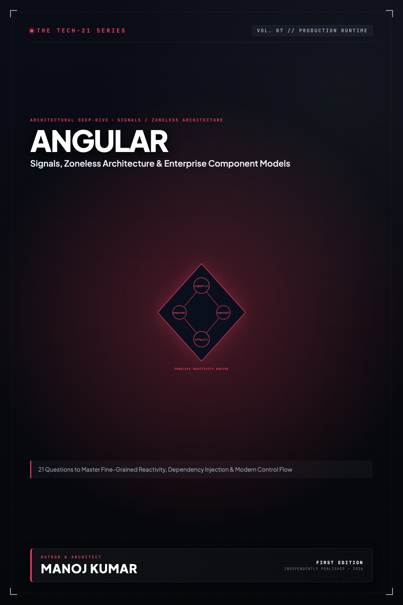

# Tech-21: Angular Core Concepts

> **21 Questions to Master Signals, Zoneless Architecture, Modern Control Flow, and Enterprise Scalability**  
> *Author: Manoj Kumar* • *Tech-21 Series (Vol. 07)*

  

## 📖 About This Edition

This repository contains the **free public sampler** for **Tech-21: Angular Core Concepts**, including the **Preface and Questions 01 through 03** in their entirety. Every chapter follows the strict 5-section Tech-21 mental model framework:

1. **The Core Concept & Intuition** (High-signal problem statement & architecture)
2. **Under the Hood** (Runtime execution mechanics, memory diagrams, and comparison matrices)
3. **Clean Code in Action** (Idiomatic, production-grade implementations)
4. **Common Pitfalls & Interview Traps** (Structured bug-prevention matrices)
5. **60-Second Memory Anchor** (Permanent retention punchlines)

## 📋 Complete 21-Question Syllabus

| Chapter | Status | Title |
| :--- | :---: | :--- |
| **[00-preface](./00-preface.md)** | 🟢 **Free Sampler** | [Preface](./00-preface.md) |
| **[01-angular-architecture-and-standalone](./01-angular-architecture-and-standalone.md)** | 🟢 **Free Sampler** | [1. What is Modern Angular Architecture and How Do Standalone Components Work?](./01-angular-architecture-and-standalone.md) |
| **[02-component-lifecycle-and-control-flow](./02-component-lifecycle-and-control-flow.md)** | 🟢 **Free Sampler** | [2. How Does Component Lifecycle and Modern Built-in Control Flow Work?](./02-component-lifecycle-and-control-flow.md) |
| **[03-reactivity-with-signals](./03-reactivity-with-signals.md)** | 🟢 **Free Sampler** | [3. What Are Angular Signals and How Does Fine-Grained Reactivity Work?](./03-reactivity-with-signals.md) |
| **04-template-syntax-and-data-binding** | 🔒 *Full Edition* | 4. How Does Template Syntax, Data Binding, and Two-Way Signal Binding Work? |
| **05-dependency-injection-and-context** | 🔒 *Full Edition* | 5. How Does Hierarchical Dependency Injection and the Modern `inject()` Function Work? |
| **06-reactive-and-typed-forms** | 🔒 *Full Edition* | 6. How Do Strictly Typed Reactive Forms and Custom Validators Work? |
| **07-advanced-directives-and-host-composition** | 🔒 *Full Edition* | 7. What Are Advanced Directives and How Does Directive Composition (`hostDirectives`) Work? |
| **08-content-projection-and-dynamic-components** | 🔒 *Full Edition* | 8. How Does Content Projection and Dynamic Component Creation Work? |
| **09-routing-lazy-loading-and-guards** | 🔒 *Full Edition* | 9. How Does the Modern Angular Router, Lazy Loading, and Functional Route Guards Work? |
| **10-http-client-interceptors-and-transfer-state** | 🔒 *Full Edition* | 10. How Does HttpClient, Functional Interceptors, and TransferState Work? |
| **11-change-detection-and-zoneless** | 🔒 *Full Edition* | 11. How Does Change Detection Work and What Is Zoneless Angular Architecture? |
| **12-compiler-and-ivy-runtime** | 🔒 *Full Edition* | 12. How Does the Angular Compiler (Ivy) and Runtime Instruction Engine Work? |
| **13-rxjs-interop-and-state-synchronization** | 🔒 *Full Edition* | 13. How Does RxJS Interoperability and Reactive State Synchronization Work? |
| **14-deferrable-views-and-optimization** | 🔒 *Full Edition* | 14. What Are Deferrable Views (`@defer`) and How Do They Optimize Bundle Splitting? |
| **15-memory-management-and-leak-prevention** | 🔒 *Full Edition* | 15. How Does Memory Management, Garbage Collection, and Leak Prevention Work? |
| **16-ssr-ssg-and-hydration** | 🔒 *Full Edition* | 16. How Does Server-Side Rendering (SSR), SSG, and Non-Destructive Hydration Work? |
| **17-state-management-and-signal-store** | 🔒 *Full Edition* | 17. How Does Modern State Management Work with NgRx SignalStore and Signals? |
| **18-micro-frontends-and-module-federation** | 🔒 *Full Edition* | 18. How Does Micro-Frontend Architecture and Module Federation Work with Angular? |
| **19-security-and-defense-in-depth** | 🔒 *Full Edition* | 19. How Does Web Security, XSS Sanitization, and Defense-in-Depth Work in Angular? |
| **20-enterprise-testing-strategies** | 🔒 *Full Edition* | 20. How Do Enterprise Testing Strategies, TestBed, and Component Harnesses Work? |
| **21-build-optimization-and-production-tuning** | 🔒 *Full Edition* | 21. How Does the Modern Build Pipeline (esbuild/Vite), Bundle Budgets, and Production Tuning Work? |
| **22-appendix-modern-migration-matrix** | 🔒 *Full Edition* | Appendix A: Modern Angular Migration Matrix |
| **23-appendix-production-readiness-checklist** | 🔒 *Full Edition* | Appendix B: Enterprise Production Readiness Checklist |

---

## 🚀 How to Get the Full Edition

The complete edition unlocks **all 21 in-depth questions** and **both architectural reference appendices** (over 100+ pages of high-signal diagrams, memory layouts, and interview pitfall tables):

- 📱 **Kindle Edition**: Available on [Amazon Kindle](https://amazon.com)
- 📄 **Digital DRM-Free Bundle (EPUB + PDF)**: Instant download with high-res interior graphics
- 📦 **All-Access Pass**: Access all 15 volumes across the entire Tech-21 series

[← Return to Series Catalog](../../README.md)
