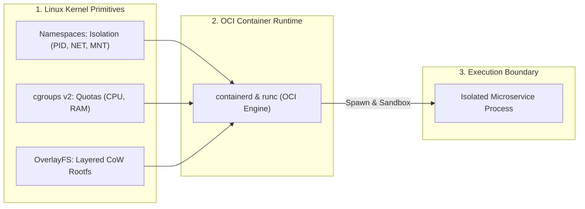

[← Back to Tech-21: Core Technologies for Modern Architects Overview](./README.md) | [🏠 Series Catalog](../../README.md)

---

# 1. How Do Docker, OCI Standards, and Container Runtimes Establish Microservice Isolation? 

## 1. The Core Concept & Intuition

Before containerization, deploying applications required managing entire virtual machines (VMs) with full guest operating systems, hypervisors, and multi-gigabyte footprints, or deploying directly onto host operating systems where conflicting dependency versions triggered the classic **"It works on my machine"** crisis.

**Containerization (Docker / OCI Standard)** packages an application along with its exact runtime dependencies, libraries, and binaries into a lightweight, immutable image that shares the host Linux OS kernel. Containers start in milliseconds and consume negligible memory compared to virtual machines.

---

## 2. Under the Hood: Linux Namespaces, Cgroups & OCI Layer Mechanics

Containers are **not** virtual machines; they are standard host OS processes wrapped by three native Linux kernel primitives:



### The 3 Core Primitives:
1. **Linux Namespaces**: Provides **isolation**:
   - `pid`: Isolate process trees (Container process sees itself as PID 1).
   - `net`: Isolate network interfaces, IP routing tables, and port bindings.
   - `mnt`: Isolate filesystem mount points.
   - `ipc`, `uts`, `user`: Isolate inter-process communication, hostnames, and user ID mappings.
2. **Control Groups (`cgroups v2`)**: Enforces **resource constraints** (e.g., limiting a container to 2 CPU cores and 4GB RAM to prevent noisy-neighbor host crashes).
3. **OverlayFS (UnionFS)**: Composes Docker images from stacked, read-only immutable layers with a single thin read-write container layer on top using **Copy-on-Write (CoW)**.

---

| Isolation Primitive | Linux Kernel Mechanism | Primary Security / Operational Purpose | Failure Mode if Omitted |
| :--- | :--- | :--- | :--- |
| **Namespaces (`pid`, `net`, `mnt`)** | Kernel virtual views | Boundary isolation; hides host processes and network stacks | Process sees and signals host processes; port collision |
| **Control Groups (`cgroups v2`)** | Kernel resource accounting | Enforces strict CPU, memory, and I/O quotas | Runaway memory leak triggers host kernel OOM panic |
| **OverlayFS (UnionFS)** | LowerDir (RO) + UpperDir (RW) | Layer sharing, deduplication, and fast spin-up via CoW | Disk exhaustion from duplicating base OS images |
| **Seccomp & Capabilities** | System call filter (`BPF`) | Restricts kernel syscalls; drops `CAP_SYS_ADMIN` | Container breakout and host privilege escalation |

---

## 3. Clean Code in Action

### A. Production Multi-Stage Distroless Build (Dockerfile)
```dockerfile
# Stage 1: Build & Compile Environment
FROM golang:1.22-alpine AS builder
WORKDIR /app
COPY go.mod go.sum ./
RUN go mod download
COPY . .
RUN CGO_ENABLED=0 GOOS=linux go build -ldflags="-w -s" -o server ./cmd/main.go

# Stage 2: Minimal Distroless Runtime Image (Zero attack surface, 15MB total size!)
FROM gcr.io/distroless/static-debian12:nonroot
WORKDIR /
COPY --from=builder /app/server /server
USER nonroot:nonroot
EXPOSE 8080
ENTRYPOINT ["/server"]
```

---

### B. Production Container Hardening & Resource Policy (compose.yaml)
```yaml
services:
  payment-service:
    image: enterprise/payment-service:v1.4.0
    restart: unless-stopped
    read_only: true
    user: "10001:10001"
    security_opt:
      - no-new-privileges:true
    cap_drop:
      - ALL
    cap_add:
      - NET_BIND_SERVICE
    deploy:
      resources:
        limits:
          cpus: '2.0'
          memory: 2048M
        reservations:
          cpus: '0.5'
          memory: 512M
    tmpfs:
      - /tmp:rw,noexec,nosuid,size=64M
    logging:
      driver: "json-file"
      options:
        max-size: "50m"
        max-file: "5"
```

---

## 4. Common Pitfalls & Interview Traps

| Trap / Misconception | Reality |
| :--- | :--- |
| **"Running as `root` inside a container is acceptable in production."** | If a container escapes or breaks isolation, an attacker gains host root access. Always specify `USER nonroot` or create an unprivileged UID/GID. |
| **"Monolithic single-stage Docker builds are fine if images are cached."** | Single-stage builds ship build tools, package managers, and source code into production, bloating image size (1GB+) and multiplying CVE attack surface. Use multi-stage builds. |
| **"Zombie process handling (PID 1) is handled automatically."** | If container PID 1 does not reap child processes (`SIGCHLD`), zombie processes saturate the host process table. Always use a lightweight init system like `tini` or `docker run --init`. |

---

## 5. 60-Second Memory Anchor

> **"Containers are isolated Linux processes, not VMs. Namespaces isolate visibility (PID, NET), cgroups limit resource consumption (CPU, RAM), and OverlayFS provides layered CoW immutability. Always use multi-stage builds, drop Linux capabilities, and run as an unprivileged non-root user."**

---

[← Preface](./00-preface.md) | **Next**: [Question 02 →](./02-kubernetes-container-orchestration.md)
