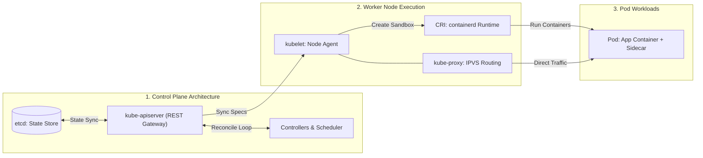

[← Back to Tech-21: Core Technologies for Modern Architects Overview](./README.md) | [🏠 Series Catalog](../../README.md)

---

# 2. How Does Kubernetes Orchestrate Enterprise Container Workloads at Scale? 

## 1. The Core Concept & Intuition

Deploying hundreds of independent containerized microservices across a cluster of bare-metal servers or cloud VMs requires automated scheduling, health monitoring, rolling deployments, secret injection, service discovery, and horizontal scaling.

**Kubernetes (K8s)** is the open-source industry-standard **Container Orchestration Engine** that manages the complete lifecycle of containerized workloads across a distributed fleet of worker nodes. Instead of imperatively restarting failed services, Kubernetes continuously reconciles the cluster's current state against a declared desired state.

---

## 2. Under the Hood: Control Plane Architecture & Declarative Reconciliation Loop



### The Declarative Reconciliation Loop:
K8s operates on a continuous **Reconciliation Loop (Desired State vs Actual State)**:
1. An engineer or GitOps agent submits a declarative YAML manifest to `kube-apiserver`.
2. The spec is validated and persisted durably in **`etcd`** (distributed Raft key-value store).
3. The **Controller Manager** continuously watches `etcd`. If a Pod crashes (Actual < Desired), it instructs the **Kube-Scheduler** to select an optimal worker node based on affinity, taints, and resource headroom.
4. The node's **`kubelet`** invokes the Container Runtime Interface (CRI) to launch the replacement container.

---

| Workload Controller | State Semantics | Pod Identity & Storage | Primary Use Case |
| :--- | :--- | :--- | :--- |
| **Deployment & ReplicaSet** | Stateless | Ephemeral IP, random names, shared or no persistent volume | Web APIs, microservices, stateless worker processors |
| **StatefulSet** | Stateful | Deterministic ordinal identity (`pod-0`), stable DNS, dedicated PVC per pod | Databases (PostgreSQL, Cassandra), Kafka brokers, ZooKeeper |
| **DaemonSet** | Node-bound | Exactly one pod per targeted cluster node | Log collectors (Fluentd), node monitoring (node-exporter), CNI agents |
| **Job & CronJob** | Ephemeral batch | Runs to successful completion (`restartPolicy: OnFailure`), exits 0 | Database migrations, nightly batch aggregations, backups |

---

## 3. Clean Code in Action

### A. Production Resilient Workload Deployment (YAML)
```yaml
apiVersion: apps/v1
kind: Deployment
metadata:
  name: order-processor
  namespace: production
  labels:
    app.kubernetes.io/name: order-processor
spec:
  replicas: 3
  strategy:
    type: RollingUpdate
    rollingUpdate:
      maxSurge: 25%
      maxUnavailable: 0
  selector:
    matchLabels:
      app: order-processor
  template:
    metadata:
      labels:
        app: order-processor
    spec:
      affinity:
        podAntiAffinity:
          preferredDuringSchedulingIgnoredDuringExecution:
            - weight: 100
              podAffinityTerm:
                labelSelector:
                  matchExpressions:
                    - key: app
                      operator: In
                      values: [order-processor]
                topologyKey: "topology.kubernetes.io/zone"
      containers:
        - name: app
          image: enterprise/order-processor:v2.1.0
          resources:
            requests:
              cpu: "500m"
              memory: "512Mi"
            limits:
              cpu: "2000m"
              memory: "1024Mi"
          securityContext:
            readOnlyRootFilesystem: true
            runAsNonRoot: true
            runAsUser: 10001
            allowPrivilegeEscalation: false
          livenessProbe:
            httpGet:
              path: /healthz
              port: 8080
            initialDelaySeconds: 15
            periodSeconds: 10
          readinessProbe:
            httpGet:
              path: /ready
              port: 8080
            initialDelaySeconds: 5
            periodSeconds: 5
```

---

### B. Event-Driven Dynamic Pod Autoscaling with KEDA (YAML)
```yaml
apiVersion: keda.sh/v1alpha1
kind: ScaledObject
metadata:
  name: order-processor-scaler
  namespace: production
spec:
  scaleTargetRef:
    apiVersion: apps/v1
    kind: Deployment
    name: order-processor
  minReplicaCount: 2
  maxReplicaCount: 30
  cooldownPeriod: 300
  triggers:
    - type: kafka
      metadata:
        bootstrapServers: kafka-cluster-kafka-bootstrap.kafka.svc:9092
        consumerGroup: order-processing-group
        topic: customer-orders
        lagThreshold: "100"
        offsetResetPolicy: latest
```

---

## 4. Common Pitfalls & Interview Traps

| Trap / Misconception | Reality |
| :--- | :--- |
| **"Omitting CPU and Memory requests and limits."** | Without `requests`, the scheduler makes blind bin-packing choices, causing node hotspotting. Without `limits`, a single memory-leaking container triggers host Linux kernel OOM panics that kill adjacent mission-critical system pods. Always declare both. |
| **"Using identical endpoints for Liveness and Readiness probes."** | If an external database slows down and `/healthz` fails, a failing liveness probe restarts the container. Restarting an entire fleet under database load triggers a catastrophic cascading restart storm. Use readiness to stop traffic and liveness strictly for deadlocks. |
| **"Omitting PodDisruptionBudgets (PDBs) for critical services."** | During automated Kubernetes node upgrades or spot node terminations, the cluster drains nodes simultaneously. Without a PDB, all replicas can be evicted concurrently, causing total service outages. |

---

## 5. 60-Second Memory Anchor

> **"Kubernetes maintains desired state through a continuous control plane reconciliation loop (API Server, etcd, Scheduler, Controllers). Distinguish stateful from stateless workloads, isolate failure domains with pod anti-affinity, and decouple liveness from readiness probes to prevent restart storms."**

---

[← Question 01](./01-docker-and-containerization.md) | **Next**: [Question 03 →](./03-apache-kafka-event-streaming.md)
