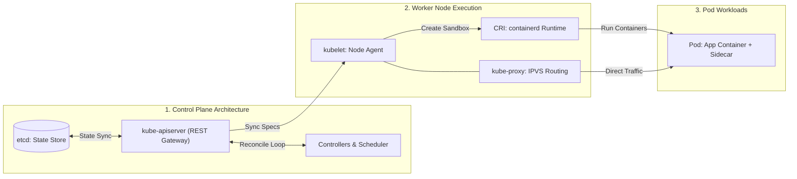

[← Back to Tech-21: Core Technologies for Modern Architects Overview](./README.md) | [🏠 Series Catalog](../../README.md)

---

# 2. How Does Kubernetes Orchestrate Enterprise Container Workloads at Scale? 

## 1. The Core Concept & Intuition

Deploying hundreds of independent containerized microservices across a cluster of bare-metal servers or cloud VMs requires automated scheduling, health monitoring, rolling deployments, secret injection, service discovery, and horizontal scaling.

**Kubernetes (K8s)** is the open-source industry-standard **Container Orchestration Engine** that manages the complete lifecycle of containerized workloads across a distributed fleet of worker nodes.

---

## 2. Under the Hood: Control Plane Architecture & Declarative Reconciliation Loop



### The Declarative Reconciliation Loop:
K8s operates on a **Reconciliation Loop (Desired State vs Actual State)**:
1. User submits a declarative YAML manifest to `kube-apiserver`.
2. The state is written to **`etcd`**.
3. The **Controller Manager** continuously watches `etcd`. If a Pod crashes (Actual < Desired), it instructs the **Scheduler** to find an available worker node and schedules `kubelet` to launch a new replacement container automatically!

---

| Architectural Dimension | Baseline / Default Setup | Production / Hardened Architecture |
| :--- | :--- | :--- |
| **Throughput & Scale** | Single-node / default resource bounds | Horizontally clustered & partitioned |
| **Fault Tolerance** | Standalone process restart | Multi-AZ active-passive or active-active quorum |
| **Security Boundary** | Permissive network & credentials | Zero-trust mTLS, RBAC, and rotated secrets |

---


## 3. Clean Code in Action

### A. Production Configuration Architecture
- **Pod**: The smallest deployable unit in K8s (shares same network IP and storage volumes).
- **Deployment / ReplicaSet**: Manages rolling updates, rollbacks, and replica counts.
- **Service (`ClusterIP`, `NodePort`, `LoadBalancer`)**: Stable virtual IP and DNS name providing L4 load balancing across transient Pods.
- **Ingress / Gateway API**: L7 HTTP/HTTPS reverse proxy and SSL routing into the cluster.
- **ConfigMap & Secret**: Injects environment variables and credentials into containers.
- **HPA (Horizontal Pod Autoscaler)** & **KEDA**: Auto-scales Pod replicas dynamically based on CPU/Memory or event queue depth (e.g. Kafka lag).

---

### B. Production Validation and Operational Verification
```bash
# Verify telemetry status and cluster readiness
curl -s http://localhost:8080/healthz
```

## 4. Common Pitfalls & Interview Traps

| Trap / Misconception | Reality |
| :--- | :--- |
| **"Missing Resource Requests and Limits"** | If you omit `resources.requests` and `resources.limits` in your Pod specs: - The scheduler cannot make intelligent bin-packing decisions. - A single memory-leaking Pod can trigger Linux host Out-Of-Memory (OOM Killer), crashing adjacent mission-critical system Pods! - **Rule**: Always specify both `requests` (for scheduling) and `limits` (for containment). |

---


## 5. 60-Second Memory Anchor

> **"Kubernetes manages distributed containers through a declarative control plane (API Server, etcd, Scheduler, Controller Manager) and worker agents (`kubelet`, `kube-proxy`). It maintains continuous state reconciliation, automated healing, and horizontal autoscaling."**

---

[← Question 01](./01-docker-and-containerization.md) | **Next**: [Question 03 →](./03-apache-kafka-event-streaming.md)
