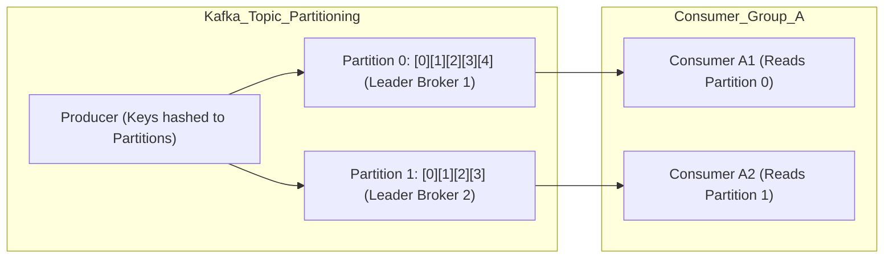

[← Back to Tech-21: Core Technologies for Modern Architects Overview](./README.md) | [🏠 Series Catalog](../../README.md)

---

# 3. How Does Apache Kafka Power High-Throughput Distributed Event Streaming and Log Retention? 

## 1. The Core Concept & Intuition

Traditional message queues (RabbitMQ, ActiveMQ) delete messages once acknowledged, are bounded by RAM, and struggle with massive multi-gigabyte throughput streams.

**Apache Kafka** is a **Distributed Event Streaming Platform** designed as a **partitioned, replicated, append-only distributed commit log**. Messages in Kafka are persisted to disk for days, months, or years, allowing multiple independent consumer services to read and process event streams at their own pace and replay historical data on demand.

---

## 2. Under the Hood: Partitioned Commit Log, PageCache & Zero-Copy Architecture



### The 4 Pillars of Kafka Performance:
1. **Sequential Disk I/O**: Kafka writes messages sequentially to the end of append-only segment files. Sequential disk writes on modern NVMe drives achieve over **600 MB/s**, rivaling random memory access!
2. **PageCache & Zero-Copy (`sendfile`)**: Data is cached directly in the Linux OS PageCache. When sending data to network sockets, the OS uses the `sendfile()` system call—transferring bytes directly from the page cache to the network NIC without copying into JVM user memory (**Zero-Copy**).
3. **Partition Parallelism**: A Topic is split into **Partitions**. Partitions are the fundamental unit of parallelism and scale in Kafka.
4. **Consumer Groups**: Multiple consumers in a group automatically balance partitions among themselves. If a consumer crashes, the group **rebalances** remaining partitions to healthy members.

---

| Architectural Dimension | Baseline / Default Setup | Production / Hardened Architecture |
| :--- | :--- | :--- |
| **Throughput & Scale** | Single-node / default resource bounds | Horizontally clustered & partitioned |
| **Fault Tolerance** | Standalone process restart | Multi-AZ active-passive or active-active quorum |
| **Security Boundary** | Permissive network & credentials | Zero-trust mTLS, RBAC, and rotated secrets |

---


## 3. Clean Code in Action
### A. Production Configuration Architecture
Modern Kafka uses **KRaft (Kafka Raft Metadata Mode)**, embedding an internal Raft consensus engine directly inside Kafka brokers. This eliminates the operational headache of managing separate ZooKeeper clusters and enables scaling to millions of partitions per cluster!

---

### B. Production Validation and Operational Verification
```bash
# Verify telemetry status and cluster readiness
curl -s http://localhost:8080/healthz
```

## 4. Common Pitfalls & Interview Traps

| Trap / Misconception | Reality |
| :--- | :--- |
| **"Partition Key Skew (Hot Partition Bug)"** | If you publish events with a poor partition key (e.g. `country_code = "US"` representing 80% of traffic), 80% of all events land on a single partition, creating a bottleneck while other consumers sit idle! Use high-cardinality partition keys (e.g. `user_id` or `order_id`). |

---


## 5. 60-Second Memory Anchor

> **"Kafka is an append-only distributed commit log. It achieves millions of events/sec using sequential disk I/O, OS PageCache Zero-Copy, and topic partitions. Scale consumer throughput by adding partitions and consumers to consumer groups."**

---

[← Question 02](./02-kubernetes-container-orchestration.md)

> ### 🎓 Looking for Questions 04 through 21 & Deep-Dive Appendices?
> You have reached the end of the free sampler for **Tech-21: Core Technologies for Modern Architects**!
> 
> The full release contains **18 additional core interview chapters** plus **2 architectural reference appendices**, memory layouts, complete edge-case tables, and production patterns.
> 
> 📖 **[Get the Full Edition (Kindle / EPUB / PDF) →](./README.md#how-to-get-the-full-edition)**

