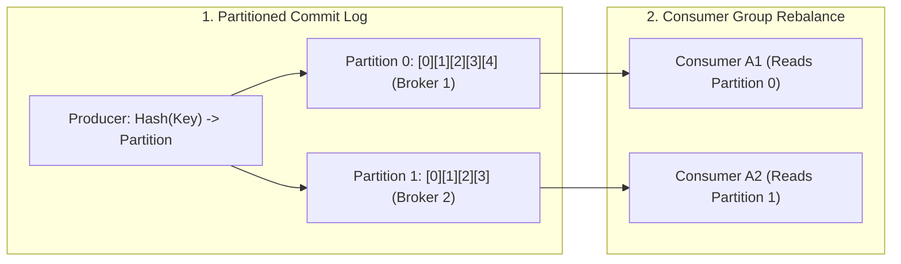

[← Back to Tech-21: Core Technologies for Modern Architects Overview](./README.md) | [🏠 Series Catalog](../../README.md)

---

# 3. How Does Apache Kafka Power High-Throughput Distributed Event Streaming and Log Retention? 

## 1. The Core Concept & Intuition

Traditional message queues (like RabbitMQ or ActiveMQ) delete messages once acknowledged, are memory-bound, and struggle with massive multi-gigabyte throughput streams.

**Apache Kafka** is a **Distributed Event Streaming Platform** designed as a **partitioned, replicated, append-only distributed commit log**. Messages in Kafka are persisted durably to disk for days, months, or years, allowing multiple independent consumer services to read event streams at their own pace, fan out independently, and replay historical data on demand.

---

## 2. Under the Hood: Partitioned Commit Log, PageCache & Zero-Copy Architecture



### The 4 Pillars of Kafka Performance:
1. **Sequential Disk I/O**: Kafka writes messages sequentially to the end of append-only segment files. Sequential disk writes on modern NVMe drives achieve over **600 MB/s**, rivaling random memory access.
2. **PageCache & Zero-Copy (`sendfile`)**: Data is cached directly in the Linux OS PageCache. When sending data to network sockets, the OS uses the `sendfile()` system call—transferring bytes directly from the page cache to the network NIC without copying into JVM user memory (**Zero-Copy**).
3. **Partition Parallelism**: A Topic is split into **Partitions**. Partitions are the fundamental unit of parallelism and scale in Kafka.
4. **Consumer Groups**: Multiple consumers in a group automatically balance partitions among themselves. If a consumer crashes, the group **rebalances** remaining partitions to healthy members.

---

| Architectural Dimension | Apache Kafka | Traditional Message Queue (RabbitMQ) | In-Memory Pub/Sub (Redis) |
| :--- | :--- | :--- | :--- |
| **Storage Model** | Append-only immutable disk log | Ephemeral queues; deleted on ACK | In-memory RAM buffer (ephemeral) |
| **Consumer Tracking** | Client-managed offset pointer | Broker-managed message state | Subscriber must be online |
| **Throughput Capacity** | Millions of events/sec (Sequential I/O) | Tens of thousands/sec (Erlang actors) | Sub-millisecond transient ops |
| **Data Replayability** | Deterministic rewind to any historical offset | Impossible once acknowledged | Unsupported |

---

## 3. Clean Code in Action

### A. Production Idempotent & At-Least-Once Producer (Go)
```go
package main

import (
	"context"
	"log"
	"time"

	"github.com/segmentio/kafka-go"
)

func NewResilientProducer(brokers []string, topic string) *kafka.Writer {
	return &kafka.Writer{
		Addr:         kafka.TCP(brokers...),
		Topic:        topic,
		Balancer:     &kafka.Murmur2Balancer{}, // Consistent hash distribution
		MaxAttempts:  5,
		BatchSize:    500,                      // Batch micro-aggregation
		BatchTimeout: 10 * time.Millisecond,
		Compression:  kafka.Zstd,               // High-compression, low CPU
		RequiredAcks: kafka.RequireAll,         // acks=all (strict durability)
		Async:        false,                    // Synchronous write verification
	}
}

func PublishOrderEvent(ctx context.Context, writer *kafka.Writer, orderID, payload string) error {
	msg := kafka.Message{
		Key:   []byte(orderID), // Guarantees strict per-order partition ordering
		Value: []byte(payload),
		Time:  time.Now(),
		Headers: []kafka.Header{
			{Key: "producer-id", Value: []byte("orders-service-v1")},
		},
	}
	return writer.WriteMessages(ctx, msg)
}
```

---

### B. Resilient Consumer Group with Dead Letter Topic (DLT) Routing (Go)
```go
package main

import (
	"context"
	"log"

	"github.com/segmentio/kafka-go"
)

func RunConsumerWithDLT(ctx context.Context, reader *kafka.Reader, dltWriter *kafka.Writer) {
	for {
		msg, err := reader.FetchMessage(ctx)
		if err != nil {
			log.Printf("Consumer fetch error: %v", err)
			break
		}

		// Process payload with error isolation
		if err := processOrder(msg.Value); err != nil {
			log.Printf("Processing failed for order %s. Routing to DLT: %v", string(msg.Key), err)
			dltMsg := kafka.Message{
				Key:   msg.Key,
				Value: msg.Value,
				Headers: append(msg.Headers, kafka.Header{
					Key: "error-reason", Value: []byte(err.Error()),
				}),
			}
			_ = dltWriter.WriteMessages(ctx, dltMsg)
		}

		// Commit offset only after successful processing or successful DLT routing
		if err := reader.CommitMessages(ctx, msg); err != nil {
			log.Printf("Failed to commit offset: %v", err)
		}
	}
}

func processOrder(data []byte) error {
	// Business validation logic
	return nil
}
```

---

## 4. Common Pitfalls & Interview Traps

| Trap / Misconception | Reality |
| :--- | :--- |
| **"Partition Key Skew (Hot Partition Bug)"** | Publishing events with a low-cardinality key (e.g., `country_code = "US"` representing 80% of traffic) routes 80% of all events to one partition. A single consumer saturates while others sit idle. Always use high-cardinality partition keys like `user_id` or `order_id`. |
| **"Heavy processing inside the poll loop triggers rebalance storms."** | If message processing takes longer than `max.poll.interval.ms`, Kafka assumes the consumer has crashed and triggers an expensive partition rebalance across the consumer group. Offload heavy processing to background worker thread pools or tune `max.poll.interval.ms`. |
| **"Adding more consumers than partitions increases throughput."** | In a Kafka consumer group, a partition can be consumed by at most one consumer instance at a time. If a topic has 10 partitions and you deploy 20 consumers, 10 consumers will sit completely idle. Throughput scale is strictly bounded by partition count. |

---

## 5. 60-Second Memory Anchor

> **"Kafka is an append-only distributed commit log. It achieves wire-speed throughput via sequential disk I/O, OS PageCache, and Linux zero-copy (`sendfile`). Maximum consumer concurrency is bounded by partition count; enforce idempotence (`acks=all`) and isolate poisoning payloads with Dead Letter Topics."**

---

[← Question 02](./02-kubernetes-container-orchestration.md)

> ### 🎓 Looking for Questions 04 through 21 & Deep-Dive Appendices?
> You have reached the end of the free sampler for **Tech-21: Core Technologies for Modern Architects**!
> 
> The full release contains **18 additional core interview chapters** plus **2 architectural reference appendices**, memory layouts, complete edge-case tables, and production patterns.
> 
> 📖 **[Get the Full Edition (Kindle / EPUB / PDF) →](./README.md#how-to-get-the-full-edition)**

