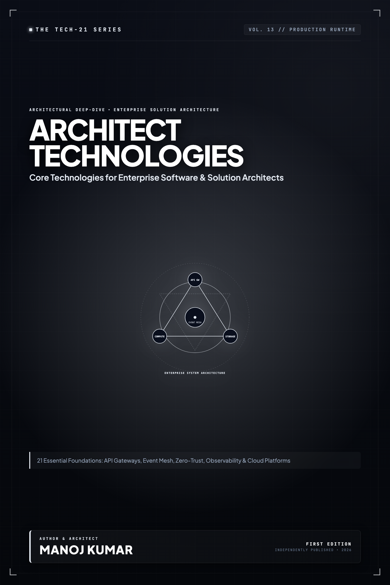

# Tech-21: Core Technologies for Modern Architects

> **21 Essential Technologies Every Software and Solution Architect Must Master**  
> *Author: Manoj Kumar* • *Tech-21 Series (Vol. 13)*

  

## 📖 About This Edition

This repository contains the **free public sampler** for **Tech-21: Core Technologies for Modern Architects**, including the **Preface and Questions 01 through 03** in their entirety. Every chapter follows the strict 5-section Tech-21 mental model framework:

1. **The Core Concept & Intuition** (High-signal problem statement & architecture)
2. **Under the Hood** (Runtime execution mechanics, memory diagrams, and comparison matrices)
3. **Clean Code in Action** (Idiomatic, production-grade implementations)
4. **Common Pitfalls & Interview Traps** (Structured bug-prevention matrices)
5. **60-Second Memory Anchor** (Permanent retention punchlines)

## 📋 Complete 21-Question Syllabus

| Chapter | Status | Title |
| :--- | :---: | :--- |
| **[00-preface](./00-preface.md)** | 🟢 **Free Sampler** | [Preface](./00-preface.md) |
| **[01-docker-and-containerization](./01-docker-and-containerization.md)** | 🟢 **Free Sampler** | [1. How Do Docker, OCI Standards, and Container Runtimes Establish Microservice Isolation?](./01-docker-and-containerization.md) |
| **[02-kubernetes-container-orchestration](./02-kubernetes-container-orchestration.md)** | 🟢 **Free Sampler** | [2. How Does Kubernetes Orchestrate Enterprise Container Workloads at Scale?](./02-kubernetes-container-orchestration.md) |
| **[03-apache-kafka-event-streaming](./03-apache-kafka-event-streaming.md)** | 🟢 **Free Sampler** | [3. How Does Apache Kafka Power High-Throughput Distributed Event Streaming and Log Retention?](./03-apache-kafka-event-streaming.md) |
| **04-redis-in-memory-data-store** | 🔒 *Full Edition* | 4. How Do Redis In-Memory Data Structures, Caching Topologies, and Sentinel Clusters Scale Systems? |
| **05-postgresql-relational-powerhouse** | 🔒 *Full Edition* | 5. How Does PostgreSQL Deliver Enterprise Scalability with MVCC, Indexing, and Connection Pooling? |
| **06-apache-cassandra-and-scylladb** | 🔒 *Full Edition* | 6. How Do Apache Cassandra and ScyllaDB Achieve Masterless Linearly Scalable Storage? |
| **07-elasticsearch-and-opensearch** | 🔒 *Full Edition* | 7. How Do Elasticsearch and OpenSearch Distribute Inverted Indexes and Lucene Shards? |
| **08-graphql-and-federation** | 🔒 *Full Edition* | 8. How Does GraphQL and Apollo Federation Unify Distributed Microservice Graphs? |
| **09-grpc-and-protocol-buffers** | 🔒 *Full Edition* | 9. How Do gRPC and Protocol Buffers Accelerate Inter-Service RPC Communication? |
| **10-envoy-proxy-and-service-mesh** | 🔒 *Full Edition* | 10. How Does Envoy Proxy Power Service Meshes with Dynamic Traffic Management and mTLS? |
| **11-terraform-and-opentofu** | 🔒 *Full Edition* | 11. How Do Terraform and OpenTofu Enforce Declarative Infrastructure State Management? |
| **12-prometheus-and-grafana** | 🔒 *Full Edition* | 12. How Do Prometheus and Grafana Scrape, Store, and Alert on Time-Series Metrics? |
| **13-opentelemetry-distributed-tracing** | 🔒 *Full Edition* | 13. How Does OpenTelemetry Provide Vendor-Neutral Distributed Tracing Across Services? |
| **14-apache-spark-big-data-compute** | 🔒 *Full Edition* | 14. How Does Apache Spark Execute High-Throughput In-Memory Distributed Data Processing? |
| **15-snowflake-and-lakehouse-architecture** | 🔒 *Full Edition* | 15. How Do Snowflake and Lakehouse Architectures Separate Compute from Storage? |
| **16-rabbitmq-message-queuing** | 🔒 *Full Edition* | 16. How Does RabbitMQ Route Messages with AMQP Exchanges, Queues, and Confirmations? |
| **17-hashicorp-vault-secrets-management** | 🔒 *Full Edition* | 17. How Does HashiCorp Vault Secure Secrets, Issue Dynamic Credentials, and Manage KMS? |
| **18-keycloak-oauth2-and-oidc** | 🔒 *Full Edition* | 18. How Does Keycloak Implement OAuth 2.0, OpenID Connect, and Federated Identity? |
| **19-temporal-durable-workflow-orchestration** | 🔒 *Full Edition* | 19. How Does Temporal Enable Fault-Tolerant Durable Workflow Orchestration Across Microservices? |
| **20-apache-flink-stream-processing** | 🔒 *Full Edition* | 20. How Does Apache Flink Execute Stateful Stream Processing with Exactly-Once Guarantees? |
| **21-vector-databases-and-rag** | 🔒 *Full Edition* | 21. How Do Vector Databases Index High-Dimensional Embeddings for Retrieval-Augmented Generation (RAG)? |
| **22-appendix-technology-selection-matrix** | 🔒 *Full Edition* | Appendix A: Technology Selection Decision Matrix |
| **23-appendix-enterprise-architecture-blueprint** | 🔒 *Full Edition* | Appendix B: Modern Enterprise Cloud-Native Architecture Blueprint |

---

## 🚀 How to Get the Full Edition

The complete edition unlocks **all 21 in-depth questions** and **both architectural reference appendices** (over 100+ pages of high-signal diagrams, memory layouts, and interview pitfall tables):

- 📱 **Kindle Edition**: Available on [Amazon Kindle](https://amazon.com)
- 📄 **Digital DRM-Free Bundle (EPUB + PDF)**: Instant download with high-res interior graphics
- 📦 **All-Access Pass**: Access all 15 volumes across the entire Tech-21 series

[← Return to Series Catalog](../../README.md)
