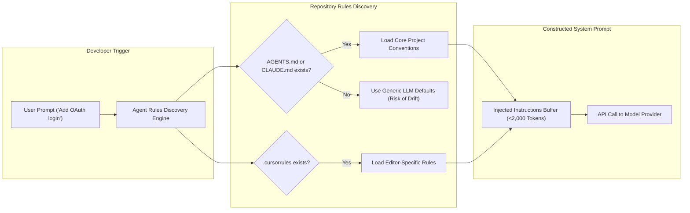

[← Back to Tech-21: Coding with AI Agents Overview](./README.md) | [🏠 Series Catalog](../../README.md)

---

# 1. How Should You Set Up Your Project and Rules Files for AI Coding Agents? 

## 1. The Core Concept & Intuition

When a human software engineer joins your team on their first day, you do not expect them to know your tech stack conventions instinctively. You tell them:
- *"We use TypeScript with Node 20+, not CommonJS."*
- *"We write unit tests using Vitest, never Jest."*
- *"Our CSS is written in Vanilla CSS modules; do not install Tailwind."*
- *"Run `npm run verify` before committing."*

When you invoke an AI coding agent without configuring project rules, the agent is in the exact same position as a brand-new junior hire on their first morning. The agent has broad knowledge of every language and library in the world, but **zero knowledge of your specific repository's conventions**. As a result, it guesses: it generates CommonJS `require()` calls in an ESM project, imports outdated libraries, or fabricates new styling patterns.

Setting up project rules files—such as `AGENTS.md`, `CLAUDE.md`, or `.cursorrules`—is the single highest-leverage setup task you can perform. It primes the agent on every interaction with your repository's architectural guardrails, test runners, and coding standards.

---

## 2. Under the Hood: The Rules Ingestion Lifecycle & File Precedence

When you type a prompt in an editor like Cursor, Windsurf, or invoke a CLI tool like Claude Code, the agent runtime automatically checks the repository root for standardized configuration files before sending your prompt to the LLM.



The runtime prepends these rules directly into the hidden system prompt. For this mechanism to remain effective, the rules must follow two mechanical constraints:
1. **Under 2,500 Tokens**: A rules file that is 5,000 words long will suffer from attention degradation. Keep your rules crisp and scannable.
2. **Positive Imperatives Over Endless Negatives**: Instead of writing 50 negative rules (*"Do NOT do X, do NOT do Y"*), write positive defaults (*"Always use Z pattern"*). Models follow clear, positive patterns with much higher fidelity.

### Rules File Formats Compared

| File Name | Primary Supported Tools | Best For | Typical Location |
| :--- | :--- | :--- | :--- |
| **`AGENTS.md`** | Universal open standard (Cursor, Windsurf, Claude Code, Cline) | General architecture, stack rules, build/test commands | Repository root (`/AGENTS.md`) |
| **`CLAUDE.md`** | Claude Code CLI & Anthropic Desktop | Terminal CLI build commands, project overview, style guidelines | Repository root (`/CLAUDE.md`) |
| **`.cursorrules`** | Cursor IDE | Editor-specific prompt behaviors, inline editing preferences | Repository root (`/.cursorrules`) |
| **`.windsurfrules`** | Windsurf IDE (Codeium) | Cascade agent rules and workflow preferences | Repository root (`/.windsurfrules`) |

---

## 3. Clean Code in Action

### A. Three Practical Workflows to Bootstrap `AGENTS.md` for an Existing Codebase

When introducing AI coding agents into an established repository, do not invent rules in a vacuum. Use one of three field-tested workflows:

#### 1. Method 1: Autonomous AI Reverse-Engineering (Fastest — 30 Seconds)
Pass your agent a one-shot bootstrap prompt (see **Appendix A, Template 6**). Because autonomous agents can execute shell commands and read files, instruct the agent to inspect package manifests (`package.json`, `pom.xml`, `pyproject.toml`, `go.mod`), discover test runners and linters, and inspect 1–2 typical business logic files. The agent drafts a crisp, high-signal `<100`-line `AGENTS.md` automatically.

#### 2. Method 2: Native CLI Initializers & Tool Aliasing (`claude init`)
Autonomous terminal agents provide native initialization commands:
```bash
# In Claude Code CLI:
# (or /init in active session to auto-detect and generate CLAUDE.md /
# AGENTS.md)
claude init
```
To maintain a single source of truth across Cursor, Windsurf, and Claude Code without duplicating files, create symbolic links in the repository root:
```bash
ln -s AGENTS.md .cursorrules
ln -s AGENTS.md .windsurfrules
```

#### 3. Method 3: The 4-File Manual Extraction Protocol (5 Minutes)
If you prefer authoring your rules manually on a legacy project, inspect just four key files:
- **Dependency Manifest** (`package.json`, `go.mod`, `pom.xml`): Captures language LTS version, frameworks, and allowed/forbidden libraries.
- **Scripts Block** (`scripts` in `package.json` or `Makefile`): Extracts exact deterministic test, lint, and build commands.
- **Linter / Type Config** (`tsconfig.json`, `eslint.config.js`): Extracts strict typing rules (e.g., no `any`, strict null checks).
- **One Canonical Service** (e.g., `src/services/user.service.ts`): Designates the reference blueprint for error handling and validation style.

---

### B. Universal `AGENTS.md` Production Starter Template
The following markdown template is compact, comprehensive, and universally respected by modern coding agents:

```markdown
# Repository Development Guidelines

## 1. Tech Stack & Environment
- **Runtime**: Node.js v20+ LTS (ES Modules only; never use
  `require()`).
- **Language**: TypeScript 5.4+ with strict mode enabled.
- **Frameworks**: Express 4.x for API, React 18 for frontend.
- **Styling**: Vanilla CSS Modules (do NOT install Tailwind or
  third-party CSS frameworks).
- **Testing**: Vitest for unit tests; Playwright for E2E.

## 2. Deterministic Commands
- **Run Unit Tests**: `npm run test:unit`
- **Run Single Test**: `npm run test -- <path-to-test-file>`
- **Typecheck**: `npm run typecheck`
- **Lint**: `npm run lint`
- **Full Verification**: `npm run verify` (runs typecheck + lint +
  test)

## 3. Coding Standards & Invariants
- Colocate unit test files alongside implementation (`foo.ts` ->
  `foo.spec.ts`).
- Never use `any` or `@ts-ignore`. If types are complex, declare an
  explicit interface.
- Keep domain logic decoupled from framework controllers.
- Always validate external input using Zod schemas before processing.

## 4. Git & Workflow Rules
- Write commit messages following Conventional Commits (`feat:`,
  `fix:`, `test:`, `refactor:`).
- Never edit package dependencies without explicit developer approval.
```

For monorepos with separate frontend and backend boundaries, append scoped rules via path matching:

```markdown
# Scoped Frontend Rules (Applies to src/frontend/**/*)
- Use functional components with explicit TypeScript prop interfaces.
- Prefer React standard hooks (`useState`, `useEffect`, `useCallback`)
  over external state libraries.
- All interactive buttons and inputs must include accessible
  `aria-label` attributes.
- Use CSS variables defined in `src/frontend/styles/tokens.css` for
  colors and spacing.
```

---

## 4. Common Pitfalls & Developer Traps

| Trap / Misconception | Reality |
| :--- | :--- |
| **"Writing a 40-page rules document ensures perfect code."** | Massive rules documents trigger attention degradation and prompt rot. Keep rules under 150 lines focusing on the top 10 most violated conventions. |
| **"Telling the agent 'Write high-quality code' in rules works."** | Phrases like "write clean code" or "be elegant" are completely meaningless to an LLM. Specify concrete actions: "All exported methods must define return types." |
| **"Rules files are only for advanced teams."** | Solo developers benefit the most: a clean `AGENTS.md` prevents you from having to repeat your stack and test commands on every new chat prompt. |
| **"Leaving outdated rules in the repository is harmless."** | Stale rules mentioning deprecated libraries (e.g. referencing Jest when you migrated to Vitest) will actively confuse the agent, causing broken test generation. |

---

## 5. 60-Second Memory Anchor

> **"An AI agent without an `AGENTS.md` is a junior developer who never received an onboarding doc; write down your stack, your exact test commands, and your forbidden libraries to eliminate 80% of hallucinations."**

---

[← Preface](./00-preface.md) | **Next**: [Question 02 →](./02-how-do-you-write-specifications-that-agents-implement-accurately.md)
