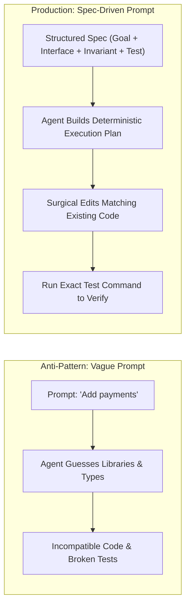

[← Back to Tech-21: Coding with AI Agents Overview](./README.md) | [🏠 Series Catalog](../../README.md)

---

# 2. How Do You Write Feature Specifications That Agents Implement Accurately on the First Try? 

## 1. The Core Concept & Intuition

The single most common reason developers get frustrated with AI coding agents is **Under-Specification**.

Consider the prompt:
> *"Add user authentication to our API."*

To a human developer who knows the product, this prompt still requires an hour of clarifying questions: Which auth scheme (JWT, session cookies, OAuth2)? Where are passwords hashed? What rate limits apply? Which database table stores users? What error status codes should be returned?

When given this prompt, an AI agent cannot ask twenty clarifying questions—so it guesses. It invents an arbitrary JWT implementation, selects a library you don't use, and writes thirty lines of boilerplate that don't fit your database schema.

To get an agent to implement a feature accurately on the first attempt, you must adopt **Spec-Driven Prompting**. A great specification does not require writing hundreds of lines of prose; it requires answering four simple, concrete technical questions:
1. **The Exact Objective**: What feature or fix is being built?
2. **The Concrete Interfaces**: What are the input types and expected outputs?
3. **The Non-Negotiable Invariants**: What existing behavior must NOT break?
4. **The Verification Proof**: How will we know the implementation works (which test to run)?

---

## 2. Under the Hood: The Spec Ingestion & Task Planning Pipeline

When an agent receives a structured specification, its internal chain of thought switches from "exploratory guesswork" to "deterministic code execution."



A structured specification constrains the model's token sampling space. Instead of searching across hundreds of thousands of potential architectural patterns, the model's probability distribution is focused strictly on implementing the exact function signatures and passing the declared test cases.

### Vague Prompting vs. Spec-Driven Prompting Compared

| Prompting Attribute | Vague Prompting | Spec-Driven Prompting |
| :--- | :--- | :--- |
| **Initial Prompt Example** | *"Add rate limiting to the endpoints"* | *"Implement Redis sliding window rate limiter on `/api/v1/auth`"* |
| **Interface Definition** | Undefined (Agent invents types) | Declared explicitly (Params, headers, return codes) |
| **Error Handling** | Generic `500 Internal Error` | Specified (`429 Too Many Requests` with `Retry-After` header) |
| **First-Try Success Rate** | <25% | >85% |
| **Developer Frustration** | High (Requires 5+ rounds of correction) | Minimal (Verified in 1–2 turns) |

---

## 3. Clean Code in Action

### A. The 4-Pillar Spec Prompt Blueprint
Use this battle-tested prompt template whenever asking an agent to build a new feature or endpoint:

```markdown
### TASK: Implement User Password Reset Token Flow

1. GOAL:
Add a `requestPasswordReset(email: string): Promise<string>` method to
`src/modules/auth/auth.service.ts`.

2. INTERFACE & BEHAVIOR:
- Query the `users` table via `db.user.findUnique({ where: { email }
  })`.
- If user does not exist, return a generic success string (do not leak
  email existence).
- Generate a cryptographically secure 32-byte hex token using Node's
  `crypto.randomBytes(32).toString('hex')`.
- Hash the token using `crypto.createHash('sha256')` before storing it
  in `password_reset_tokens` table with a 15-minute expiration
  timestamp.
- Return the unhashed raw token string for email delivery.

3. CONSTRAINTS & INVARIANTS:
- Do NOT install any third-party auth libraries; use built-in
  `node:crypto`.
- Use existing database client imported from `@/database/client`.
- Follow our standard Result pattern: return `{ success: true, token?:
  string }`.

4. VERIFICATION:
- Run `npm run test -- src/modules/auth/auth.service.spec.ts` to
  verify existing tests still pass.
- Add a new unit test verifying that expired tokens are rejected.
```

### B. Lightweight Markdown Spec Workflow (`spec.md`)
For features touching multiple files, create a temporary `spec.md` in your project root and tell the agent: *"Read `spec.md` and implement Phase 1."*

```markdown
# Feature Specification: Webhook Delivery Service

## Files to Modify:
- `src/services/webhook.service.ts` (Core delivery logic)
- `src/services/webhook.types.ts` (Payload definitions)
- `src/services/webhook.service.spec.ts` (Unit tests)

## Sequence of Operations:
1. Define `WebhookPayload` interface in `webhook.types.ts`.
2. Implement exponential backoff retry loop (max 3 attempts: 1s, 2s,
   4s).
3. Sign payload using HMAC-SHA256 with `X-Signature-256` header.
4. Execute unit tests: `npm run test:unit`.
```

---

## 4. Common Pitfalls & Developer Traps

| Trap / Misconception | Reality |
| :--- | :--- |
| **"Writing a spec takes longer than just writing the code yourself."** | Writing a 10-line bulleted spec takes 60 seconds; an unguided agent will waste 20 minutes generating broken code and breaking your build. |
| **"The agent will automatically know which HTTP status codes to use."** | Agents frequently default to returning `200 OK` with `{ error: "..." }` in the body unless you explicitly specify REST standard status codes (`400`, `401`, `404`, `429`). |
| **"You don't need to specify what NOT to touch."** | Without negative constraints ("Do not modify the database schema"), agents will often alter your database models or rewrite unrelated interfaces. |
| **"Copy-pasting a 5-page Product Requirements Document (PRD) works."** | PRDs are written for humans with business fluff. Agents need technical specs: file paths, method signatures, exact error cases, and test commands. |

---

## 5. 60-Second Memory Anchor

> **"If you wouldn't assign a task to a junior engineer with a three-word instruction, don't give it to an AI agent; define the Goal, the Types, the Constraints, and the exact Test Command to verify."**

---

[← Question 01](./01-how-should-you-set-up-your-project-for-ai-coding-agents.md) | **Next**: [Question 03 →](./03-how-do-you-manage-context-to-prevent-the-agent-from-getting-confused.md)
