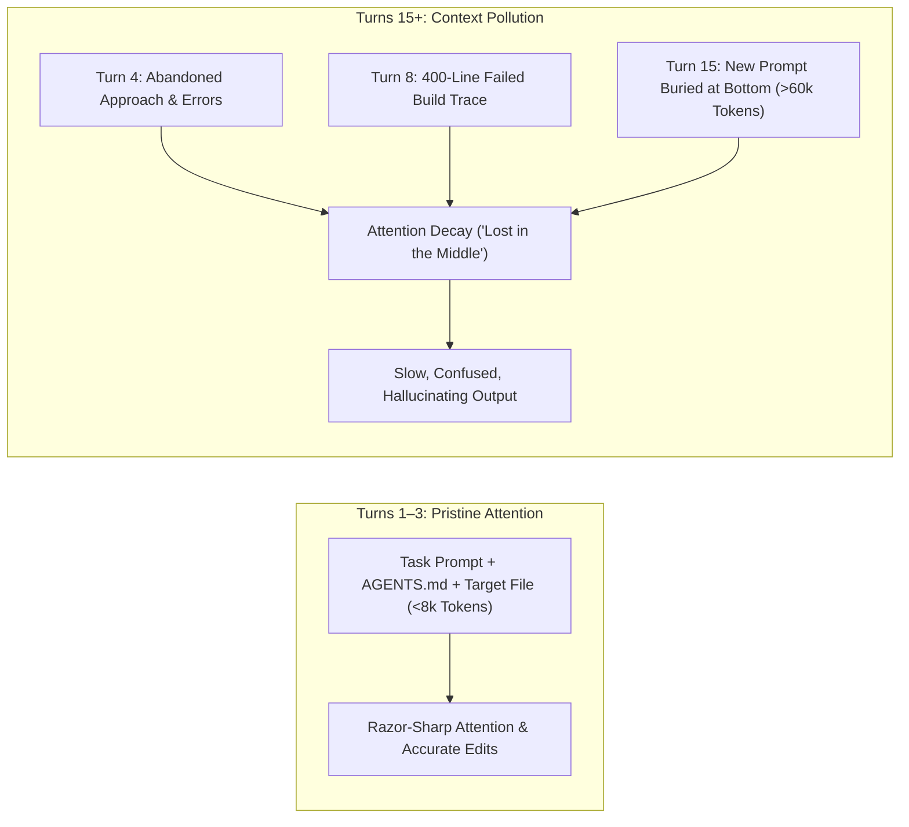

[← Back to Tech-21: Coding with AI Agents Overview](./README.md) | [🏠 Series Catalog](../../README.md)

---

# 3. How Do You Manage Context and Chat History to Prevent the Agent From Getting Confused? 

## 1. The Core Concept & Intuition

Every developer using AI agents eventually encounters the "Drunken Agent Syndrome":
- In Turn 1, the agent is brilliant, writing sharp code and understanding instructions perfectly.
- By Turn 12, the agent starts forgetting previous files, proposing contradictory fixes, and repeating mistakes you corrected ten minutes ago.
- By Turn 25, the agent takes 30 seconds to respond, hallucinates syntax, and deletes working methods.

Why does this happen? Because developers treat an AI chat session like a human Slack conversation that stays open all day.

To an AI model, **every single message in your chat history is re-sent with every new prompt**. When a chat thread runs for an hour, it accumulates hundreds of lines of failed compilation logs, abandoned code attempts, and conversational chatter. This accumulated history acts as **Context Pollution**: the model's attention gets distracted by old discarded ideas, drowning out your latest prompt.

The most productive developers practice strict **Context Hygiene**: they keep active editor tabs lean, avoid long marathon chat threads, and reset to a fresh chat window as soon as a task milestone is reached.

---

## 2. Under the Hood: Chat History Accumulation & Token Pollution

Understanding how context builds up across an active pairing session reveals why older chats degrade:



Every time you ask an agent to "try again" after a failure, both the bad code and the failure trace remain in context. After three failed attempts, the context contains more erroneous code examples than correct ones! The model statistically gravitates toward repeating the bad patterns.

### Marathon Chat vs. Single-Task Chat Sessions Compared

| Workflow Dimension | Marathon Chat (All-Day Thread) | Single-Task Chat (Fresh Window per Feature) |
| :--- | :--- | :--- |
| **Session Length** | 20–50 turns | 3–6 turns |
| **Context Overhead** | 50,000–150,000 tokens | 5,000–15,000 tokens |
| **Response Latency** | Slow (15–30 seconds per turn) | Fast (2–5 seconds per turn) |
| **Token Cost** | 10x higher (quadratic history burn) | Minimal (linear prefix-cached requests) |
| **Hallucination Rate** | High (Context poisoning from old errors) | Very Low (Clean working state) |

---

## 3. Clean Code in Action

### A. Context Handoff Summary Template
When a task is complete or when a chat begins to degrade after 5–6 turns, do not continue the thread. Ask the current agent for a **Handoff Summary**, copy it, and paste it into a **fresh chat session**:

```markdown
### PROMPT: Generate Handoff Summary for Fresh Chat

We have completed the refactor of `src/auth/jwt.service.ts`.
Before I start a new session, provide a concise 5-line technical handoff summary:
1. What changes were successfully made and tested?
2. What is the active state of git working tree?
3. What is the immediate next step to implement?
```

The agent will output a clean 5-line summary. You open a new chat (`Cmd+L` or `/new`), paste that summary, and proceed with pristine, zero-overhead attention!

### B. The Developer Pre-Prompt Context Checklist
Before typing a prompt into your agent, perform this 10-second checklist:

```text
[ ] TAB HYGIENE: Close all open tabs except the 2–3 files directly relevant to this task.
[ ] CHAT AGE: If the current chat has more than 6 turns, open a fresh chat.
[ ] SPECIFICITY: Did I mention the exact file path and function name?
[ ] NOISY LOGS: Did I paste only the relevant stack trace snippet rather than 500 lines of build logs?
```

---

## 4. Common Pitfalls & Developer Traps

| Trap / Misconception | Reality |
| :--- | :--- |
| **"Keeping one long chat preserves the agent's memory of my project."** | The opposite happens: the chat fills with obsolete code and discarded experiments, confusing the agent. Your `AGENTS.md` is what preserves project memory, not old chat history. |
| **"Leaving 25 tabs open in VS Code helps the agent understand the app."** | Many IDE agents (Cursor, Windsurf) automatically harvest open tabs into context. 25 open tabs saturate token budgets and distract the model. |
| **"When an agent fails, reprompting 'try again' 10 times will fix it."** | If an agent fails twice in a row, reprompting usually makes it worse. Undo the bad changes (`git checkout`), open a fresh chat, and refine your prompt. |
| **"Pasting the entire terminal log is better than trimming it."** | 90% of terminal output is success noise. Trimming the log to just the 10-line error snippet prevents token bloat and keeps the agent focused. |

---

## 5. 60-Second Memory Anchor

> **"One Task = One Chat; when a task is finished or an agent fails twice, do not argue with a poisoned context—close the window, open a fresh chat, and start clean."**

---

[← Question 02](./02-how-do-you-write-specifications-that-agents-implement-accurately.md)

> ### 🎓 Looking for Questions 04 through 21 & Deep-Dive Appendices?
> You have reached the end of the free sampler for **Tech-21: Coding with AI Agents**!
> 
> The full release contains **18 additional core interview chapters** plus **2 architectural reference appendices**, memory layouts, complete edge-case tables, and production patterns.
> 
> 📖 **[Get the Full Edition (Kindle / EPUB / PDF) →](./README.md#how-to-get-the-full-edition)**

