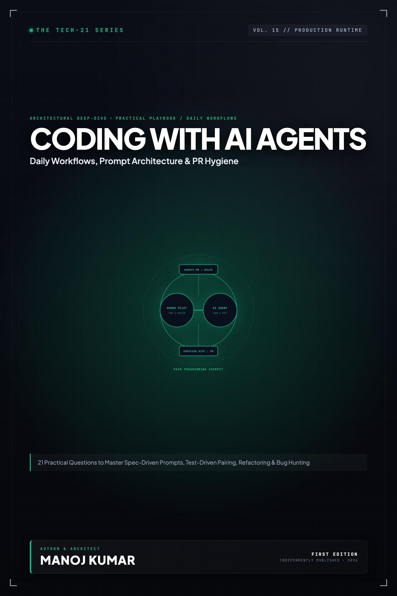

# Tech-21: Coding with AI Agents

> **21 Practical Questions to Master Daily Workflows, Prompt Architecture, Test-Driven Pairing & PR Hygiene**  
> *Author: Manoj Kumar* • *Tech-21 Series (Vol. 15)*

  

## 📖 About This Edition

This repository contains the **free public sampler** for **Tech-21: Coding with AI Agents**, including the **Preface and Questions 01 through 03** in their entirety. Every chapter follows the strict 5-section Tech-21 mental model framework:

1. **The Core Concept & Intuition** (High-signal problem statement & architecture)
2. **Under the Hood** (Runtime execution mechanics, memory diagrams, and comparison matrices)
3. **Clean Code in Action** (Idiomatic, production-grade implementations)
4. **Common Pitfalls & Interview Traps** (Structured bug-prevention matrices)
5. **60-Second Memory Anchor** (Permanent retention punchlines)

## 📋 Complete 21-Question Syllabus

| Chapter | Status | Title |
| :--- | :---: | :--- |
| **[00-preface](./00-preface.md)** | 🟢 **Free Sampler** | [Preface](./00-preface.md) |
| **[01-how-should-you-set-up-your-project-for-ai-coding-agents](./01-how-should-you-set-up-your-project-for-ai-coding-agents.md)** | 🟢 **Free Sampler** | [1. How Should You Set Up Your Project and Rules Files for AI Coding Agents?](./01-how-should-you-set-up-your-project-for-ai-coding-agents.md) |
| **[02-how-do-you-write-specifications-that-agents-implement-accurately](./02-how-do-you-write-specifications-that-agents-implement-accurately.md)** | 🟢 **Free Sampler** | [2. How Do You Write Feature Specifications That Agents Implement Accurately on the First Try?](./02-how-do-you-write-specifications-that-agents-implement-accurately.md) |
| **[03-how-do-you-manage-context-to-prevent-the-agent-from-getting-confused](./03-how-do-you-manage-context-to-prevent-the-agent-from-getting-confused.md)** | 🟢 **Free Sampler** | [3. How Do You Manage Context and Chat History to Prevent the Agent From Getting Confused?](./03-how-do-you-manage-context-to-prevent-the-agent-from-getting-confused.md) |
| **04-how-do-you-effectively-pair-program-with-an-ai-agent** | 🔒 *Full Edition* | 4. How Do You Effectively Pair-Program with an AI Agent in Your Day-to-Day Workflow? |
| **05-how-do-you-choose-between-inline-assistants-and-autonomous-cli-agents** | 🔒 *Full Edition* | 5. How Do You Choose Between Inline Assistants and Autonomous CLI Agents? |
| **06-how-do-you-get-an-ai-agent-to-write-thorough-unit-and-integration-tests** | 🔒 *Full Edition* | 6. How Do You Get an AI Agent to Write Thorough Unit and Integration Tests? |
| **07-how-do-you-use-ai-agents-to-diagnose-and-fix-complex-bugs** | 🔒 *Full Edition* | 7. How Do You Use AI Agents to Diagnose and Fix Complex Production Bugs? |
| **08-how-do-you-safely-refactor-legacy-code-using-an-ai-agent** | 🔒 *Full Edition* | 8. How Do You Safely Refactor Legacy Code Using an AI Agent Without Breaking Things? |
| **09-how-do-you-scaffold-new-features-and-boilerplate-rapidly** | 🔒 *Full Edition* | 9. How Do You Scaffold New Features and APIs Rapidly Without Introducing Bloat? |
| **10-how-do-you-navigate-and-understand-an-unfamiliar-codebase-with-an-agent** | 🔒 *Full Edition* | 10. How Do You Navigate and Understand an Unfamiliar Codebase Using an AI Agent? |
| **11-how-do-you-review-ai-generated-pull-requests-and-diffs-effectively** | 🔒 *Full Edition* | 11. How Do You Review AI-Generated Pull Requests and Diffs Effectively? |
| **12-how-do-you-prevent-the-agent-from-hallucinating-non-existent-libraries** | 🔒 *Full Edition* | 12. How Do You Prevent the Agent from Hallucinating Non-Existent Libraries and APIs? |
| **13-how-do-you-steer-an-agent-when-it-gets-stuck-in-an-error-loop** | 🔒 *Full Edition* | 13. How Do You Steer an Agent When It Gets Stuck in an Unproductive Error Loop? |
| **14-how-do-you-leverage-terminal-execution-and-git-tools-safely** | 🔒 *Full Edition* | 14. How Do You Leverage Terminal Execution and Git Tools Safely with Agents? |
| **15-how-do-you-generate-comprehensive-documentation-and-api-specs** | 🔒 *Full Edition* | 15. How Do You Generate Comprehensive Documentation and API Specs with Agents? |
| **16-how-do-you-create-reusable-agent-workflows-and-custom-prompts** | 🔒 *Full Edition* | 16. How Do You Create Reusable Agent Workflows and Custom Slash Commands? |
| **17-how-do-you-handle-database-migrations-and-schema-changes-with-agents** | 🔒 *Full Edition* | 17. How Do You Handle Database Migrations and Schema Changes with AI Agents? |
| **18-how-do-you-balance-agent-speed-with-clean-code-and-maintainability** | 🔒 *Full Edition* | 18. How Do You Balance Agent Speed with Clean Code and Long-Term Maintainability? |
| **19-how-do-you-automate-repetitive-code-audits-and-dependency-upgrades** | 🔒 *Full Edition* | 19. How Do You Automate Repetitive Code Audits and Dependency Upgrades with Agents? |
| **20-how-do-you-build-a-personal-ai-assisted-development-workflow** | 🔒 *Full Edition* | 20. How Do You Build a Seamless Personal AI-Assisted Development Workflow? |
| **21-what-are-the-critical-developer-habits-that-separate-great-ai-coders-from-vibe-coders** | 🔒 *Full Edition* | 21. What Are the Critical Developer Habits That Separate Great AI Coders from Vibe Coders? |
| **22-appendix-developer-prompt-templates-cheatsheet** | 🔒 *Full Edition* | Appendix A: The Pragmatic Developer Prompt Templates & Cheatsheet |
| **23-appendix-developer-checklist-and-antipatterns** | 🔒 *Full Edition* | Appendix B: The Daily AI Coding Checklist & Anti-Pattern Field Guide |

---

## 🚀 How to Get the Full Edition

The complete edition unlocks **all 21 in-depth questions** and **both architectural reference appendices** (over 100+ pages of high-signal diagrams, memory layouts, and interview pitfall tables):

- 📱 **Kindle Edition**: Available on [Amazon Kindle](https://amazon.com)
- 📄 **Digital DRM-Free Bundle (EPUB + PDF)**: Instant download with high-res interior graphics
- 📦 **All-Access Pass**: Access all 15 volumes across the entire Tech-21 series

[← Return to Series Catalog](../../README.md)
