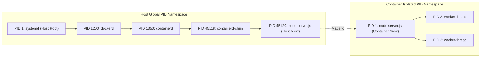
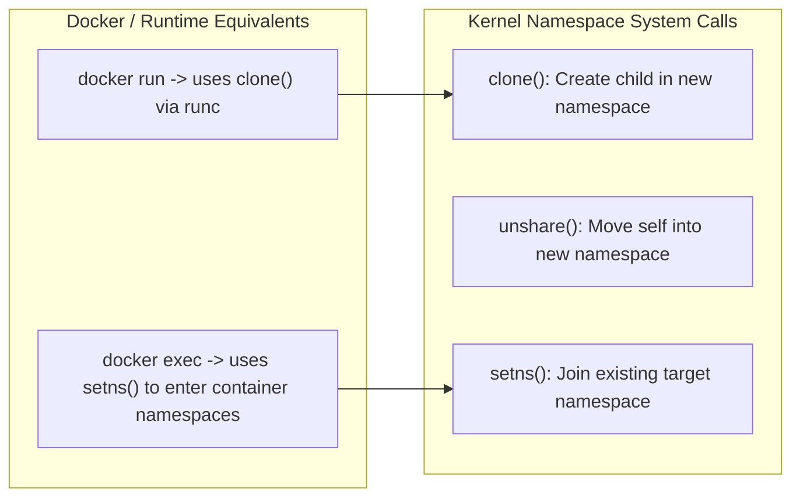

[← Back to Tech-21: Docker & Container Runtimes Overview](./README.md) | [🏠 Series Catalog](../../README.md)

---

# 1. How Do Linux Namespaces Create Isolated Process Environments in Containers? 

> *"Namespaces are the lens through which a process views the operating system. By virtualizing system resources into separate compartments, the Linux kernel gives a container process the illusion that it owns a dedicated computer."*

---

## 1. The Core Concept & Intuition

### The Isolation Problem
In a standard multi-user Linux environment, all processes share a single unified process tree, network stack, filesystem mount table, and user database. If process $A$ executes `ps aux`, it sees process $B$. If process $A$ binds to port `8080`, process $B$ cannot. If process $A$ crashes or exhausts system file descriptors, process $B$ is impacted.

### What Linux Namespaces Do
Namespaces partition global system resources into isolated instances:
- Processes assigned to Namespace $X$ can only see and interact with resources belonging to Namespace $X$.
- To the isolated process, it appears to be running on a dedicated operating system instance with its own root PID (`PID 1`), dedicated network interfaces (`eth0`, `lo`), private mount points, and independent user accounts.
- To the host kernel, the containerized application is simply a regular process running alongside standard system daemons.


---

## 2. Under the Hood: Linux Namespaces Create Isolated Process

### Process Identification Across Namespace Boundaries
When a container starts, the Linux kernel assigns it a new PID namespace. The main container process is assigned **PID 1** within that namespace. However, on the host OS kernel's global process table, the process is assigned a standard high-numbered PID (e.g., PID 45120).



### The System Call Interface (`clone`, `unshare`, `setns`)
The Linux kernel provides three fundamental system calls to manipulate namespaces:
1. `clone(..., flags)`: Spawns a child process inside newly created namespaces specified by bitwise flags (e.g., `CLONE_NEWPID | CLONE_NEWNET`).
2. `unshare(flags)`: Disassociates the calling process from its current namespaces and moves it into new ones.
3. `setns(fd, nstype)`: Attaches the calling process to an existing namespace via its file descriptor in `/proc/<PID>/ns/` (this is exactly how `docker exec` works).



### The 8 Linux Kernel Isolation Namespaces

| Namespace | Kernel Flag | Isolated System Resource | Container Boundary Impact |
| :--- | :--- | :--- | :--- |
| **PID** | `CLONE_NEWPID` | Process IDs & Process Hierarchy | Container process becomes PID 1; cannot see or signal host processes. |
| **NET** | `CLONE_NEWNET` | Network interfaces, routes, iptables | Dedicated virtual loopback and `eth0`; private port bindings. |
| **MNT** | `CLONE_NEWNS` | Filesystem mount tables | Container root filesystem (`rootfs`) isolated from host mount tree. |
| **IPC** | `CLONE_NEWIPC` | System V IPC & POSIX message queues | Prevents shared memory corruption across container boundaries. |
| **UTS** | `CLONE_NEWUTS` | Hostname and NIS domain name | Allows container to define independent hostname without host mutation. |
| **USER** | `CLONE_NEWUSER`| User and Group ID mappings | Maps unprivileged host UID (e.g. 10000) to container root (UID 0). |
| **CGROUP** | `CLONE_NEWCGROUP`| Cgroup root view in `/proc` | Masks host cgroup tree; container only sees its own cgroup slice. |
| **TIME** | `CLONE_NEWTIME`| `CLOCK_MONOTONIC` & `CLOCK_BOOTTIME` | Independent system clock virtualization for testing time travel. |

---

## 3. Clean Code in Action

### A. Inspecting and Entering Container Namespaces via Host CLI

Every running container exposes its assigned namespace file descriptors under `/proc/<PID>/ns/`. Administrators can inspect and attach to these namespaces directly without docker daemon intervention:

```bash
# Start a sample container
docker run -d --name web-sandbox nginx:alpine

# Find the host PID of the container
CONTAINER_PID=$(docker inspect --format '{{.State.Pid}}' web-sandbox)
echo "Host PID: $CONTAINER_PID"

# List the namespace file descriptors
ls -la /proc/$CONTAINER_PID/ns/
# Output shows symbolic links with unique inode numbers:
# cgroup -> 'cgroup:[4026531835]'
# ipc    -> 'ipc:[4026532298]'
# mnt    -> 'mnt:[4026532296]'
# net    -> 'net:[4026532301]'
# pid    -> 'pid:[4026532299]'
# user   -> 'user:[4026531837]'
# uts    -> 'uts:[4026532297]'

# Join container network and PID namespace directly using nsenter
sudo nsenter --target $CONTAINER_PID --net --pid /bin/sh
```

### B. Low-Level Process Isolation in C Using `clone()`
```c
#define _GNU_SOURCE
#include <sched.h>
#include <stdio.h>
#include <stdlib.h>
#include <sys/wait.h>
#include <unistd.h>

#define STACK_SIZE (1024 * 1024)
static char child_stack[STACK_SIZE];

int child_exec(void *arg) {
    printf("[Child] Inside isolated namespaces. My PID: %d\n",
           getpid());
    sethostname("mini-container", 14);
    system("ps aux");
    return 0;
}

int main() {
    printf("[Host] Parent PID: %d. Spawning child...\n",
           getpid());
    
    // Clone with isolated PID, UTS (hostname), Mount, and Network
    // namespaces
    int clone_flags = CLONE_NEWPID | CLONE_NEWUTS | CLONE_NEWNS |
                      CLONE_NEWNET | SIGCHLD;
    pid_t child_pid = clone(child_exec, child_stack + STACK_SIZE,
                            clone_flags, NULL);
    
    if (child_pid == -1) {
        perror("clone failed");
        exit(1);
    }
    
    waitpid(child_pid, NULL, 0);
    printf("[Host] Child process exited cleanly.\n");
    return 0;
}
```

---

## 4. Common Pitfalls & Interview Traps

| Trap / Misconception | Reality |
| :--- | :--- |
| **"Disabling Namespace Isolation with `--net=host` or `--pid=host`"** | Running containers with `docker run --net=host --pid=host` in production to bypass port mapping or debugging hurdles. This strips away network and process isolation. The container can snoop on host traffic, bind to host ports directly, and inspect/kill host processes. Keep default namespaces enabled. Use custom bridge networks for inter-container communication and explicit port bindings (`-p 8080:80`). |
| **"Neglecting the USER Namespace (Root Inside = Root Outside)"** | Running containers as UID 0 (root) without enabling Docker User Namespaces (`userns-remap`). By default, UID 0 inside a container is UID 0 on the host kernel. If a container escapes via a filesystem or syscall exploit, the attacker has full root control over the physical host. Map container root UID 0 to an unprivileged host UID (e.g., UID 100000) using User Namespaces, or enforce non-root `USER 10001` in the Dockerfile. |

---


## 5. 60-Second Memory Anchor


> **"Namespaces isolate VISION: They control what a process can see. PID 1 Inside, High PID Outside: The kernel translates process IDs across namespace boundaries."**

---

[← Preface](./00-preface.md) | **Next**: [Question 02 →](./02-cgroups-v2-and-resource-management.md)
