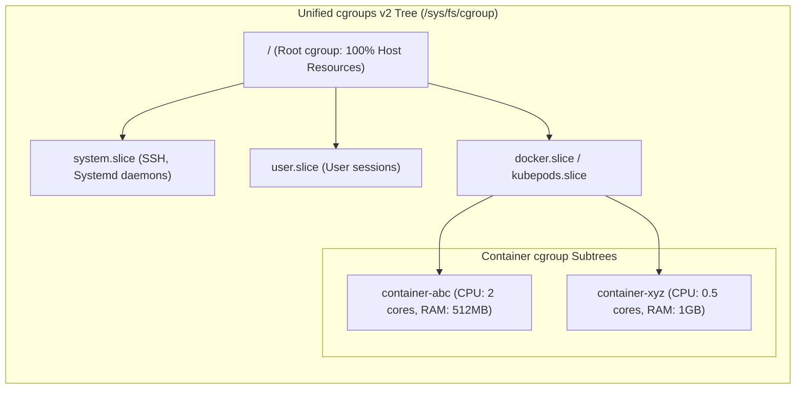
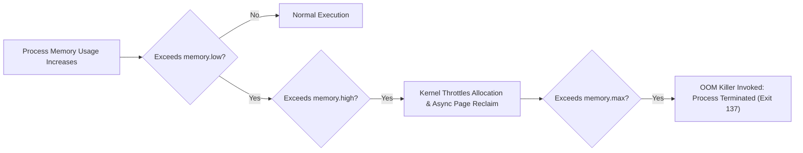

[← Back to Tech-21: Docker & Container Runtimes Overview](./README.md) | [🏠 Series Catalog](../../README.md)

---

# 2. How Do Control Groups (cgroups v2) Enforce CPU, Memory, and I/O Resource Limits? 

> *"Namespaces isolate what a container can see; Control Groups (cgroups) strictly govern what a container can consume. Without cgroups, a single runaway thread can exhaust all host CPU and trigger the kernel Out-Of-Memory (OOM) killer across unrelated workloads."*

---

## 1. The Core Concept & Intuition

### The Noisy Neighbor Catastrophe
In a multi-container environment, processes compete for shared physical resources:
- **CPU Starvation**: An infinite loop in one container monopolizes all available CPU cores.
- **Memory Exhaustion**: A memory leak in container $A$ forces the kernel into severe swap thrashing or triggers the global OOM killer to terminate critical database processes.
- **Disk I/O Saturation**: A batch job writing unbuffered gigabytes of logs chokes read/write throughput for transactional web applications.

### cgroups v1 vs cgroups v2
Control Groups (**cgroups**) are a Linux kernel feature that organizes processes into hierarchical groups and meters/limits their resource consumption.
- **cgroups v1 (Legacy)**: Used separate, uncoordinated hierarchies for each resource controller (one tree for `cpu`, another for `memory`, another for `blkio`). This made cross-resource coordination (like buffered write-back I/O throttling) impossible and caused high kernel lock contention.
- **cgroups v2 (Unified Hierarchy)**: Introduced in modern Linux distributions (Fedora, RHEL 9, Ubuntu 22.04+, Debian 11+). All controllers share a single, unified process tree mounted at `/sys/fs/cgroup`. It introduces memory pressure stalls (PSI), accurate I/O writeback accounting, and strict rootless container isolation.


---

## 2. Under the Hood: Control Groups (cgroups V2) Enforce

### The Unified cgroup v2 Hierarchy
In cgroups v2, every process belongs to exactly one cgroup node in a single hierarchical tree. Systemd acts as the primary cgroup manager:



### CPU Quotas: Periods & Quotas
Linux CFS (Completely Fair Scheduler) enforces CPU throttling using two metrics:
- **`cpu.cfs_period_us`**: The scheduling enforcement window (default: $100,000\mu\text{s} = 100\text{ms}$).
- **`cpu.cfs_quota_us`**: The total allowed CPU runtime within that window across all available cores.

$$\text{Allocated Cores} = \frac{\text{cpu.cfs\_quota\_us}}{\text{cpu.cfs\_period\_us}} = \frac{200,000\mu\text{s}}{100,000\mu\text{s}} = 2.0\text{ CPUs}$$

If a 2-core container exhausts its $200\text{ms}$ quota in the first $30\text{ms}$ of a period, the kernel immediately **throttles** all threads until the period resets, causing severe latency spikes.

### The Memory Hierarchy & OOM Killer
cgroups v2 provides fine-grained memory boundaries:
1. **`memory.min`**: Hard memory protection; kernel will never reclaim pages below this threshold.
2. **`memory.low`**: Soft protection; reclaimed only when no other memory is available.
3. **`memory.high`**: Throttle threshold; when exceeded, the kernel slows down the process and reclaims memory aggressively without killing it.
4. **`memory.max`**: Hard ceiling; exceeding this triggers the Out-Of-Memory (OOM) killer, terminating the container with **Exit Code 137** (`128 + 9 (SIGKILL)`).



---

## 3. Clean Code in Action

### A. Production Configuration and Implementation
### C. Setting Resource Limits via Docker CLI
```bash
# Run container with:
# - Max 1.5 CPU cores
# - Max 512MB RAM (Hard limit: memory.max)
# - Soft memory warning limit (memory.high) at 400MB
# - Max 100 process threads (PID limit to prevent fork bombs)
docker run -d \
  --name api-server \
  --cpus="1.5" \
  --memory="512m" \
  --memory-reservation="400m" \
  --pids-limit=100 \
  nginx:alpine
```

### 2. Inspecting Live cgroup v2 Limits on Host
### B. Advanced Production Pattern
```bash
# Find the container ID
CONTAINER_ID=$(docker inspect --format '{}' api-server)

# Navigate to cgroup v2 directory (systemd driver)
CGROUP_PATH="/sys/fs/cgroup/system.slice/docker-${CONTAINER_ID}.scope"
# Or on standard Docker runtime:
# CGROUP_PATH="/sys/fs/cgroup/docker/${CONTAINER_ID}"

# View active memory ceiling
cat $CGROUP_PATH/memory.max
# Output: 536870912 (512 * 1024 * 1024 bytes)

# View active CPU limits (quota period)
cat $CGROUP_PATH/cpu.max
# Output: 150000 100000 (1.5 cores)

# View Pressure Stall Information (PSI) for Memory
cat $CGROUP_PATH/memory.pressure
# Output:
# some avg10=0.00 avg60=0.00 avg300=0.00 total=0
# full avg10=0.00 avg60=0.00 avg300=0.00 total=0
```

### 3. Simulating Memory OOM Termination
```bash
# Run a memory allocator script bounded to 50MB
docker run --rm -m 50m python:alpine python -c "
import time
print('Allocating memory beyond 50MB...')
x = bytearray(70 * 1024 * 1024) # Allocate 70MB
"

# Check the exit status
echo $?
# Output: 137 (Terminated by SIGKILL / OOM Killer)
```

---

## 4. Common Pitfalls & Interview Traps

| Trap / Misconception | Reality |
| :--- | :--- |
| **"CFS CPU Quota Throttling in Multi-Threaded Runtimes (Java / Go / Node.js)"** | Allocating 2 CPUs (`--cpus=2`) to a JVM application configured with 16 parallel GC threads. All 16 threads run concurrently on 16 physical cores, consuming the container's entire $200\text{ms}$ quota in just $12.5\text{ms}$ ($200\text{ms} / 16$). For the remaining $87.5\text{ms}$ of the window, the entire application is completely frozen by the kernel. Match application thread pools and GC worker counts to the allocated cgroup CPU limit: `-XX:ActiveProcessorCount=2` or `GOMAXPROCS=2`. |
| **"OOM Kills Caused by JVM Heap vs Off-Heap Miscalculation"** | Setting container memory to 1GB (`-m 1g`) and setting Java heap to 1GB (`-Xmx1024m`). The JVM requires off-heap memory for Metaspace, thread stacks, JIT compilation, and native buffers. When total memory crosses 1024MB, the kernel kills the container instantly. Set `-Xmx` to no more than 70-75% of the container memory limit: `-XX:MaxRAMPercentage=75.0`. |

---


## 5. 60-Second Memory Anchor


> **"cgroups govern CONSUMPTION: Memory limits, CPU shares, I/O rates, and thread counts. Exit Code 137 = OOM Killed: The kernel sent `SIGKILL` (9) because `memory.max` was breached."**

---

[← Question 01](./01-linux-namespaces-and-process-isolation.md) | **Next**: [Question 03 →](./03-overlayfs-and-union-filesystems.md)
