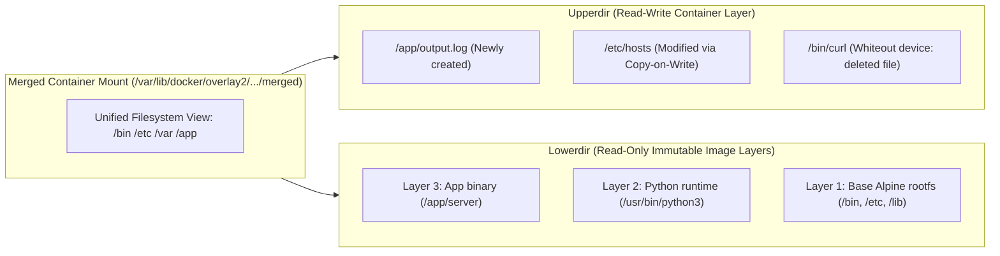

[← Back to Tech-21: Docker & Container Runtimes Overview](./README.md) | [🏠 Series Catalog](../../README.md)

---

# 3. How Does OverlayFS and Union Filesystem Layering Compose Container Rootfs? 

> *"Container images can be gigabytes in size, yet hundreds of containers can launch from the same image in milliseconds without duplicating disk space. This magic is powered by OverlayFS: a union filesystem that merges read-only layers with a single copy-on-write scratchpad."*

---

## 1. The Core Concept & Intuition

### The Storage Duplication Problem
If every container required a dedicated full copy of its 500MB base filesystem (Ubuntu libraries, Python binaries, packages), running 100 containers would consume 50GB of disk space and require minutes of disk copying during container startup.

### The Union Filesystem Solution
A **Union Filesystem** takes multiple distinct physical directories and mounts them together so they appear as a single, coherent virtual filesystem tree:
- **Image Layers are Read-Only (Immutable)**: Multiple containers share the exact same underlying image layer files on disk without duplicating a single byte.
- **Containers are Read-Write (Ephemeral)**: When a container starts, the storage driver creates an empty, lightweight read-write directory on top of the image layers.
- **Copy-on-Write (CoW)**: When a container modifies an existing file from an image layer, the filesystem makes a copy into the container's private read-write directory before modifying it. The underlying image layer remains untouched.


---

## 2. Under the Hood: Es Overlayfs And Union Filesystem

### How OverlayFS Merges Directories
OverlayFS takes four directory paths when mounting:
1. **`lowerdir`**: Colon-separated list of read-only image layers (`layer3:layer2:layer1`).
2. **`upperdir`**: The container's private read-write directory.
3. **`workdir`**: An empty directory on the same filesystem used by the kernel to prepare file copies atomically before moving them to `upperdir`.
4. **`merged`**: The target mount point presented to the container as root (`/`).



### File Operations in OverlayFS: Read, Write, and Delete
- **Reading a File**:
  - If the file exists in `upperdir`, it is read immediately.
  - If not, OverlayFS searches down through `lowerdir` layers from top to bottom and reads the first occurrence.
- **Modifying an Existing File (Copy-on-Write)**:
  - If a file exists only in a `lowerdir`, the first write operation triggers the kernel to allocate space in `upperdir`, copy the entire file upwards, and apply modifications in `upperdir`.
  - Subsequent reads and writes target the copy in `upperdir`.
- **Deleting a File (Whiteout Files)**:
  - You cannot physically delete a file from a read-only `lowerdir`.
  - Instead, OverlayFS creates a **character device with major/minor number 0/0** (a "whiteout" file) in `upperdir`.
  - When the kernel reads the directory, it hides any file matching the whiteout name.

```
Lowerdir Layer: [ /app/config.json ]  <-- (Read-Only)
Upperdir Layer: [ /app/.wh.config.json (Character device 0/0: Whiteout) ]
Merged View:    [ config.json is HIDDEN from directory listings ]
```


| Layer Type | Directory Role | Permissions & Lifecycle |
| :--- | :--- | :--- |
| **Merged View** | `merged/` | Unified container root `/` |
| **Read-Write Scratch** | `upperdir/` | Ephemeral container edits |
| **Atomic Staging** | `workdir/` | Internal kernel staging |
| **Base Image Layers** | `lowerdir/` (Layer 1..N) | Immutable & shared in RAM |

---


---

## 3. Clean Code in Action

### A. Production Configuration and Implementation
### C. Manual OverlayFS Mount via Linux Kernel Command
You can construct a working OverlayFS mount manually to observe the mechanics:

```bash
# 1. Create directory structure
mkdir -p /tmp/overlay-demo/{lower1,lower2,upper,work,merged}

# 2. Populate lower layers
echo "Base OS Config v1" > /tmp/overlay-demo/lower1/config.txt
echo "Default App Code" > /tmp/overlay-demo/lower2/app.py

# 3. Mount OverlayFS
sudo mount -t overlay overlay \
  -o lowerdir=/tmp/overlay-demo/lower2:/tmp/overlay-demo/lower1,\
upperdir=/tmp/overlay-demo/upper,\
workdir=/tmp/overlay-demo/work \
  /tmp/overlay-demo/merged

# 4. Verify merged contents
ls /tmp/overlay-demo/merged
# Output: app.py  config.txt

# 5. Modify config.txt in merged view (Triggers Copy-on-Write!)
echo "Custom Container Config v2" > /tmp/overlay-demo/merged/config.txt

# 6. Verify upperdir now contains the copied & modified file
ls /tmp/overlay-demo/upper
# Output: config.txt (contains "Custom Container Config v2")

# Verify lower1 still contains original untouched version
cat /tmp/overlay-demo/lower1/config.txt
# Output: Base OS Config v1
```

### 2. Inspecting Docker's `overlay2` Storage on Host
### B. Advanced Production Pattern
```bash
# Start a container
docker run -d --name overlay-test alpine sleep 3600

# Inspect the GraphDriver details
docker inspect --format '{{json .GraphDriver.Data}}' overlay-test | jq .

# Output:
# {
#   "LowerDir": "/var/lib/docker/overlay2/.../diff:...",
#   "MergedDir": "/var/lib/docker/overlay2/.../merged",
#   "UpperDir": "/var/lib/docker/overlay2/.../diff",
#   "WorkDir": "/var/lib/docker/overlay2/.../work"
# }
```

---

## 4. Common Pitfalls & Interview Traps

| Trap / Misconception | Reality |
| :--- | :--- |
| **"Heavy Disk Writes Inside the Container Layer (CoW Penalty)"** | Running high-throughput databases (PostgreSQL, MySQL, Kafka) writing WAL logs directly to the container's root filesystem (`/var/lib/postgresql/data`). Every file write inside the container layer traverses the OverlayFS driver, incurring Copy-on-Write latency overhead and fragmentation. Furthermore, all data is lost when the container is deleted. Always use **Docker Named Volumes** or **Bind Mounts** for I/O-intensive storage. Volumes bypass the OverlayFS union filesystem completely, writing directly to the host filesystem at native speed. |
| **"Layer Bloat Caused by Late File Deletion in Dockerfiles"** | ```dockerfile # BAD: Layer 1 downloads 500MB tarball RUN wget https://example.com/big-dataset.tar.gz # BAD: Layer 2 extracts and deletes tarball RUN tar -xzf big-dataset.tar.gz && rm big-dataset.tar.gz ``` Because image layers are immutable, `big-dataset.tar.gz` remains permanently stored in Layer 1! Layer 2 simply creates a whiteout marker. The resulting Docker image remains 500MB larger than necessary. Combine download, extraction, and cleanup in a **single `RUN` instruction**: ```dockerfile # GOOD: Single layer contains only the extracted output RUN wget -qO- https://example.com/big-dataset.tar.gz \| tar -xzf - ``` |

---


## 5. 60-Second Memory Anchor


> **"Shared Read-Only Layers: 100 containers sharing one image use the memory and disk footprint of a single image. Upperdir is Ephemeral: Destroying a container simply deletes its `upperdir` and `workdir`."**

---

[← Question 02](./02-cgroups-v2-and-resource-management.md)

> ### 🎓 Looking for Questions 04 through 21 & Deep-Dive Appendices?
> You have reached the end of the free sampler for **Tech-21: Docker & Container Runtimes**!
> 
> The full release contains **18 additional core interview chapters** plus **2 architectural reference appendices**, memory layouts, complete edge-case tables, and production patterns.
> 
> 📖 **[Get the Full Edition (Kindle / EPUB / PDF) →](./README.md#how-to-get-the-full-edition)**

