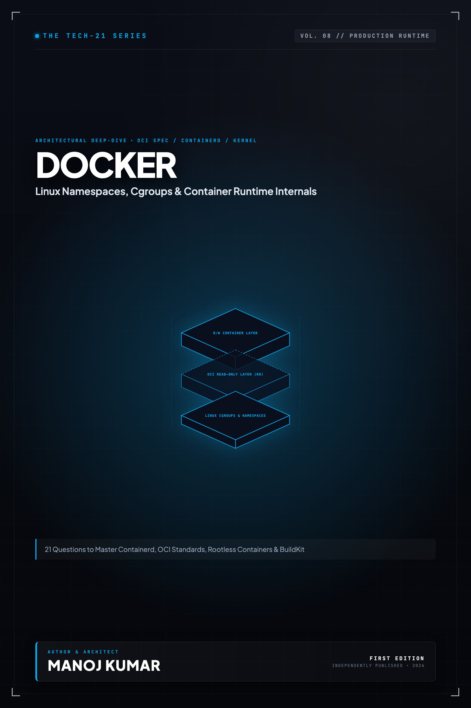

# Tech-21: Docker & Container Runtimes

> **21 Core Concepts to Master Linux Containers, Containerd, BuildKit, and Production Runtimes**  
> *Author: Manoj Kumar* • *Tech-21 Series (Vol. 08)*

  

## 📖 About This Edition

This repository contains the **free public sampler** for **Tech-21: Docker & Container Runtimes**, including the **Preface and Questions 01 through 03** in their entirety. Every chapter follows the strict 5-section Tech-21 mental model framework:

1. **The Core Concept & Intuition** (High-signal problem statement & architecture)
2. **Under the Hood** (Runtime execution mechanics, memory diagrams, and comparison matrices)
3. **Clean Code in Action** (Idiomatic, production-grade implementations)
4. **Common Pitfalls & Interview Traps** (Structured bug-prevention matrices)
5. **60-Second Memory Anchor** (Permanent retention punchlines)

## 📋 Complete 21-Question Syllabus

| Chapter | Status | Title |
| :--- | :---: | :--- |
| **[00-preface](./00-preface.md)** | 🟢 **Free Sampler** | [Preface](./00-preface.md) |
| **[01-linux-namespaces-and-process-isolation](./01-linux-namespaces-and-process-isolation.md)** | 🟢 **Free Sampler** | [1. How Do Linux Namespaces Create Isolated Process Environments in Containers?](./01-linux-namespaces-and-process-isolation.md) |
| **[02-cgroups-v2-and-resource-management](./02-cgroups-v2-and-resource-management.md)** | 🟢 **Free Sampler** | [2. How Do Control Groups (cgroups v2) Enforce CPU, Memory, and I/O Resource Limits?](./02-cgroups-v2-and-resource-management.md) |
| **[03-overlayfs-and-union-filesystems](./03-overlayfs-and-union-filesystems.md)** | 🟢 **Free Sampler** | [3. How Does OverlayFS and Union Filesystem Layering Compose Container Rootfs?](./03-overlayfs-and-union-filesystems.md) |
| **04-oci-standards-and-runc** | 🔒 *Full Edition* | 4. What Are OCI Standards, Runtime Bundles, and How Does runc Spawn Containers? |
| **05-containerd-and-cri-o** | 🔒 *Full Edition* | 5. How Do containerd and CRI-O Implement the Container Runtime Interface (CRI)? |
| **06-dockerfile-production-engineering** | 🔒 *Full Edition* | 6. How Do Multi-Stage Builds and Dockerfile Engineering Optimize Production Images? |
| **07-distroless-alpine-and-minimal-bases** | 🔒 *Full Edition* | 7. Why and When Should You Choose Distroless, Alpine, or Minimal Base Images? |
| **08-container-lifecycle-and-signal-handling** | 🔒 *Full Edition* | 8. How Does the Container Lifecycle Manage PID 1, Init Processes, and Unix Signals? |
| **09-docker-networking-bridge-and-host** | 🔒 *Full Edition* | 9. How Do Bridge, Host, and Port-Mapping Networks Route Traffic in Docker? |
| **10-docker-networking-macvlan-and-overlay** | 🔒 *Full Edition* | 10. How Do Macvlan, IPVlan, and Overlay Drivers Handle Advanced Container Networking? |
| **11-storage-volumes-and-bind-mounts** | 🔒 *Full Edition* | 11. How Do Storage Volumes, Bind Mounts, and tmpfs Mounts Manage Persistent State? |
| **12-docker-compose-for-local-development** | 🔒 *Full Edition* | 12. How Does Docker Compose Orchestrate Multi-Container Topologies for Local Development? |
| **13-docker-buildkit-and-multi-arch-builds** | 🔒 *Full Edition* | 13. How Does Docker BuildKit Execute Concurrent Builds and Multi-Architecture Images? |
| **14-container-security-and-non-root-execution** | 🔒 *Full Edition* | 14. Why Is Non-Root Execution Crucial for Hardening Container Security Boundaries? |
| **15-linux-capabilities-and-seccomp** | 🔒 *Full Edition* | 15. How Do Linux Capabilities, Seccomp Profiles, and AppArmor Restrict Kernel Privileges? |
| **16-rootless-docker-and-podman** | 🔒 *Full Edition* | 16. How Do Rootless Docker and Podman Execute Daemonless Containers Safely? |
| **17-image-vulnerability-scanning-and-trivy** | 🔒 *Full Edition* | 17. How Do Static Vulnerability Scanners, SBOMs, and Trivy Secure Supply Chains? |
| **18-image-signing-and-provenance-cosign** | 🔒 *Full Edition* | 18. How Does Cryptographic Image Signing with Sigstore Cosign Guarantee Image Provenance? |
| **19-container-logging-and-log-drivers** | 🔒 *Full Edition* | 19. How Does Container Logging Architecture and Non-Blocking Log Drivers Prevent App Freezes? |
| **20-container-healthchecks-and-restart-policies** | 🔒 *Full Edition* | 20. How Do Healthchecks and Restart Policies Keep Containerized Services Available? |
| **21-advanced-debugging-and-troubleshooting** | 🔒 *Full Edition* | 21. How Do You Troubleshoot and Debug Crashing or Unresponsive Containers in Production? |
| **22-appendix-docker-cli-cheatsheet** | 🔒 *Full Edition* | Appendix A: Docker & Container CLI Cheatsheet |
| **23-appendix-production-dockerfile-patterns** | 🔒 *Full Edition* | Appendix B: Production Dockerfile Reference Patterns |

---

## 🚀 How to Get the Full Edition

The complete edition unlocks **all 21 in-depth questions** and **both architectural reference appendices** (over 100+ pages of high-signal diagrams, memory layouts, and interview pitfall tables):

- 📱 **Kindle Edition**: Available on [Amazon Kindle](https://amazon.com)
- 📄 **Digital DRM-Free Bundle (EPUB + PDF)**: Instant download with high-res interior graphics
- 📦 **All-Access Pass**: Access all 15 volumes across the entire Tech-21 series

[← Return to Series Catalog](../../README.md)
