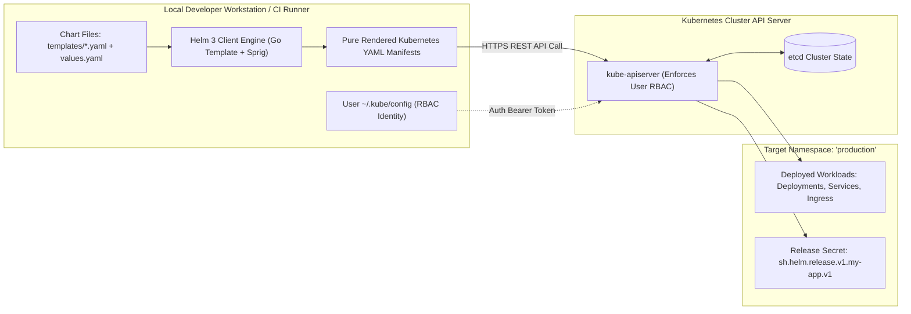

[← Back to Tech-21: Helm & Cloud-Native Packaging Overview](./README.md) | [🏠 Series Catalog](../../README.md)

---

# 1. How Does Helm 3 Architecture Eliminate Tiller and Interact with the Kubernetes API? 

> *"Helm 2 introduced Tiller—an in-cluster pod with cluster-admin privileges that bypassed Kubernetes RBAC and created massive security vulnerabilities. Helm 3 completely removed Tiller, transforming Helm into a client-only, RBAC-compliant, decentralized package manager."*

---

## 1. The Core Concept & Intuition

### The Tiller Security Vulnerability in Helm 2
In Helm 2, the architecture relied on a server-side component called **Tiller**:
- Tiller ran inside the cluster as a pod in `kube-system` with **`cluster-admin`** superuser privileges.
- When an unprivileged developer executed `helm install`, the Helm CLI talked to Tiller via gRPC.
- Tiller then applied the manifests to Kubernetes as `cluster-admin`.
- **The Fatal Flaw**: Any user with basic namespace access could talk to Tiller and deploy privileged pods, completely bypassing Kubernetes RBAC security policies!

### The Helm 3 Paradigm: Client-Only Architecture
Helm 3 redesigned the entire toolchain:
1. **Zero Server-Side Pods (No Tiller)**: Helm 3 is a pure client-side binary. It authenticates directly against `kube-apiserver` using the developer's local `kubeconfig` and enforces standard Kubernetes RBAC.
2. **Release State Stored in Secrets**: Release metadata is stored directly in standard Kubernetes **Secrets** within the release's target namespace (`sh.helm.release.v1.<release-name>.v1`).
3. **3-Way Strategic Merge Patch**: Replaces Helm 2's two-way diff with a three-way diff (Old Manifest vs Live Cluster State vs New Manifest), preventing Helm from overwriting live cluster changes made by controllers or GitOps tools.


---

## 2. Under the Hood: Es Helm 3 Architecture Eliminate

### Helm 3 Rendering & Execution Pipeline
When an engineer runs `helm install my-app ./my-chart`:
1. **Local Chart & Values Compilation**: The Helm CLI reads `Chart.yaml`, `templates/*.yaml`, and `values.yaml` in memory on the local machine.
2. **Go Template Engine Execution**: Helm passes the values into the Go template renderer along with the **Sprig function library**, generating pure Kubernetes YAML manifests.
3. **Schema Validation**: Evaluates user inputs against `values.schema.json`.
4. **Direct API Dispatch**: Helm sends the rendered manifests directly to `kube-apiserver` over HTTPS using the user's active RBAC credentials.
5. **State Persistence**: Upon successful creation, Helm writes the base64-encoded, gzipped release record into a Secret in the target namespace.



### 3-Way Strategic Merge Patch Mechanics
In Helm 3, executing `helm upgrade` computes a three-way diff:
- **State A (Original Chart Manifest)**: What was in the chart during the previous release.
- **State B (Live Cluster State)**: The current live object in etcd (which may include live changes, such as an HPA scaling replicas or an admission webhook injecting sidecars).
- **State C (New Chart Manifest)**: What is declared in the new chart.
- **Outcome**: Helm applies the new changes from $C$ while **preserving non-conflicting live modifications** from $B$.

---

## 3. Clean Code in Action

### A. Production Configuration and Implementation
### C. Production Configuration and Implementation
### C. Basic Helm 3 Release Lifecycle Commands
```bash
# 1. Add an official Helm repository
helm repo add bitnami https://charts.bitnami.com/bitnami
helm repo update

# 2. Install a chart into a dedicated namespace with custom values
helm install production-db bitnami/postgresql \
  --namespace database \
  --create-namespace \
  --set auth.postgresPassword="secure_password" \
  --set primary.persistence.size="50Gi"

# 3. View active releases in the cluster
helm list -n database

# 4. Inspect the underlying Kubernetes Secret holding the release state
kubectl get secret -n database -l owner=helm
# Output:
# NAME                                TYPE                DATA   AGE
# sh.helm.release.v1.production-db.v1 helm.sh/release.v1 1      5m
```

### 2. Decoding a Helm Release Secret
The release state is stored as a gzipped, base64-encoded JSON payload inside the Kubernetes secret:

### B. Advanced Production Pattern
```bash
# Extract and decode the raw release state from etcd
kubectl get secret sh.helm.release.v1.production-db.v1 -n database -o jsonpath='{.data.release}' | \
  base64 -d | base64 -d | gzip -d | jq .info
```

---

## 4. Common Pitfalls & Interview Traps


| Trap / Misconception | Reality |
| :--- | :--- |
| **"Manual Manifest Edits Overwritten on Helm Upgrade"** | Using `kubectl edit deployment my-app` to change environment variables directly on a live cluster managed by Helm. The next time CI/CD runs `helm upgrade`, Helm's three-way merge detects that the environment variable was removed in the new chart, reverting your manual hotfix. Never edit live cluster objects manually. All changes must be committed to `values.yaml` in Git. |
| **"Release Name Collisions Across Namespaces"** | Assuming release names are globally unique cluster-wide. **Why It Works (and Confuses)**: In Helm 3, release names are **scoped to individual namespaces**. You can have a release named `redis` in namespace `dev` and another release named `redis` in namespace `prod` without collision. |

---


## 5. 60-Second Memory Anchor


> **"Tiller is Dead: Helm 3 uses standard user `kubeconfig` credentials. Release State in Secrets: `sh.helm.release.v1.<name>.v<revision>`."**

---

[← Preface](./00-preface.md) | **Next**: [Question 02 →](./02-chart-structure-and-chart-yaml.md)
