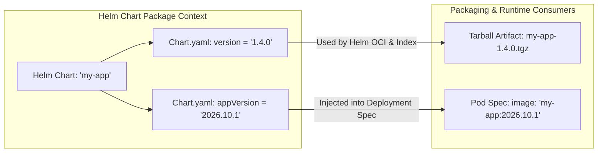

[← Back to Tech-21: Helm & Cloud-Native Packaging Overview](./README.md) | [🏠 Series Catalog](../../README.md)

---

# 2. What Is the Anatomical Structure of a Helm Chart and How Does `Chart.yaml` Function? 

> *"A Helm Chart is not just a loose directory of YAML templates; it is a strictly structured package format governed by SemVer 2.0 versioning, application metadata, and dependency declarations defined in Chart.yaml."*

---

## 1. The Core Concept & Intuition

### The Standard Chart Directory Layout
When you run `helm create my-chart`, Helm generates a standardized directory tree:
- **`Chart.yaml`**: The top-level package manifest (name, version, appVersion, description, dependencies).
- **`values.yaml`**: The default configuration values for parameter injection.
- **`templates/`**: Directory containing parameterized Kubernetes manifest templates (`deployment.yaml`, `service.yaml`, `ingress.yaml`).
- **`templates/_helpers.tpl`**: Reusable Go template helper functions and named blocks.
- **`templates/NOTES.txt`**: Plaintext instructions displayed to the user immediately after `helm install`.
- **`charts/`**: Directory holding unpacked subcharts (managed via `Chart.lock`).
- **`crds/`**: Directory holding Custom Resource Definitions installed before any template execution.

---

## 2. Under the Hood: Anatomical Directory Architecture, Chart Contracts, and SemVer 2.0

### SemVer 2.0: `version` vs `appVersion`
A common source of confusion in `Chart.yaml` is the distinction between `version` and `appVersion`:
- **`version` (Chart Package Version)**: Strictly follows **Semantic Versioning 2.0** (`MAJOR.MINOR.PATCH`). Incremented whenever the *Helm templates or values* change.
- **`appVersion` (Underlying Software Version)**: Arbitrary string representing the actual container application version (e.g., `v2.4.1` or `2026.10`).



### Chart Classification & Architectural Roles

| Chart Characteristic | Application Chart (`type: application`) | Library Chart (`type: library`) | Umbrella / Metachart |
| :--- | :--- | :--- | :--- |
| **Deployability** | Directly installable via `helm install` | Non-installable; rejected by CLI if deployed standalone | Directly installable via `helm install` |
| **Primary Artifact** | Concrete Kubernetes manifests (`deployment.yaml`, etc.) | Reusable Go template definitions (`_helpers.tpl`) | Dependency coordinator (`Chart.yaml` dependencies) |
| **`templates/` Contents** | Production runtime workload templates | Only helper files (prefixed with `_` or macros) | Usually empty or minimal routing/ingress glue |
| **Version Lifecycle** | Tracks application packaging updates | Follows shared enterprise API standards | Tracks composite stack release milestones |
| **Use Case** | Single microservice, database, ingress controller | Centralized enterprise compliance baselines | Complete enterprise environments (e-commerce suite) |

---

## 3. Clean Code in Action

### A. Production-Grade `Chart.yaml` (apiVersion: v2)
```yaml
apiVersion: v2
name: enterprise-order-service
description: >-
  High-throughput order service with PostgreSQL & Kafka integration
type: application

# 1. Chart SemVer version (Must be incremented on EVERY
# template/values edit!)
version: 1.4.2

# 2. Application software version (Injected into container image tag)
appVersion: "2.4.0"

kubeVersion: ">=1.26.0-0"
home: https://enterprise.com/order-service
sources:
  - https://github.com/enterprise-org/order-service

maintainers:
  - name: Platform Engineering Team
    email: platform-eng@enterprise.com

keywords:
  - e-commerce
  - order-processing
  - microservice

# 3. Declarative Subchart Dependencies
dependencies:
  - name: postgresql
    version: "15.5.1"
    repository: "https://charts.bitnami.com/bitnami"
    condition: postgresql.enabled
    tags:
      - database
```

### B. Dynamic Context-Aware Post-Install Instructions (`templates/NOTES.txt`)
```text
==================================================================
🎉 {{ .Chart.Name }} (v{{ .Chart.Version }}) successfully deployed!
==================================================================

Release Name: {{ .Release.Name }}
Namespace:    {{ .Release.Namespace }}

To access the Order Service API:

{{- if .Values.ingress.enabled }}
  Endpoint: https://{{ (index .Values.ingress.hosts 0).host }}
{{- else if contains "NodePort" .Values.service.type }}
  Export Node IP and Port:
  SVC="{{ include "order.fullname" . }}"
  export NODE_PORT=$(kubectl get svc "$SVC" \
    -n {{ .Release.Namespace }} \
    -o jsonpath="{.spec.ports[0].nodePort}")
  export NODE_IP=$(kubectl get nodes -n {{ .Release.Namespace }} \
    -o jsonpath="{.items[0].status.addresses[0].address}")
  echo http://$NODE_IP:$NODE_PORT
{{- else }}
  Forward local port:
  kubectl port-forward -n {{ .Release.Namespace }} \
    svc/{{ include "order.fullname" . }} 8080:80
  URL: http://localhost:8080
{{- end }}
==================================================================
```

---

## 4. Common Pitfalls & Interview Traps

| Trap / Misconception | Reality |
| :--- | :--- |
| **"Forgetting `Chart.lock` in Git Version Control"** | Defining dependencies in `Chart.yaml`, running `helm dependency build`, and adding `Chart.lock` to `.gitignore`. In CI/CD pipelines, `helm dependency update` resolves floating dependency ranges (e.g., `^15.0.0`), inadvertently pulling a new major or breaking minor subchart release during a production deployment! **Always commit `Chart.lock` to Git** to ensure deterministic, reproducible dependency builds. |
| **"Modifying CRDs in `crds/` Directory During Upgrades"** | Editing a CustomResourceDefinition inside `crds/my-crd.yaml` and running `helm upgrade`, expecting the CRD schema in the cluster to update. By design, **Helm NEVER upgrades or deletes CRDs in the `crds/` folder** during `helm upgrade`. This design prevents catastrophic accidental deletion of custom resource data. Upgrade CRDs out-of-band using `kubectl apply -f crds/` or manage CRDs via a dedicated CRD Operator. |

---

## 5. 60-Second Memory Anchor

> **"Commit `Chart.lock`: Guarantees reproducible builds in CI/CD. `crds/` Safety Guarantee: Helm never mutates CRDs during upgrades."**

---

[← Question 01](./01-helm-architecture-and-helm3-evolution.md) | **Next**: [Question 03 →](./03-go-template-engine-and-pipelines.md)
