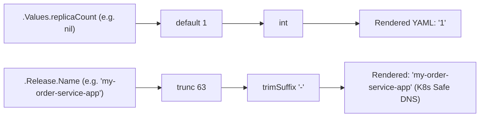

[← Back to Tech-21: Helm & Cloud-Native Packaging Overview](./README.md) | [🏠 Series Catalog](../../README.md)

---

# 3. How Does the Go Template Engine Process Pipelines, Variables, and Whitespace Control? 

> *"Helm manifests are not static YAML files; they are Go text templates parsed line-by-line by the Go template engine. Mastering the dot (.) scope, pipeline chaining (|), and whitespace trimming modifiers ({{- -}}) is what separates novice YAML hackers from expert Helm engineers."*

---

## 1. The Core Concept & Intuition

### How Helm Templating Works
When Helm evaluates a template file in `templates/`, it executes the standard Go `text/template` engine:
- Any text wrapped inside **`{{ ... }}`** delimiters is evaluated as executable template code.
- Anything outside the delimiters is treated as literal YAML text.

### The Critical Concept: The Dot (`.`) Scope
In Go templates, the **dot (`.`)** represents the **Current Context**:
- At the root level of a template, `.` represents the global execution context containing `.Values`, `.Release`, `.Chart`, and `.Capabilities`.
- If you enter a loop (`range`) or a context block (`with`), **the value of `.` changes** to represent the inner item!
- If you need to access global values from inside an inner loop, you must use the **`$` (Root Context)** variable.


---

## 2. Under the Hood: Es The Go Template Engine

### Pipelines (`|`) & The Sprig Function Library
Helm integrates over **100+ helper functions** from the **Sprig Template Library**. Pipelines allow chaining the output of one function directly into the input of the next using the UNIX pipe operator (`|`):

$$\text{value} \mid \text{function1} \mid \text{function2}$$



### Whitespace Control: The `{{-` and `-}}` Modifiers
YAML is strictly indentation-sensitive. A single rogue newline or extra space causes `YAML parse error: error converting YAML to JSON`:
- **`{{`**: Normal opening delimiter. Preserves all preceding spaces and newlines.
- **`{{-` (Left Trim)**: Strips **all whitespace, tabs, and newlines to the left** of the tag until non-whitespace text is reached.
- **`-}}` (Right Trim)**: Strips **all whitespace, tabs, and newlines to the right** of the tag.

```
Template Code:
apiVersion: v1
kind: ConfigMap
metadata:
  name: test-cm
data:
  {{- if .Values.enabled }}
  status: "active"
  {{- end }}

Rendered Output (Zero blank lines!):
apiVersion: v1
kind: ConfigMap
metadata:
  name: test-cm
data:
  status: "active"
```

---

## 3. Clean Code in Action

### A. Production Configuration and Implementation
### C. Production Configuration and Implementation
### C. The `toYaml` and `nindent` Power Combo
The most common Helm templating task is injecting complex nested dictionaries (such as `resources`, `nodeSelector`, or `affinity`) from `values.yaml` into Kubernetes YAML.
- **`toYaml`**: Serializes a Go map/struct into YAML text.
- **`nindent <N>`**: Adds a newline and indents every line by exactly $N$ spaces.

```yaml
# templates/deployment.yaml
apiVersion: apps/v1
kind: Deployment
metadata:
  name: {{ .Release.Name }}-api
spec:
  template:
    spec:
      containers:
        - name: app
          image: "{{ .Values.image.repository }}:{{ .Values.image.tag | default .Chart.AppVersion }}"
          {{- with .Values.resources }}
          resources:
            {{- toYaml . | nindent 12 }}
          {{- end }}
          {{- with .Values.nodeSelector }}
          nodeSelector:
            {{- toYaml . | nindent 8 }}
          {{- end }}
```

### 2. Corresponding `values.yaml`
### B. Advanced Production Pattern
```yaml
image:
  repository: nginx
  tag: "1.25.3"

resources:
  requests:
    cpu: 100m
    memory: 128Mi
  limits:
    cpu: 500m
    memory: 512Mi

nodeSelector:
  disktype: ssd
  topology.kubernetes.io/zone: us-east-1a
```

### 3. Generated Clean Output
```yaml
apiVersion: apps/v1
kind: Deployment
metadata:
  name: my-release-api
spec:
  template:
    spec:
      containers:
        - name: app
          image: "nginx:1.25.3"
          resources:
            limits:
              cpu: 500m
              memory: 512Mi
            requests:
              cpu: 100m
              memory: 128Mi
          nodeSelector:
            disktype: ssd
            topology.kubernetes.io/zone: us-east-1a
```

---

## 4. Common Pitfalls & Interview Traps


| Trap / Misconception | Reality |
| :--- | :--- |
| **"Using `indent` Instead of `nindent` with `toYaml`"** | ```yaml resources: {{- toYaml .Values.resources \| indent 4 }} # BUG! ``` `indent 4` indents every line *except the first line*. The first line appears with 2 spaces instead of 4, producing invalid YAML syntax. **Always use `nindent`** (`toYaml . \| nindent 4`). `nindent` explicitly inserts a newline first and then applies uniform indentation to all lines. |
| **"Losing Root Scope Inside `range` or `with`"** | ```yaml {{- with .Values.securityContext }} securityContext: runAsUser: {{ .runAsUser }} # BUG: .Release.Name is undefined because '.' is currently .Values.securityContext! runAsGroup: {{ .Release.Name }} {{- end }} ``` Template engine panics with `nil pointer evaluating interface {}`. Use the global **`$`** root anchor: `{{ $.Release.Name }}`. |

---


## 5. 60-Second Memory Anchor


> **"Always use `nindent`: Prevents first-line YAML indentation corruption. Root Context Anchor `$`: Access `.Release` or `.Values` from inside nested loops."**

---

[← Question 02](./02-chart-structure-and-chart-yaml.md)

> ### 🎓 Looking for Questions 04 through 21 & Deep-Dive Appendices?
> You have reached the end of the free sampler for **Tech-21: Helm & Cloud-Native Packaging**!
> 
> The full release contains **18 additional core interview chapters** plus **2 architectural reference appendices**, memory layouts, complete edge-case tables, and production patterns.
> 
> 📖 **[Get the Full Edition (Kindle / EPUB / PDF) →](./README.md#how-to-get-the-full-edition)**

