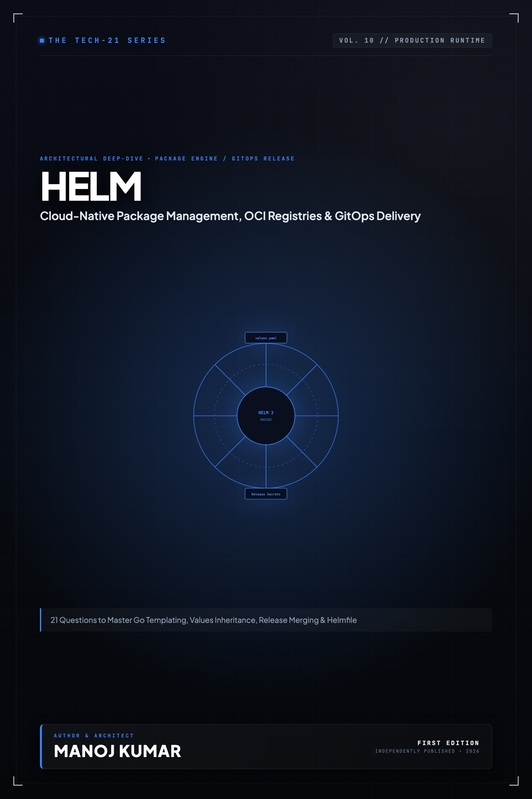

# Tech-21: Helm & Cloud-Native Packaging

> **21 Core Concepts to Master Kubernetes Package Management, Templating, OCI Registries & GitOps**  
> *Author: Manoj Kumar* • *Tech-21 Series (Vol. 10)*

  

## 📖 About This Edition

This repository contains the **free public sampler** for **Tech-21: Helm & Cloud-Native Packaging**, including the **Preface and Questions 01 through 03** in their entirety. Every chapter follows the strict 5-section Tech-21 mental model framework:

1. **The Core Concept & Intuition** (High-signal problem statement & architecture)
2. **Under the Hood** (Runtime execution mechanics, memory diagrams, and comparison matrices)
3. **Clean Code in Action** (Idiomatic, production-grade implementations)
4. **Common Pitfalls & Interview Traps** (Structured bug-prevention matrices)
5. **60-Second Memory Anchor** (Permanent retention punchlines)

## 📋 Complete 21-Question Syllabus

| Chapter | Status | Title |
| :--- | :---: | :--- |
| **[00-preface](./00-preface.md)** | 🟢 **Free Sampler** | [Preface](./00-preface.md) |
| **[01-helm-architecture-and-helm3-evolution](./01-helm-architecture-and-helm3-evolution.md)** | 🟢 **Free Sampler** | [1. How Does Helm 3 Architecture Eliminate Tiller and Interact with the Kubernetes API?](./01-helm-architecture-and-helm3-evolution.md) |
| **[02-chart-structure-and-chart-yaml](./02-chart-structure-and-chart-yaml.md)** | 🟢 **Free Sampler** | [2. What Is the Anatomical Structure of a Helm Chart and How Does `Chart.yaml` Function?](./02-chart-structure-and-chart-yaml.md) |
| **[03-go-template-engine-and-pipelines](./03-go-template-engine-and-pipelines.md)** | 🟢 **Free Sampler** | [3. How Does the Go Template Engine Process Pipelines, Variables, and Whitespace Control?](./03-go-template-engine-and-pipelines.md) |
| **04-values-hierarchy-and-merging-strategies** | 🔒 *Full Edition* | 4. How Does the Values Hierarchy Resolve and Merge Configurations Across Environments? |
| **05-built-in-objects-and-functions** | 🔒 *Full Edition* | 5. What Built-in Objects and Sprig Functions Power Dynamic Helm Manifest Templating? |
| **06-flow-control-and-loops** | 🔒 *Full Edition* | 6. How Does Flow Control with `if`, `with`, and `range` Loops Structure Dynamic Helm Templates? |
| **07-named-templates-and-helper-functions** | 🔒 *Full Edition* | 7. How Do Named Templates and `_helpers.tpl` Partial Definitions Promote Manifest Reuse? |
| **08-subcharts-and-chart-dependencies** | 🔒 *Full Edition* | 8. How Do Subcharts, Chart Dependencies, and Global Values Coordinate Multi-Tier Deployments? |
| **09-library-charts-and-code-reuse** | 🔒 *Full Edition* | 9. How Do Library Charts Abstract Common Boilerplate and Enforce Enterprise Standardization? |
| **10-helm-chart-hooks-and-lifecycle** | 🔒 *Full Edition* | 10. How Do Helm Chart Hooks Control Release Lifecycles and Database Migrations? |
| **11-release-management-and-state-secrets** | 🔒 *Full Edition* | 11. How Does Helm Manage Release Revisions, Cluster State Secrets, and Automatic Rollbacks? |
| **12-chart-testing-and-helm-test** | 🔒 *Full Edition* | 12. How Do Post-Install Smoke Tests and `helm test` Validate Pod Health in Clusters? |
| **13-dry-run-template-debugging-and-linting** | 🔒 *Full Edition* | 13. How Do `helm template`, `--dry-run`, and `helm lint` Debug Broken Kubernetes Manifests? |
| **14-values-schema-validation-with-json-schema** | 🔒 *Full Edition* | 14. How Does JSON Schema Validation (`values.schema.json`) Enforce Strict Type Safety on User Inputs? |
| **15-oci-chart-registries-and-packaging** | 🔒 *Full Edition* | 15. How Do OCI Registries Package, Sign, and Distribute Modern Helm Chart Artifacts? |
| **16-chart-security-and-helm-secrets** | 🔒 *Full Edition* | 16. How Do `helm-secrets` and Mozilla SOPS Protect Sensitive Configuration in GitOps Repositories? |
| **17-helm-chart-testing-with-ct-and-unittest** | 🔒 *Full Edition* | 17. How Do the Chart Testing CLI (`ct`) and `helm-unittest` Automate CI/CD Validation? |
| **18-helmfile-multi-environment-orchestration** | 🔒 *Full Edition* | 18. How Does Helmfile Orchestrate Declarative Multi-Environment Deployments Across Clusters? |
| **19-gitops-integration-argocd-and-flux-helm** | 🔒 *Full Edition* | 19. How Do ArgoCD and Flux Integrate with Helm for Continuous GitOps Delivery? |
| **20-helm-plugin-ecosystem** | 🔒 *Full Edition* | 20. How Does the Helm Plugin Architecture Extend the CLI for Enterprise Workflows? |
| **21-advanced-migration-and-drift-management** | 🔒 *Full Edition* | 21. How Do You Detect Cluster Drift and Execute Safe Helm 2-to-3 and Three-Way Merge Upgrades? |
| **22-appendix-helm-cli-and-sprig-cheatsheet** | 🔒 *Full Edition* | Appendix A: Helm CLI & Sprig Template Reference |
| **23-appendix-production-helm-chart-blueprint** | 🔒 *Full Edition* | Appendix B: Production Helm Chart Reference Architecture |

---

## 🚀 How to Get the Full Edition

The complete edition unlocks **all 21 in-depth questions** and **both architectural reference appendices** (over 100+ pages of high-signal diagrams, memory layouts, and interview pitfall tables):

- 📱 **Kindle Edition**: Available on [Amazon Kindle](https://amazon.com)
- 📄 **Digital DRM-Free Bundle (EPUB + PDF)**: Instant download with high-res interior graphics
- 📦 **All-Access Pass**: Access all 15 volumes across the entire Tech-21 series

[← Return to Series Catalog](../../README.md)
