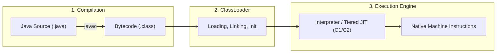

[← Back to Tech-21: Java Core & Modern Concepts Overview](./README.md) | [🏠 Series Catalog](../../README.md)

---

# 1. How Does JVM Architecture, Bytecode Execution, and the JIT Compiler Pipeline Work? 

## 1. The Core Concept & Intuition

Java’s foundational promise has always been **"Write Once, Run Anywhere" (WORA)**. This portability is achieved not by compiling Java source code (`.java`) directly into platform-specific machine code, but by compiling it into an intermediate representation called **Java Bytecode** (`.class`).

The **Java Virtual Machine (JVM)** is the abstract computing machine that executes this bytecode. While bytecode is platform-independent, the JVM itself is platform-dependent—customized for macOS, Linux, Windows, ARM, or x86 architectures.

---

## 2. Under the Hood: The JVM Runtime Subsystems

The JVM comprises three primary subsystems:



| Execution Tier / Subsystem | Primary Mechanism | Optimization Strategy | Latency vs Throughput Profile |
| :--- | :--- | :--- | :--- |
| **Interpreter** | Instruction-by-instruction execution | Zero startup pause; immediate dispatch | Low startup time, lowest steady-state throughput |
| **C1 Compiler (Client)** | Basic JIT compilation with profiling counters | Quick method compilation, simple inlining | Fast warmup, moderate steady-state performance |
| **C2 Compiler (Server)** | Aggressive optimizing JIT compiler | Escape analysis, loop unrolling, monomorphic inlining | Slower compilation warmup, maximum peak throughput |
| **Garbage Collector** | Automated tracing and memory reclamation | Generational copying, concurrent marking | Minimizes STW pauses while maximizing heap utilization |

---


| Execution Tier / Subsystem | Primary Mechanism | Optimization Strategy | Latency vs Throughput Profile |
| :--- | :--- | :--- | :--- |
| **Interpreter** | Instruction-by-instruction execution | Zero startup pause; immediate dispatch | Low startup time, lowest steady-state throughput |
| **C1 Compiler (Client)** | Basic JIT compilation with profiling counters | Quick method compilation, simple inlining | Fast warmup, moderate steady-state performance |
| **C2 Compiler (Server)** | Aggressive optimizing JIT compiler | Escape analysis, loop unrolling, monomorphic inlining | Slower compilation warmup, maximum peak throughput |
| **Garbage Collector** | Automated tracing and memory reclamation | Generational copying, concurrent marking | Minimizes STW pauses while maximizing heap utilization |

---


### A. ClassLoader Subsystem
Loads, links, and initializes `.class` files dynamically at runtime using a hierarchical delegation model:
1. **Loading**: Reads binary bytecode data from disk or network into memory.
2. **Linking**:
   - *Verification*: Ensures bytecode complies with JVM safety and security constraints.
   - *Preparation*: Allocates memory for `static` fields and initializes them to default values.
   - *Resolution*: Replaces symbolic references in the constant pool with direct memory references.
3. **Initialization**: Executes static initializers (`static { ... }`) and assigns initial static values.

### B. Runtime Data Areas (Memory Areas)
1. **Method Area / Metaspace**: Stores class metadata, runtime constant pool, and static variables.
2. **Heap Memory**: Shared memory pool where all class instances and arrays are allocated.
3. **Java Thread Stacks**: Thread-private memory containing stack frames for method invocations (local variables, operand stack).
4. **Program Counter (PC) Registers**: Tracks the current instruction address for each active thread.
5. **Native Method Stacks**: Supports execution of native C/C++ libraries via JNI (Java Native Interface).

### C. Execution Engine
1. **Interpreter**: Reads and executes bytecode instructions sequentially.
2. **Just-In-Time (JIT) Compiler**:
   - Identifies "hot spots" (frequently executed code blocks or loops).
   - **C1 (Client Compiler)**: Performs quick compilation with basic optimizations.
   - **C2 (Server Compiler)**: Performs deep, aggressive optimizations (method inlining, loop unrolling, escape analysis, dead code elimination) to emit ultra-fast native machine code.
3. **Garbage Collector (GC)**: Reclaims unreferenced heap memory automatically.

---

## 3. Clean Code in Action

### A. Idiomatic Mathematical Calculation in Java
Understanding what `javac` generates under the hood demystifies language behavior:

```java
public class CalculationDemo {
    public static int compute(int a, int b) {
        int sum = a + b;
        return sum * 2;
    }
}
```

### B. Disassembled Bytecode Analysis via javap
Disassembling the class file using `javap -c CalculationDemo`:

```text
public static int compute(int, int);
  Code:
     0: iload_0          // Push parameter 0 (a) onto operand stack
     1: iload_1          // Push parameter 1 (b) onto operand stack
     2: iadd             // Pop a and b, add them, push result
     // Pop result and store into local variable 2 (sum)
     3: istore_2
     4: iload_2          // Push sum onto operand stack
     5: iconst_2         // Push integer constant 2 onto operand stack
     6: imul             // Pop sum and 2, multiply them, push result
     7: ireturn          // Return integer at top of stack
```

---

## 4. Common Pitfalls & Interview Traps

| Trap / Misconception | Reality |
| :--- | :--- |
| **"Java is strictly an interpreted language."** | Java is **both compiled and interpreted**. Source is compiled to bytecode, then executed via an interpreter and adaptive JIT compilers (Tiered Compilation). |
| **"JDK, JRE, and JVM are interchangeable terms."** | **JVM** executes bytecode. **JRE** = JVM + standard runtime libraries. **JDK** = JRE + developer tools (`javac`, `javap`, `jconsole`, `jcmd`). |
| **"Metaspace is stored on the Java Heap."** | Since Java 8, PermGen was replaced by **Metaspace**, which resides in **native OS memory**, bounded only by available system RAM or `-XX:MaxMetaspaceSize`. |

---

## 5. 60-Second Memory Anchor

> **"`javac` translates human Java into platform-agnostic bytecode. The JVM loads it via the ClassLoader, stores objects in the Heap, executes frames on the Thread Stack, and uses the JIT compiler to turn hot loops into blazing native machine code."**

---

[← Preface](./00-preface.md) | **Next**: [Question 02 →](./02-primitives-objects-and-autoboxing.md)
