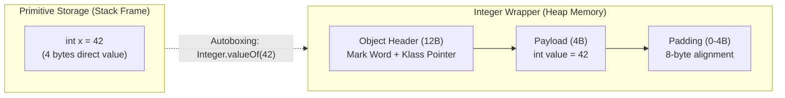

[← Back to Tech-21: Java Core & Modern Concepts Overview](./README.md) | [🏠 Series Catalog](../../README.md)

---

# 2. How Do Primitive Types and Reference Types Differ, and What Are Autoboxing Traps? 

## 1. The Core Concept & Intuition

Java is not a pure object-oriented language because it retains **8 primitive data types**: `byte`, `short`, `int`, `long`, `float`, `double`, `boolean`, and `char`.

Primitives store raw binary values directly on the stack (or inside containing objects on the heap) without object header overhead. To integrate primitives into Java’s object-based Collections framework (`List`, `Map`, `Set`), Java provides corresponding **Wrapper classes** (`Integer`, `Double`, `Boolean`, etc.) and automated conversions called **Autoboxing** and **Unboxing**.

---

## 2. Under the Hood: Memory Footprint & The Wrapper Cache

### A. Memory Overhead: Primitive vs Object
A raw primitive `int` occupies exactly **4 bytes (32 bits)** of memory.

An `Integer` wrapper object on a 64-bit JVM with Compressed Oops occupies **16 or 24 bytes**:
1. **12-byte Object Header** (8-byte Mark Word + 4-byte Klass Word pointer)
2. **4-byte primitive int payload**
3. **Padding** to align to an 8-byte boundary.



### B. The Integer Cache Mechanism
To prevent excessive heap allocations, the JVM caches wrapper instances for frequently used values via `Integer.valueOf(int)`:
- Range: **`-128` to `127`** (configurable via `-XX:AutoBoxCacheMax=<size>`).
- Caches also exist for `Byte`, `Short`, `Long` (`-128` to `127`), `Character` (`0` to `127`), and `Boolean` (`TRUE`, `FALSE`).

---


| Primitive Type | Wrapper Class | Memory Size (Stack) | Object Overhead (Heap) | Default Value |
| :--- | :--- | :--- | :--- | :--- |
| `boolean` | `Boolean` | 1 bit (conceptually) / 1 byte | 16 bytes (12B header + 1B + 3B pad) | `false` |
| `byte` | `Byte` | 1 byte | 16 bytes | `0` |
| `char` | `Character` | 2 bytes (UTF-16) | 16 bytes | `'\u0000'` |
| `short` | `Short` | 2 bytes | 16 bytes | `0` |
| `int` | `Integer` | 4 bytes | 16 bytes | `0` |
| `long` | `Long` | 8 bytes | 24 bytes (12B header + 8B + 4B pad) | `0L` |
| `float` | `Float` | 4 bytes | 16 bytes | `0.0f` |
| `double` | `Double` | 8 bytes | 24 bytes | `0.0d` |

---

## 3. Clean Code in Action

### A. The Integer Cache Equality Trap

```java
public class AutoboxingTest {
    public static void main(String[] args) {
        // Values within [-128, 127] hit the cache
        Integer a = 100;
        Integer b = 100;
        System.out.println(a == b);      // true (same cached instance)
        System.out.println(a.equals(b)); // true

        // Values outside [-128, 127] create distinct heap objects!
        Integer x = 200;
        Integer y = 200;
        System.out.println(x == y);      // FALSE! (Comparing distinct object references)
        System.out.println(x.equals(y)); // TRUE (Comparing logical values)
    }
}
```

### B. Hidden Performance Drag in Loops

```java
// SEVERE PERFORMANCE ANTI-PATTERN:
// Autoboxing occurs 1,000,000 times, creating 1M temporary heap objects!
Long sum = 0L; 
for (long i = 0; i < 1_000_000L; i++) {
    sum += i; // Unboxes 'sum', adds 'i', then autoboxes back to a new 'Long' object
}

// OPTIMIZED: Keep primitive throughout computation
long fastSum = 0L;
for (long i = 0; i < 1_000_000L; i++) {
    fastSum += i;
}
```

---

## 4. Common Pitfalls & Interview Traps

| Trap / Misconception | Reality |
| :--- | :--- |
| **"Implicit unboxing of null wrappers is safe."** | Unboxing a `null` wrapper (e.g. `Integer n = null; int x = n;`) triggers an immediate `NullPointerException` at runtime because the JVM invokes `.intValue()` under the hood. |
| **"Mixed types in ternary operations preserve object references."** | In expressions like `flag ? Integer.valueOf(1) : Double.valueOf(2.0)`, binary numeric promotion forces unboxing and widening to `double`, risking subtle NPEs if either operand is `null`. |
| **"Wrapper caching covers all integer values."** | `Integer.valueOf()` only caches values from `-128` to `127` by default. Comparing wrappers with `==` outside this cache range compares references, resulting in `false`. |

---

## 5. 60-Second Memory Anchor

> **"Primitives are raw fast values (4 bytes). Wrappers are heap objects with headers (16+ bytes). Never use `==` to compare wrappers because numbers outside -128 to 127 bypass the JVM cache, and beware of unboxing `null` into a primitive."**

---

[← Question 01](./01-jvm-architecture-and-execution-model.md) | **Next**: [Question 03 →](./03-equals-and-hashcode-contract.md)
