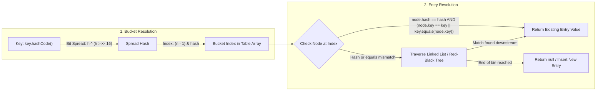

[← Back to Tech-21: Java Core & Modern Concepts Overview](./README.md) | [🏠 Series Catalog](../../README.md)

---

# 3. Why Must `equals()` and `hashCode()` Obey Their Contract, and How Does Hash Mapping Depend on Them? 

## 1. The Core Concept & Intuition

In Java, every class inherits from `java.lang.Object`. By default, `Object.equals()` tests for **reference equality (identity)**—evaluating whether two reference variables point to the exact same address on the heap (`this == obj`).

When designing domain models (such as `Employee`, `OrderKey`, or `AccountId`), applications require **logical equality**—determining whether two physically distinct objects represent equivalent business entities. If you override `equals()`, you **must** also override `hashCode()`. Breaking this contract leads to catastrophic silent bugs in hash-based collections like `HashMap`, `HashSet`, and `ConcurrentHashMap`.

---

## 2. Under the Hood: The Hash-Lookup Pipeline

A `HashMap` or `HashSet` locates entries in $O(1)$ average time through a two-stage evaluation pipeline:



### The Formal `equals`-`hashCode` Contract
1. **Consistency with Equality**: If `a.equals(b) == true`, then `a.hashCode() == b.hashCode()` **MUST** hold true.
2. **Unequal Objects and Collisions**: If `a.equals(b) == false`, `a.hashCode()` does not have to be distinct, though unique hashes reduce bucket collisions.
3. **Temporal Invariance**: The integer returned by `hashCode()` must remain invariant across invocations provided fields evaluated in `equals()` remain unmodified.

### Comparison Matrix: Identity vs. Logical Equality vs. Hash Distribution

| Dimension | Reference Identity (`==`) | Logical Equality (`equals`) | Hash Code (`hashCode`) |
| :--- | :--- | :--- | :--- |
| **Evaluation Level** | Raw memory pointer equality | Business field comparison | 32-bit signed integer hash code |
| **Default in `Object`** | Evaluates memory address (`this == obj`) | Defaults to `this == obj` | Internal native identity hash derived from object address |
| **Overriding Constraint** | Cannot be overloaded in Java | Must be reflexive, symmetric, transitive, consistent | Must yield identical hash for equal objects |
| **Hash Collection Usage** | Fast path check (`node.key == key`) | Deep equality test on bucket collision | Determines array slot index: `(length - 1) & hash` |
| **Failure Consequences** | Inability to evaluate duplicate payloads | Incorrect behavior in `List.contains()` | Silent data loss and lookup failures in `HashMap`/`HashSet` |

---

## 3. Clean Code in Action

### A. Idiomatic Domain Implementation using `java.util.Objects`

```java
import java.util.Objects;

public final class Employee {
    private final long id;
    private final String email;

    public Employee(long id, String email) {
        this.id = id;
        this.email = Objects.requireNonNull(email, "email must not be null");
    }

    public long getId() { return id; }
    public String getEmail() { return email; }

    @Override
    public boolean equals(Object o) {
        // 1. Reflexivity check (fast-path optimization)
        if (this == o) return true;

        // 2. Strict type check (prevents inheritance symmetry violations)
        if (o == null || getClass() != o.getClass()) return false;

        // 3. Cast and compare significant fields
        Employee employee = (Employee) o;
        return id == employee.id && Objects.equals(email, employee.email);
    }

    @Override
    public int hashCode() {
        // Standard JDK hash generation across significant fields
        return Objects.hash(id, email);
    }
}
```

### B. Production Record Idiom and Map Key Verification

```java
import java.util.HashMap;
import java.util.Map;

public class EmployeeLookupDemo {
    // Java 16+ records automatically generate compliant, immutable equals() and hashCode()
    public record DepartmentKey(String deptCode, int regionId) {}

    public static void main(String[] args) {
        Map<DepartmentKey, String> departmentLeads = new HashMap<>();

        DepartmentKey engineering = new DepartmentKey("ENG", 101);
        departmentLeads.put(engineering, "Alice Chen");

        // Lookup with an identical logical instance created separately on heap
        DepartmentKey queryKey = new DepartmentKey("ENG", 101);
        String lead = departmentLeads.get(queryKey);

        System.out.println("Lead found: " + lead); // Prints "Alice Chen"
        assert "Alice Chen".equals(lead) : "Contract satisfied: separate instance resolves entry";
    }
}
```

---

## 4. Common Pitfalls & Interview Traps

| Trap / Misconception | Reality |
| :--- | :--- |
| **"Overriding `equals` without overriding `hashCode` works fine in lists."** | While lists use `equals()`, hash collections (`HashMap`, `HashSet`) fail catastrophically: equal objects land in different buckets, making lookups return `null`. |
| **"Mutating object fields after using it as a HashMap key is harmless."** | Mutating fields that participate in `hashCode()` changes the bucket index; subsequent lookups calculate the new index and cannot find the entry, causing a silent memory leak. |
| **"Using `instanceof` violates the symmetric contract of equals."** | Using `getClass() != o.getClass()` ensures strict type symmetry for subclasses with state, whereas `instanceof` can violate symmetry if subclasses add state without overriding `equals`. |

---

## 5. 60-Second Memory Anchor

> **"If two objects are `equals()`, their `hashCode()` MUST be identical. `hashCode()` finds the correct bucket; `equals()` finds the exact match inside that bucket. Never use mutable fields as Map keys!"**

---

[← Question 02](./02-primitives-objects-and-autoboxing.md)

> ### 🎓 Looking for Questions 04 through 21 & Deep-Dive Appendices?
> You have reached the end of the free sampler for **Tech-21: Java Core & Modern Concepts**!
> 
> The full release contains **18 additional core interview chapters** plus **2 architectural reference appendices**, memory layouts, complete edge-case tables, and production patterns.
> 
> 📖 **[Get the Full Edition (Kindle / EPUB / PDF) →](./README.md#how-to-get-the-full-edition)**

