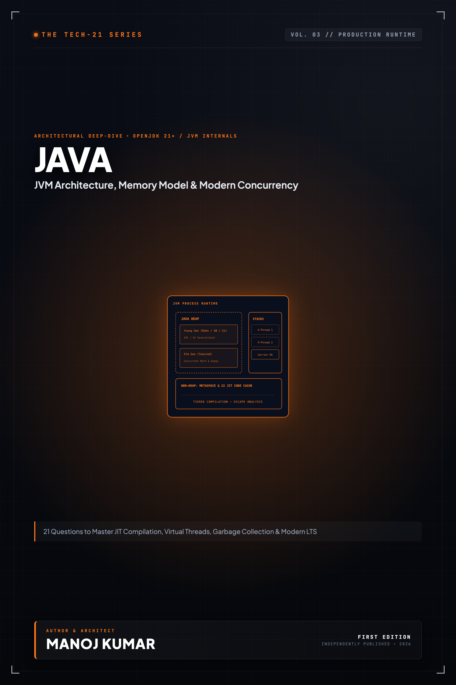

# Tech-21: Java Core & Modern Concepts

> **21 Questions to Refresh, Master, and Ace Core Java**  
> *Author: Manoj Kumar* • *Tech-21 Series (Vol. 03)*

  

## 📖 About This Edition

This repository contains the **free public sampler** for **Tech-21: Java Core & Modern Concepts**, including the **Preface and Questions 01 through 03** in their entirety. Every chapter follows the strict 5-section Tech-21 mental model framework:

1. **The Core Concept & Intuition** (High-signal problem statement & architecture)
2. **Under the Hood** (Runtime execution mechanics, memory diagrams, and comparison matrices)
3. **Clean Code in Action** (Idiomatic, production-grade implementations)
4. **Common Pitfalls & Interview Traps** (Structured bug-prevention matrices)
5. **60-Second Memory Anchor** (Permanent retention punchlines)

## 📋 Complete 21-Question Syllabus

| Chapter | Status | Title |
| :--- | :---: | :--- |
| **[00-preface](./00-preface.md)** | 🟢 **Free Sampler** | [Preface](./00-preface.md) |
| **[01-jvm-architecture-and-execution-model](./01-jvm-architecture-and-execution-model.md)** | 🟢 **Free Sampler** | [1. How Does JVM Architecture, Bytecode Execution, and the JIT Compiler Pipeline Work?](./01-jvm-architecture-and-execution-model.md) |
| **[02-primitives-objects-and-autoboxing](./02-primitives-objects-and-autoboxing.md)** | 🟢 **Free Sampler** | [2. How Do Primitive Types and Reference Types Differ, and What Are Autoboxing Traps?](./02-primitives-objects-and-autoboxing.md) |
| **[03-equals-and-hashcode-contract](./03-equals-and-hashcode-contract.md)** | 🟢 **Free Sampler** | [3. Why Must `equals()` and `hashCode()` Obey Their Contract, and How Does Hash Mapping Depend on Them?](./03-equals-and-hashcode-contract.md) |
| **04-string-immutability-and-string-pool** | 🔒 *Full Edition* | 4. Why Are Strings Immutable, and How Do the String Pool and Compact Strings Optimize Memory? |
| **05-oop-principles-and-method-dispatch** | 🔒 *Full Edition* | 5. How Do OOP Principles, Method Overloading, and Dynamic Method Dispatch Operate at Runtime? |
| **06-interfaces-and-abstract-classes** | 🔒 *Full Edition* | 6. How Do Interfaces, Abstract Classes, and Default Methods Differ in Architectural Design? |
| **07-memory-layout-stack-heap-metaspace** | 🔒 *Full Edition* | 7. How Does the JVM Lay Out Memory Across the Stack, Heap, and Metaspace? |
| **08-garbage-collection-and-memory-management** | 🔒 *Full Edition* | 8. How Do Garbage Collection Mechanics and Modern Collectors (G1, ZGC) Manage the Heap? |
| **09-exception-hierarchy-and-try-with-resources** | 🔒 *Full Edition* | 9. How Does the Exception Hierarchy Work, and Why Use Try-With-Resources for Resource Safety? |
| **10-generics-and-type-erasure** | 🔒 *Full Edition* | 10. How Does Generic Type Erasure Work, and When Should You Apply Wildcard PECS? |
| **11-collections-framework-internals** | 🔒 *Full Edition* | 11. How Does the Java Collections Framework Implement List, Set, and Map Under the Hood? |
| **12-comparable-and-comparator** | 🔒 *Full Edition* | 12. How Do `Comparable` and `Comparator` Differ When Ordering Objects and Collections? |
| **13-threads-executors-and-concurrency** | 🔒 *Full Edition* | 13. How Do Threads, Runnables, and Executor Thread Pools Manage Concurrency in Java? |
| **14-synchronization-locks-and-thread-safety** | 🔒 *Full Edition* | 14. How Do Intrinsic Synchronization, Explicit Locks, and Thread Safety Primitives Work? |
| **15-java-memory-model-volatile-and-atomics** | 🔒 *Full Edition* | 15. How Does the Java Memory Model Enforce Visibility and Ordering with `volatile` and Atomics? |
| **16-lambdas-and-functional-interfaces** | 🔒 *Full Edition* | 16. How Do Lambdas, Functional Interfaces, and Method References Translate to Bytecode? |
| **17-stream-api-and-parallel-streams** | 🔒 *Full Edition* | 17. How Does the Stream API Process Data Pipelines, and What Are Parallel Stream Pitfalls? |
| **18-optional-and-null-safety** | 🔒 *Full Edition* | 18. How Does `Optional` Eliminate Null Pointer Exceptions, and When Should It Be Avoided? |
| **19-records-sealed-classes-pattern-matching** | 🔒 *Full Edition* | 19. How Do Records, Sealed Classes, and Pattern Matching Modernize Java Domain Modeling? |
| **20-virtual-threads-and-project-loom** | 🔒 *Full Edition* | 20. How Do Virtual Threads (Project Loom) Enable High-Throughput Concurrency Without Reactive Complexity? |
| **21-reflection-annotations-and-proxies** | 🔒 *Full Edition* | 21. How Do Reflection, Custom Annotations, and Dynamic Proxies Work Internally? |
| **22-appendix-classloader-hierarchy** | 🔒 *Full Edition* | Appendix A: ClassLoader Hierarchy and Delegation Model |
| **23-appendix-concurrent-collections-cheat-sheet** | 🔒 *Full Edition* | Appendix B: Concurrency and Collections Quick Reference |

---

## 🚀 How to Get the Full Edition

The complete edition unlocks **all 21 in-depth questions** and **both architectural reference appendices** (over 100+ pages of high-signal diagrams, memory layouts, and interview pitfall tables):

- 📱 **Kindle Edition**: Available on [Amazon Kindle](https://amazon.com)
- 📄 **Digital DRM-Free Bundle (EPUB + PDF)**: Instant download with high-res interior graphics
- 📦 **All-Access Pass**: Access all 15 volumes across the entire Tech-21 series

[← Return to Series Catalog](../../README.md)
