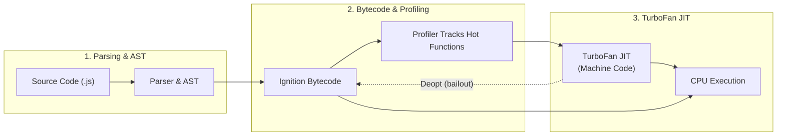

[← Back to Tech-21: JavaScript Core Concepts Overview](./README.md) | [🏠 Series Catalog](../../README.md)

---

# 1. What is JavaScript and How Does the Engine Work? 

## 1. The Core Concept & Intuition

JavaScript is a lightweight, single-threaded, dynamically typed, multi-paradigm programming language with **first-class functions**. Although originally created in 1995 to add simple interactivity to web pages in Netscape Navigator, modern JavaScript runs everywhere: browsers, servers (Node.js, Deno, Bun), databases (MongoDB, CouchDB), desktop apps (Electron), and mobile platforms (React Native).

JavaScript conforms to the **ECMAScript (ECMA-262)** standard. While ECMAScript specifies the language grammar, semantics, and built-in objects, host environments (like the browser or Node.js) provide runtime Web APIs such as `fetch`, `setTimeout`, and DOM manipulation APIs.

---

## 2. Under the Hood: The Engine Architecture

A modern JavaScript engine (such as Google Chrome's **V8**, Firefox's **SpiderMonkey**, or Safari's **JavaScriptCore**) is not purely interpreted. It uses a **Just-In-Time (JIT) Compilation** pipeline:



### Engine Component Roles

| Component | V8 (Chrome/Node) | SpiderMonkey (Firefox) | JavaScriptCore (Safari) |
| :--- | :--- | :--- | :--- |
| **Parser** | Scanner + AST | Parser + AST | Lexer + AST |
| **Interpreter** | Ignition (bytecode) | Baseline Interpreter | LLInt (Low-Level Interpreter) |
| **Optimizing JIT** | TurboFan (machine code) | IonMonkey / Warp | FTL (Faster Than Light) |
| **Garbage Collector** | Orinoco (generational Mark-Sweep/Compact) | Incremental GC | Riptide (concurrent GC) |
| **Memory Model** | Heap + Stack + Hidden Classes | Heap + Stack + Shapes | Heap + Stack + Structures |

1. **Parser & Abstract Syntax Tree (AST)**: Source code is parsed into tokens and translated into an AST.
2. **Interpreter (e.g., Ignition in V8)**: Rapidly generates and executes unoptimized bytecode.
3. **Profiling & JIT Compiler (e.g., TurboFan in V8)**: Frequently executed code ("hot functions") is dynamically compiled into highly optimized machine code.
4. **Memory Heap**: An unstructured memory pool where objects, arrays, and functions are allocated.
5. **Call Stack**: A LIFO (Last-In, First-Out) data structure that keeps track of function execution contexts.
6. **Garbage Collector (e.g., Orinoco/Mark-and-Sweep)**: Automatically reclaims heap memory that is no longer reachable from the root execution contexts.

---

## 3. Clean Code in Action

### A. First-Class Functions
In JavaScript, functions are first-class citizens. They can be stored in variables, passed as arguments, returned from other functions, and even have properties attached to them:

```javascript
// 1. Functions assigned to variables
const greet = function(name) {
  return `Hello, ${name}!`;
};

// 2. Passing functions as arguments (higher-order functions)
function executeWithLog(fn, value) {
  console.log('Executing function...');
  return fn(value);
}
console.log(executeWithLog(greet, 'Manoj')); // "Hello, Manoj!"

// 3. Attaching properties to functions (functions are callable objects)
function counter() {
  counter.invocations = (counter.invocations || 0) + 1;
}
counter();
counter();
console.log(counter.invocations); // 2
```

### B. Dynamic Typing and Runtime Type Checking
JavaScript determines types at runtime. The `typeof` operator reveals the engine's internal type tags:

```javascript
// Dynamic typing: the same variable can hold different types
let value = 42;
console.log(typeof value); // "number"

value = "hello";
console.log(typeof value); // "string"

value = () => {};
console.log(typeof value); // "function"

// Runtime type guard pattern
function processInput(input) {
  if (typeof input === "string") {
    return input.trim().toUpperCase();
  }
  if (typeof input === "number") {
    return input.toFixed(2);
  }
  throw new TypeError(`Unsupported type: ${typeof input}`);
}
```

---

## 4. Common Pitfalls & Interview Traps

| Trap / Misconception | Reality |
| :--- | :--- |
| **"JavaScript is purely an interpreted language."** | Modern engines use **JIT compilation** to compile hot bytecode into machine code at runtime. V8's TurboFan generates optimized machine code comparable to statically compiled languages. |
| **"JavaScript is multithreaded because of `setTimeout` and `async/await`."** | JavaScript has a **single call stack** and runs synchronous JS code on one main thread. Asynchronous operations are offloaded to host environment APIs and resolved via the Event Loop. |
| **"Functions are a primitive data type."** | Functions are specialized objects (`typeof fn === 'function'`, but `fn instanceof Object === true`). They have properties like `.name`, `.length`, and a prototype chain. |
| **"JavaScript and Java are related languages."** | Despite the name (a marketing decision by Netscape in 1995), JavaScript and Java share no architectural lineage. JavaScript is prototype-based and dynamically typed; Java is class-based and statically typed. |

---

## 5. 60-Second Memory Anchor

> **"JavaScript is a single-threaded JIT-compiled language with a single Call Stack, a Memory Heap for objects, and an Event Loop that coordinates asynchronous I/O offloaded to the host environment."**

---

[← Preface](./00-preface.md) | **Next**: [Question 02 →](./02-declaration-and-data-types.md)
