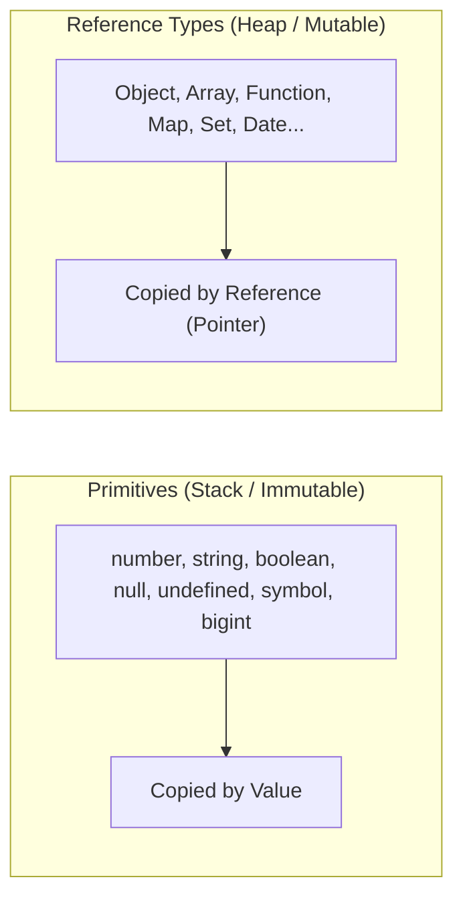

[← Back to Tech-21: JavaScript Core Concepts Overview](./README.md) | [🏠 Series Catalog](../../README.md)

---

# 2. Variable Declarations & JavaScript Data Types 

## 1. The Core Concept & Intuition

JavaScript provides three keywords for variable declarations: `var` (legacy ES5), `let` (ES6+), and `const` (ES6+). Understanding the distinctions between them—specifically **scoping** and the **Temporal Dead Zone (TDZ)**—is critical to preventing subtle bugs and state leaks.

JavaScript is dynamically typed, meaning variable bindings do not have fixed types, but the underlying values do. ECMAScript defines **8 distinct data types**:
- **7 Primitive Types**: `number`, `string`, `boolean`, `null`, `undefined`, `symbol`, `bigint`
- **1 Reference Type**: `object` (which includes plain objects, arrays, functions, dates, sets, maps, and regexes)

---

## 2. Under the Hood: Scoping & The Data Type System



### Scope & Lifecycle Comparison

| Feature | `var` | `let` | `const` |
| :--- | :--- | :--- | :--- |
| **Scope** | Function / Global | Block (`{ ... }`) | Block (`{ ... }`) |
| **Hoisting** | Hoisted & initialized to `undefined` | Hoisted into TDZ (unusable before declaration) | Hoisted into TDZ (unusable before declaration) |
| **Reassignment** | Allowed | Allowed | Prohibited |
| **Redeclaration** | Allowed in same scope | Throws `SyntaxError` | Throws `SyntaxError` |
| **Global Object Property** | Creates property on `window`/`global` | Does not create property on global object | Does not create property on global object |

### Primitives vs. Reference Types in Memory
- **Primitives** are immutable values stored directly on the stack (or optimized into execution frames). When assigned or passed, they are copied by **value**.
- **Objects (Reference Types)** are stored in the heap. The variable holds only a pointer/reference to that heap address. When assigned or passed, they are copied by **reference**.

---

## 3. Clean Code in Action

### A. Block Scoping and `const` Immutability

```javascript
let isUserLoggedIn = true;

if (isUserLoggedIn) {
  let blockScoped = 'Accessible only within this block';
  var functionScoped = 'Leaked outside this block';
  
  const config = { theme: 'dark' };
  // VALID: Mutating properties of the object is allowed
  config.theme = 'light';
  
  // INVALID: TypeError (reassigning the identifier binding is
  // forbidden)
  // config = { theme: 'system' };
}

// console.log(blockScoped); // ReferenceError: blockScoped is not
// defined
console.log(functionScoped);     // "Leaked outside this block"
```

### B. The 8 Data Types in Action

```javascript
// 1. Number (64-bit IEEE 754 float: -(2^53 - 1) to (2^53 - 1))
const count = 42;
const price = 19.99;
const notANumber = NaN;          // typeof NaN === 'number'
const positiveInfinity = 1 / 0;  // typeof Infinity === 'number'

// 2. BigInt (arbitrary precision integers, introduced in ES2020)
const bigValue = 9007199254740991n + 2n; // 9007199254740993n

// 3. String (UTF-16 text)
const greeting = "Hello, World!";

// 4. Boolean
const isActive = true;

// 5. Undefined (default value of declared but unassigned variables)
// value: undefined, typeof: "undefined"
let unassigned;

// 6. Null (intentional absence of any object value)
// value: null, typeof: "object" (legacy bug)
const emptySlot = null;

// 7. Symbol (unique and immutable primitive identifier, ES6)
const idSym = Symbol('userId');

// 8. Object (Reference type)
const user = { name: 'Manoj', role: 'Engineer' };
const numbers = [1, 2, 3];       // typeof numbers === 'object'
// typeof handler === 'function' (special object)
const handler = () => {};
```

---

## 4. Common Pitfalls & Interview Traps

| Trap / Misconception | Reality |
| :--- | :--- |
| **"`typeof null` returns `'null'`."** | `typeof null === 'object'` is a legacy bug from JavaScript's first implementation (1995). The type tag `000` for objects was shared with the `null` pointer (`0x00`). To reliably check: `val === null`. |
| **"`NaN === NaN` is `true`."** | `NaN` is the only value in JavaScript not equal to itself. Use `Number.isNaN(val)` or `Object.is(val, NaN)` for reliable checks. |
| **"`const` freezes the object."** | `const` only prevents reassignment of the variable binding. Object properties can still be mutated. Use `Object.freeze()` for shallow immutability. |
| **"`let` and `const` are not hoisted."** | They **are** hoisted into the block scope, but remain in the **Temporal Dead Zone (TDZ)** until their declaration line, throwing `ReferenceError` if accessed early. |

---

## 5. 60-Second Memory Anchor

> **"`var` leaks out of blocks and hoists with `undefined`; `let` and `const` stay inside blocks and live in the Temporal Dead Zone until initialized. `const` locks the variable pointer, not the object interior."**

---

[← Question 01](./01-what-is-javascript.md) | **Next**: [Question 03 →](./03-double-and-triple-equality.md)
