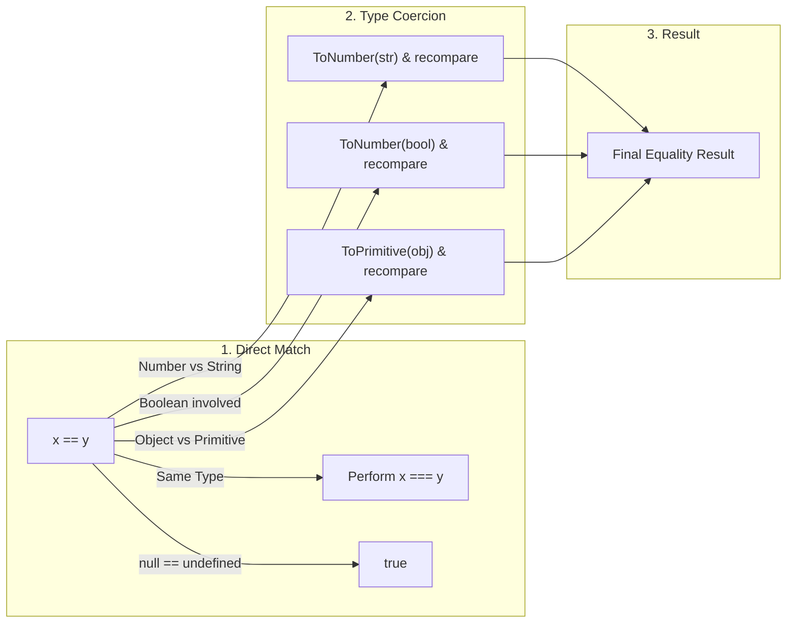

[← Back to Tech-21: JavaScript Core Concepts Overview](./README.md) | [🏠 Series Catalog](../../README.md)

---

# 3. Double (`==`), Triple (`===`), and Same-Value (`Object.is`) Equality 

## 1. The Core Concept & Intuition

JavaScript provides three distinct ways to compare values for equality:
1. **Loose Equality (`==`)**: Compares values with **implicit type coercion**.
2. **Strict Equality (`===`)**: Compares values **without type coercion** (types and values must match).
3. **Same-Value Equality (`Object.is()`)**: Follows strict equality, but correctly handles `NaN` and `+0` vs `-0`.

In production code, **always prefer `===`** over `==` to prevent subtle bugs caused by unexpected type conversions.

---

## 2. Under the Hood: The Comparison Algorithms



### Comparison Matrix

| Comparison Expression | Loose Equality (`==`) | Strict Equality (`===`) | Same-Value (`Object.is`) |
| :--- | :--- | :--- | :--- |
| `5 == "5"` | `true` (coerced) | `false` | `false` |
| `null == undefined` | `true` (coerced) | `false` | `false` |
| `0 == ""` | `true` (coerced to 0) | `false` | `false` |
| `+0 === -0` | `true` | `true` | **`false`** |
| `NaN === NaN` | `false` | `false` | **`true`** |
| `{} === {}` | `false` (different refs) | `false` | `false` |

---

## 3. Clean Code in Action

### A. Strict vs. Loose Equality in Practice

```javascript
const zero = 0;
const negZero = -0;
const blank = " ";
const emptyArray = [];

// 1. Loose Equality (==) - Implicit Coercion
console.log(zero == blank);       // true  (blank converts to Number(" ") -> 0)
console.log(zero == false);       // true  (false converts to 0)
console.log(null == undefined);   // true  (special ECMA rule)

// 2. Strict Equality (===) - No Coercion
console.log(zero === blank);      // false (Number vs String)
console.log(zero === false);      // false (Number vs Boolean)
console.log(null === undefined);  // false (Null vs Undefined)

// 3. Same-Value Equality (Object.is)
console.log(NaN === NaN);               // false
console.log(Object.is(NaN, NaN));       // true

console.log(zero === negZero);          // true
console.log(Object.is(zero, negZero));  // false
```

### B. Reliable Null/Undefined Checking Patterns

```javascript
// The one valid use case for == : checking null or undefined in one check
function process(val) {
  if (val == null) {
    // Catches BOTH null and undefined
    return 'No value';
  }
  return val;
}

// Modern alternatives for object property checking
const user = { profile: { address: null } };
console.log(user?.profile?.address?.city); // undefined (no TypeError)
console.log(user?.profile?.address?.city ?? 'Unknown'); // "Unknown"
```

---

## 4. Common Pitfalls & Interview Traps

| Trap / Misconception | Reality |
| :--- | :--- |
| **"`[] == ![]` should be `false`."** | It evaluates to `true`. `![]` → `false` → `0`; `[]` → `""` → `0`; `0 == 0` → `true`. The Abstract Equality Algorithm applies multiple coercion steps. |
| **"Both `==` and `===` compare object contents."** | Both check object **identity** (heap memory address). Two structurally identical objects are never equal unless they share the same reference. Use deep comparison utilities or `JSON.stringify()` for structural equality. |
| **"`===` handles all edge cases correctly."** | `===` fails two cases: `NaN !== NaN` returns `true`, and `+0 === -0` returns `true`. Use `Object.is()` when these IEEE-754 edge cases matter. |
| **"`typeof null === 'null'`."** | `typeof null` returns `"object"` due to a legacy bug. Always use `val === null` for reliable null checks. |

---

## 5. 60-Second Memory Anchor

> **"`==` coerces types through convoluted rules; `===` compares type and value strictly; `Object.is()` fixes edge cases by recognizing `NaN === NaN` and separating `+0` from `-0`."**

---

[← Question 02](./02-declaration-and-data-types.md)

> ### 🎓 Looking for Questions 04 through 21 & Deep-Dive Appendices?
> You have reached the end of the free sampler for **Tech-21: JavaScript Core Concepts**!
> 
> The full release contains **18 additional core interview chapters** plus **2 architectural reference appendices**, memory layouts, complete edge-case tables, and production patterns.
> 
> 📖 **[Get the Full Edition (Kindle / EPUB / PDF) →](./README.md#how-to-get-the-full-edition)**

