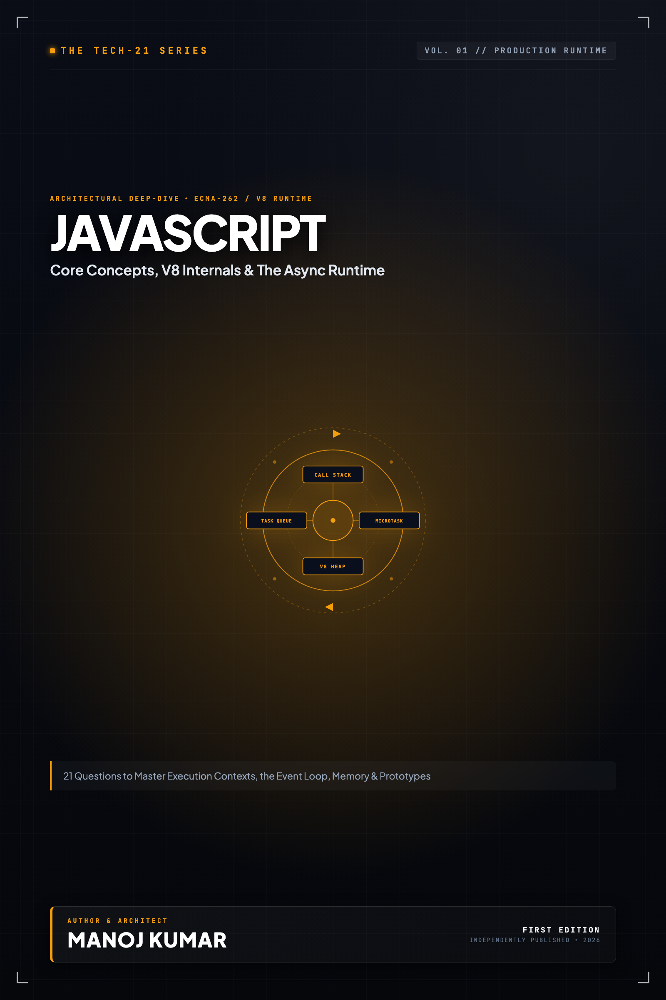

# Tech-21: JavaScript Core Concepts

> **21 Questions to Refresh, Master, and Ace Core JavaScript**  
> *Author: Manoj Kumar* • *Tech-21 Series (Vol. 01)*

  

## 📖 About This Edition

This repository contains the **free public sampler** for **Tech-21: JavaScript Core Concepts**, including the **Preface and Questions 01 through 03** in their entirety. Every chapter follows the strict 5-section Tech-21 mental model framework:

1. **The Core Concept & Intuition** (High-signal problem statement & architecture)
2. **Under the Hood** (Runtime execution mechanics, memory diagrams, and comparison matrices)
3. **Clean Code in Action** (Idiomatic, production-grade implementations)
4. **Common Pitfalls & Interview Traps** (Structured bug-prevention matrices)
5. **60-Second Memory Anchor** (Permanent retention punchlines)

## 📋 Complete 21-Question Syllabus

| Chapter | Status | Title |
| :--- | :---: | :--- |
| **[00-preface](./00-preface.md)** | 🟢 **Free Sampler** | [Preface](./00-preface.md) |
| **[01-what-is-javascript](./01-what-is-javascript.md)** | 🟢 **Free Sampler** | [1. What is JavaScript and How Does the Engine Work?](./01-what-is-javascript.md) |
| **[02-declaration-and-data-types](./02-declaration-and-data-types.md)** | 🟢 **Free Sampler** | [2. Variable Declarations & JavaScript Data Types](./02-declaration-and-data-types.md) |
| **[03-double-and-triple-equality](./03-double-and-triple-equality.md)** | 🟢 **Free Sampler** | [3. Double (`==`), Triple (`===`), and Same-Value (`Object.is`) Equality](./03-double-and-triple-equality.md) |
| **04-control-flow** | 🔒 *Full Edition* | 4. Control Flow, Iteration, and Modern Logical Operators |
| **05-manipulating-strings** | 🔒 *Full Edition* | 5. String Manipulation, Immutability, and Modern Methods |
| **06-how-to-write-functions** | 🔒 *Full Edition* | 6. Function Declarations, Expressions, Arrow Functions, and Generators |
| **07-working-with-json** | 🔒 *Full Edition* | 7. Working with JSON and Object Serialization |
| **08-working-with-arrays** | 🔒 *Full Edition* | 8. Mastering JavaScript Arrays and Functional Methods |
| **09-the-this-keyword** | 🔒 *Full Edition* | 9. Demystifying the `this` Keyword and Binding Rules |
| **10-strict-mode** | 🔒 *Full Edition* | 10. Strict Mode and Modern ECMAScript Execution |
| **11-hoisting** | 🔒 *Full Edition* | 11. Hoisting, Execution Context, and the Temporal Dead Zone (TDZ) |
| **12-closures** | 🔒 *Full Edition* | 12. Closures, Lexical Scope, and Memory Management |
| **13-call-bind-apply** | 🔒 *Full Edition* | 13. Explicit Context Binding: `call()`, `apply()`, and `bind()` |
| **14-classes-and-prototypes** | 🔒 *Full Edition* | 14. ES6 Classes, Prototypal Inheritance, and Private Fields |
| **15-error-handling** | 🔒 *Full Edition* | 15. Robust Error Handling, Custom Errors, and Error Chaining |
| **16-string-types-and-templates** | 🔒 *Full Edition* | 16. String Literals, Template Literals, and Tagged Templates |
| **17-settimeout-and-setinterval** | 🔒 *Full Edition* | 17. Timers, Delays, Drift, and Non-Blocking Scheduling |
| **18-promises** | 🔒 *Full Edition* | 18. Promises, State Lifecycle, and Modern Combinators |
| **19-rest-and-spread** | 🔒 *Full Edition* | 19. Rest Parameters, Spread Syntax, and Object Immutability |
| **20-async-and-await** | 🔒 *Full Edition* | 20. Async / Await, Non-Blocking Syntax, and Parallelism |
| **21-the-event-loop** | 🔒 *Full Edition* | 21. The Event Loop, Microtasks, Macrotasks, and Concurrency |
| **22-appendix-prototypical-inheritance** | 🔒 *Full Edition* | Appendix A: Prototypal Inheritance Deep-Dive |
| **23-appendix-primitives-vs-objects** | 🔒 *Full Edition* | Appendix B: Primitives vs. Object Wrappers and Autoboxing |

---

## 🚀 How to Get the Full Edition

The complete edition unlocks **all 21 in-depth questions** and **both architectural reference appendices** (over 100+ pages of high-signal diagrams, memory layouts, and interview pitfall tables):

- 📱 **Kindle Edition**: Available on [Amazon Kindle](https://amazon.com)
- 📄 **Digital DRM-Free Bundle (EPUB + PDF)**: Instant download with high-res interior graphics
- 📦 **All-Access Pass**: Access all 15 volumes across the entire Tech-21 series

[← Return to Series Catalog](../../README.md)
