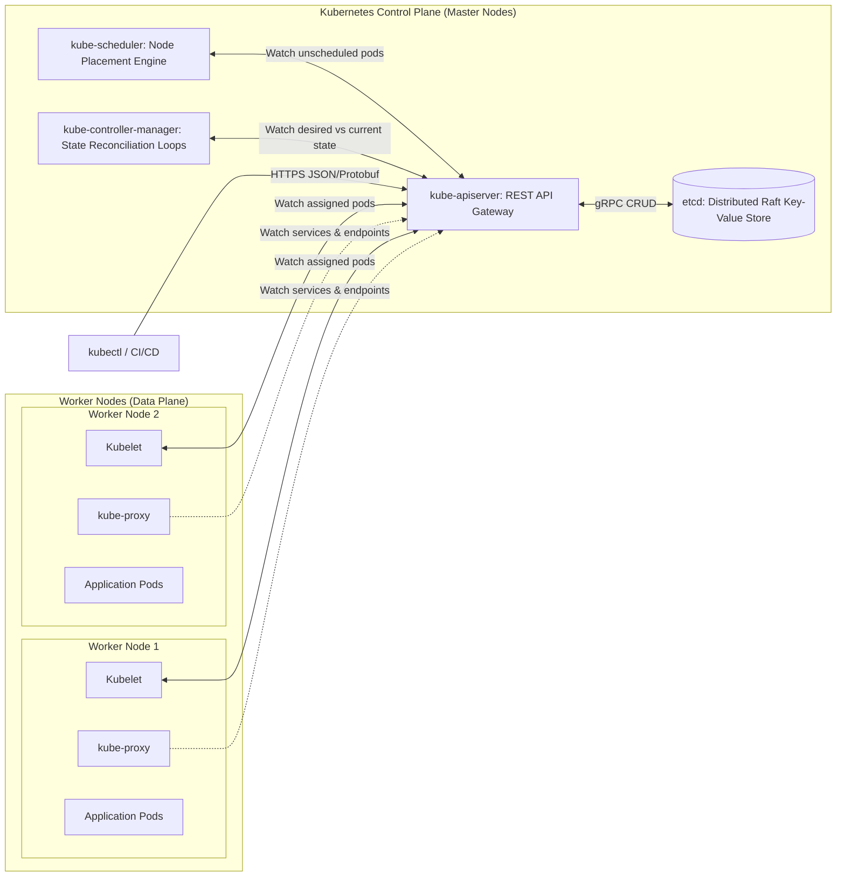
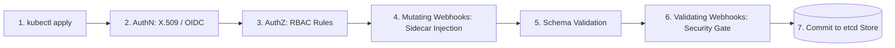

[← Back to Tech-21: Kubernetes Overview](./README.md) | [🏠 Series Catalog](../../README.md)

---

# 1. How Does the Kubernetes Control Plane Orchestrate Cluster State and Scheduling? 

> *"The Kubernetes Control Plane is a masterclass in declarative, event-driven distributed systems. No component directly commands another. Instead, components communicate exclusively through a central REST API and an immutable etcd event log using reconciliation loops."*

---

## 1. The Core Concept & Intuition

### Imperative vs Declarative Orchestration
In traditional systems orchestration (imperative), administrators send commands: *"Deploy 3 containers on Node 5; if Node 5 dies, run them on Node 6."* If the network drops a message, state drifts and the cluster breaks.

Kubernetes operates on **Declarative State Reconciliation**:
- You declare the **Desired State** in YAML (`spec: replicas: 3`).
- Control Plane controllers continuously observe the **Current State** (`status: replicas: 2`).
- The controller executes a loop: $\text{Difference} = \text{Desired} - \text{Current}$. It drives the system toward zero difference. If a physical node burns down, the controller detects 2 running vs 3 desired, and schedules a new pod onto a healthy node automatically.


---

## 2. Under the Hood: Control Plane Architecture and Request Admission Pipeline

### The 4 Core Control Plane Components
1. **`kube-apiserver`**: The front door of the cluster. A stateless REST API gateway that handles Authentication, Authorization (RBAC), Admission Webhooks (Mutating/Validating), and OpenAPI schema validation. **The API server is the ONLY component in the entire cluster that communicates with `etcd`.**
2. **`etcd`**: A highly available, distributed key-value store implementing the Raft consensus algorithm. It holds the complete cluster state and configuration history.
3. **`kube-scheduler`**: The placement engine. It watches for newly created, unscheduled pods (`nodeName: ""`) and evaluates node filtering (Predicates) and scoring (Priorities) to select the optimal worker node.
4. **`kube-controller-manager`**: A unified binary running dozens of distinct reconciliation controllers (DeploymentController, ReplicaSetController, NodeController, EndpointsController, ServiceAccountController).



### The API Request Lifecycle & Admission Chain
When an administrator executes `kubectl apply -f deployment.yaml`:
1. **Authentication (AuthN)**: API server validates the client identity via X.509 client certificates, Bearer JWT tokens, or OIDC.
2. **Authorization (AuthZ)**: API server checks RBAC policies (does this user have `create` permissions on `deployments` in namespace `production`?).
3. **Mutating Admission Webhooks**: External webhooks modify the manifest (e.g., Istio sidecar injection, adding default resource limits).
4. **Schema Validation**: Validates fields against OpenAPI v3 specifications.
5. **Validating Admission Webhooks**: External webhooks validate security policies (e.g., Kyverno / OPA Gatekeeper rejecting root images).
6. **etcd Commit**: The serialized object is written into `etcd` at `/registry/deployments/production/my-app`.



| Component | State Storage | Scaling Pattern | Leader Election? | Failure Impact |
| :--- | :--- | :--- | :--- | :--- |
| **`kube-apiserver`** | Stateless (Delegates to etcd) | Horizontal active-active behind L4 LB | No | Total cluster API freeze; existing pods keep running |
| **`etcd`** | Stateful (Raft log on disk) | Fixed odd quorum (3 or 5 nodes) | Yes (Raft Leader) | Cluster cannot modify state or schedule new pods |
| **`kube-scheduler`** | In-memory cache + API watch | Active-passive (Multiple standby replicas) | Yes (Coordination Lease) | New pods remain in `Pending` phase |
| **`kube-controller-manager`** | In-memory cache + API watch | Active-passive (Multiple standby replicas) | Yes (Coordination Lease) | Drift unreconciled; dead pods not replaced |

---

## 3. Clean Code in Action

### A. High-Availability Control Plane Health & Leader Lease Inspection
In production, the Control Plane runs across 3 or 5 master nodes behind a Layer-4 load balancer (HAProxy, AWS NLB). Use diagnostic commands to inspect component health and distributed coordination leases:

```bash
# Verify health of all control plane components
kubectl get componentstatuses
# Query the comprehensive livez/readyz health endpoints
kubectl get --raw='/readyz?verbose'

# View active leader for scheduler and controller-manager
kubectl get leases -n kube-system
# Output shows which master node holds the distributed coordination
# lease:
# NAME                      HOLDER                  AGE
# kube-controller-manager   master-node-01.internal 45d
# kube-scheduler            master-node-01.internal 45d
```

### B. Production API Server Audit Policy
Enable API Server Audit Logging in `/etc/kubernetes/manifests/kube-apiserver.yaml` via `--audit-policy-file` to record sensitive operations while filtering high-frequency reads:

```yaml
apiVersion: audit.k8s.io/v1
kind: Policy
rules:
  # Log pod changes and secret accesses at RequestResponse level for
  # security forensics
  - level: RequestResponse
    resources:
      - group: ""
        resources: ["pods", "secrets"]
  # Log metadata only for high-volume watch and list calls to avoid
  # disk saturation
  - level: Metadata
    verbs: ["watch", "list"]
```

---

## 4. Common Pitfalls & Interview Traps

| Trap / Misconception | Reality |
| :--- | :--- |
| **"Direct Node-to-etcd Communication"** | Attempting to configure worker nodes, Kubelets, or custom microservices to read directly from `etcd`. Violates the single-entrypoint security model. Bypasses authentication, authorization, auditing, and optimistic locking mechanisms. Only `kube-apiserver` touches `etcd`. All other components use API Server Watches. |
| **"Overloading API Server with Unindexed List Calls"** | Polling the API server every second with `GET /api/v1/pods` across thousands of pods without using Informer caches or ResourceVersions. Serialization of massive JSON payloads saturates API server memory and CPU, triggering HTTP 429 Too Many Requests. Use the **Informer Pattern** (which uses a single initial List followed by persistent HTTP/2 Watch streams) or pagination with limit chunks. |

---


## 5. 60-Second Memory Anchor


> **"Stateless API Gateway: Scales horizontally behind a Layer-4 Load Balancer. Reconciliation Over Commands: Controllers drive observed state toward declared state."**

---

[← Preface](./00-preface.md) | **Next**: [Question 02 →](./02-kubelet-and-node-architecture.md)
