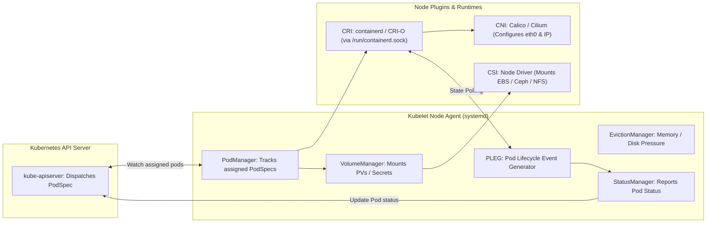

[← Back to Tech-21: Kubernetes Overview](./README.md) | [🏠 Series Catalog](../../README.md)

---

# 2. How Does the Kubelet Manage Pod Lifecycles and Communicate with Worker Nodes? 

> *"If the Control Plane is the brain of Kubernetes, Kubelet is the muscle. Running as a systemd service on every worker node, Kubelet bridges the declarative API world with local Linux container runtimes, storage mounts, and network interfaces."*

---

## 1. The Core Concept & Intuition

### The Node Agent Contract
A Kubernetes worker node is a physical or virtual Linux machine responsible for running containerized workloads. However, the Linux kernel does not know what a "Kubernetes Pod" is.

**Kubelet** is the primary node agent that translates Kubernetes specifications into concrete operating system actions:
- It watches the API server for PodSpecs assigned to its node (`nodeName == this_node`).
- It coordinates with the **Container Runtime Interface (CRI)** to create container namespaces, cgroups, and processes.
- It coordinates with the **Container Storage Interface (CSI)** to mount persistent volumes.
- It coordinates with the **Container Network Interface (CNI)** to attach network interfaces and assign Pod IPs.
- It executes **Pod Lifecycle Event Generator (PLEG)** health checks and reports node health back to the control plane.


---

## 2. Under the Hood: Es The Kubelet Manage Pod

### Kubelet Architecture & Sub-Controllers
Inside the Kubelet binary, specialized managers handle discrete node responsibilities:
1. **PodConfig / PodManager**: Receives PodSpecs from API server (and local static pod manifests in `/etc/kubernetes/manifests`).
2. **PLEG (Pod Lifecycle Event Generator)**: Periodically queries the container runtime (e.g., every 1 second) to detect container state changes (Started, Exited, Crashed) and generates internal events.
3. **VolumeManager**: Attaches and mounts storage volumes before containers start.
4. **StatusManager**: Syncs pod status back to `kube-apiserver`.
5. **EvictionManager**: Monitors node disk space, inode usage, and memory pressure, evicting pods when thresholds are breached.



### Static Pods (Control Plane Bootstrapping)
How does Kubernetes run the control plane (API server, etcd, scheduler) if Kubernetes isn't running yet?
- Kubelet reads local YAML manifests from `/etc/kubernetes/manifests/`.
- Kubelet launches these **Static Pods** directly via CRI without needing an API server.
- Once the API server is up, Kubelet creates a **Mirror Pod** on the API server so administrators can see control plane health via `kubectl get pods -n kube-system`.

---

## 3. Clean Code in Action

### A. Production Configuration and Implementation
### C. Kubelet Configuration File (`/var/lib/kubelet/config.yaml`)
```yaml
apiVersion: kubelet.config.k8s.io/v1beta1
kind: KubeletConfiguration
cgroupDriver: systemd
containerRuntimeEndpoint: unix:///run/containerd/containerd.sock

# Eviction Hard Thresholds to protect node stability
evictionHard:
  memory.available: "250Mi"
  nodefs.available: "10%"
  nodefs.inodesFree: "5%"
  imagefs.available: "15%"

# Image Garbage Collection Thresholds
imageGCHighThresholdPercent: 80
imageGCLowThresholdPercent: 70

# Max pods allowed on this node (Default: 110)
maxPods: 110

# Protect System Daemons (OS & Kubelet) from OOM
systemReserved:
  cpu: "500m"
  memory: "1Gi"
kubeReserved:
  cpu: "500m"
  memory: "1Gi"
```

### 2. Inspecting Node Health & Allocatable Capacity
### B. Advanced Production Pattern
```bash
# View Node Capacity vs Allocatable Resources
kubectl describe node worker-node-01.internal | grep -A 8 "Allocatable:"

# Output:
# Allocatable:
#   cpu:                3500m      (4000m Total - 500m Reserved)
#   ephemeral-storage:  92348Mi
#   memory:             14336Mi    (16384Mi Total - 2048Mi Reserved)
#   pods:               110
```

---

## 4. Common Pitfalls & Interview Traps

| Trap / Misconception | Reality |
| :--- | :--- |
| **"PLEG Is Not Healthy / Node NotReady"** | Seeing the warning `PLEG is not healthy: skip pod lifecycle event generator: runtime took 4.5s to respond`. If a node has hundreds of short-lived containers or high disk I/O, the container runtime (`containerd`) stalls on listing containers. Kubelet misses its heartbeat to the API server, marking the entire node **`NotReady`** and evicting healthy workloads! Reduce `maxPods` per node, upgrade to modern containerd snapshotters, and enforce memory/CPU limits. |
| **"OOM Kills of System Daemons (Missing `kubeReserved`)"** | Allocating 100% of node memory to user application pods without configuring `systemReserved` and `kubeReserved`. Under severe memory load, the Linux kernel OOM killer terminates `systemd-journald`, `sshd`, or `kubelet` itself, bricking the node. Always reserve at least 1GB of memory and 500m CPU for system daemons in Kubelet config. |

---


## 5. 60-Second Memory Anchor


> **"Runs as systemd service: Bridges Kubernetes control plane to local Linux kernel. Coordinates 3 Interfaces: CRI (Runtime), CNI (Network), CSI (Storage)."**

---

[← Question 01](./01-kubernetes-control-plane-architecture.md) | **Next**: [Question 03 →](./03-etcd-distributed-key-value-store.md)
