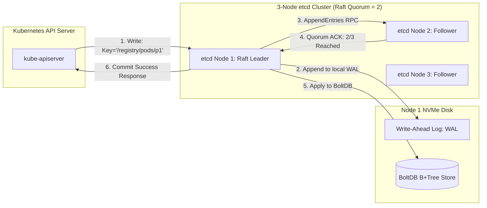

[← Back to Tech-21: Kubernetes Overview](./README.md) | [🏠 Series Catalog](../../README.md)

---

# 3. How Does etcd Maintain Consistent Distributed State via the Raft Consensus Algorithm? 

> *"If etcd is down, the Kubernetes cluster is frozen. etcd is the single source of truth for all cluster state, enforcing strong consistency across master nodes using the Raft consensus algorithm and MVCC revision logging."*

---

## 1. The Core Concept & Intuition

### The Distributed Consistency Problem
In a multi-master Kubernetes cluster, three `kube-apiserver` instances handle incoming user requests concurrently. If Administrator A scales a deployment to 5 replicas while Administrator B deletes the namespace at the same millisecond, how does the cluster prevent split-brain state corruption?

### The etcd Solution
**etcd** is a strongly consistent, distributed key-value store developed under the Cloud Native Computing Foundation (CNCF).
- **Raft Consensus**: Guarantees that write operations are only committed after a strict majority (Quorum) of cluster members persist the log entry to disk.
- **Multi-Version Concurrency Control (MVCC)**: etcd never overwrites existing keys in place. Every write operation (create, update, delete) increments a global 64-bit **Revision** counter, preserving a complete, immutable audit trail.
- **Watches**: Allows API servers to stream real-time change events for keys (e.g., `/registry/pods/...`) with zero polling latency.


> *Architect's Rule: Always deploy an **odd number** of etcd nodes. A 4-node cluster requires 3 nodes for quorum (the same as a 3-node cluster) but introduces an extra point of network failure.*

---

## 2. Under the Hood: The Raft Consensus Algorithm, MVCC, and BoltDB Storage Engine

### Raft Consensus Write Flow in etcd
When an update arrives at etcd:
1. The client (API Server) sends a write request. If received by a Follower, it is forwarded to the **Raft Leader**.
2. The Leader creates an uncommitted log entry and replicates it to all Followers via gRPC `AppendEntries` RPCs.
3. Once a **Quorum (e.g., 2 out of 3 nodes)** confirms writing the entry to their Write-Ahead Log (WAL) on disk, the Leader marks the revision **Committed**.
4. The Leader applies the change to its BoltDB B+Tree storage and returns success to the API Server.



### MVCC Revisions & Key History
Inside etcd's in-memory B-Tree index, each key maps to its historical revision lifecycle:
- **`create_revision`**: The revision at which the key was first created.
- **`mod_revision`**: The revision of the most recent modification.
- **`version`**: The number of times the key was updated since creation.

```
Key: /registry/pods/prod/order-api
  Revision 100: Created (Version 1) -> value: { replicas: 1 }
  Revision 145: Modified (Version 2) -> value: { replicas: 3 }
  Revision 210: Modified (Version 3) -> value: { replicas: 5 }
  Revision 300: Tombstone (Deleted)
```

| Feature / Dimension | etcd (v3) | ZooKeeper | Consul |
| :--- | :--- | :--- | :--- |
| **Consensus Algorithm** | Raft | ZAB (ZooKeeper Atomic Broadcast) | Raft |
| **Concurrency Model** | MVCC (Immutable global 64-bit revision) | Ephemeral zNodes & explicit version integers | MVCC (Index-based) |
| **Watch Mechanism** | HTTP/2 gRPC streaming multiplexed watches | One-shot watches (Must be re-registered after trigger) | Long-polling HTTP or gRPC streaming |
| **Storage Backend** | BoltDB (Copy-on-write B+tree on local disk) | In-memory tree with snapshot + log replay | BoltDB / In-memory state store |
| **Kubernetes Role** | Native, mandatory primary cluster state store | Deprecated legacy (Early Mesos / Hadoop) | Service mesh & multi-cloud service catalog |

---

## 3. Clean Code in Action

### A. etcd Cluster Health Verification and Atomic Snapshot Creation
```bash
# Set etcdctl to use API version 3 and TLS certificates
export ETCDCTL_API=3
export ETCDCTL_CACERT="/etc/kubernetes/pki/etcd/ca.crt"
export ETCDCTL_CERT="/etc/kubernetes/pki/etcd/server.crt"
export ETCDCTL_KEY="/etc/kubernetes/pki/etcd/server.key"
export ETCDCTL_ENDPOINTS="https://127.0.0.1:2379"

# 1. Check cluster health and active leader
etcdctl endpoint health --write-out=table
etcdctl endpoint status --write-out=table

# 2. List all Kubernetes namespaces stored in etcd
etcdctl get /registry/namespaces/ --prefix --keys-only

# 3. Create an instantaneous consistent cluster snapshot (Backup)
etcdctl snapshot save /var/backups/etcd-backup-$(date +%F).db
```

### B. Automated History Compaction, Defragmentation, and Storage Alarms
Because MVCC retains all historical key revisions indefinitely, the BoltDB database file grows continuously until it hits the Quota Limit (Default: 2GB or 8GB), putting etcd into a read-only alarm state (`NOSPACE`):

```bash
# 1. Compact all historical revisions up to revision 50000
etcdctl compact 50000

# 2. Defragment physical disk storage to release space back to OS
etcdctl defrag

# 3. Clear NOSPACE alarm if triggered
etcdctl alarm disarm
```

---

## 4. Common Pitfalls & Interview Traps

| Trap / Misconception | Reality |
| :--- | :--- |
| **"Slow Disk I/O Causing Heartbeat Drops and Leader Elections"** | Running etcd on standard HDD spinning disks, network-attached HDDs, or throttled cloud volumes (e.g., standard AWS gp2 without provisioned IOPS). etcd requires sub-10ms fsync latency to write WAL entries to disk. If disk write latency spikes to 30ms+, the Raft Leader misses its heartbeat deadline. Followers trigger an emergency **Leader Election**, causing cluster-wide API latency spikes. Always run etcd on dedicated **NVMe SSDs** with provisioned IOPS (minimum 3,000 IOPS). |
| **"Neglecting Automated etcd Snapshots"** | Relying exclusively on node VM backups rather than etcd database-level snapshots. Taking a VM-level snapshot of a live multi-node database produces a corrupted, non-quiesced database state. Schedule automated hourly cron jobs executing `etcdctl snapshot save` with offsite S3 sync and automated restore drills. |

---


## 5. 60-Second Memory Anchor


> **"Raft Majority Quorum: $N=3$ tolerates 1 node failure; $N=5$ tolerates 2. MVCC Architecture: Revisions are append-only; compaction frees disk space."**

---

[← Question 02](./02-kubelet-and-node-architecture.md)

> ### 🎓 Looking for Questions 04 through 21 & Deep-Dive Appendices?
> You have reached the end of the free sampler for **Tech-21: Kubernetes**!
> 
> The full release contains **18 additional core interview chapters** plus **2 architectural reference appendices**, memory layouts, complete edge-case tables, and production patterns.
> 
> 📖 **[Get the Full Edition (Kindle / EPUB / PDF) →](./README.md#how-to-get-the-full-edition)**

