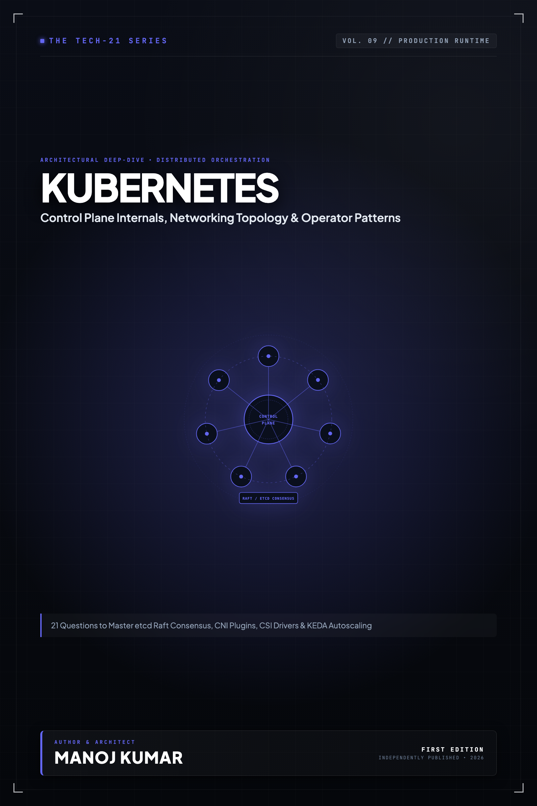

# Tech-21: Kubernetes

> **21 Core Concepts to Master Production Container Orchestration, Networking & Security**  
> *Author: Manoj Kumar* • *Tech-21 Series (Vol. 09)*

  

## 📖 About This Edition

This repository contains the **free public sampler** for **Tech-21: Kubernetes**, including the **Preface and Questions 01 through 03** in their entirety. Every chapter follows the strict 5-section Tech-21 mental model framework:

1. **The Core Concept & Intuition** (High-signal problem statement & architecture)
2. **Under the Hood** (Runtime execution mechanics, memory diagrams, and comparison matrices)
3. **Clean Code in Action** (Idiomatic, production-grade implementations)
4. **Common Pitfalls & Interview Traps** (Structured bug-prevention matrices)
5. **60-Second Memory Anchor** (Permanent retention punchlines)

## 📋 Complete 21-Question Syllabus

| Chapter | Status | Title |
| :--- | :---: | :--- |
| **[00-preface](./00-preface.md)** | 🟢 **Free Sampler** | [Preface](./00-preface.md) |
| **[01-kubernetes-control-plane-architecture](./01-kubernetes-control-plane-architecture.md)** | 🟢 **Free Sampler** | [1. How Does the Kubernetes Control Plane Orchestrate Cluster State and Scheduling?](./01-kubernetes-control-plane-architecture.md) |
| **[02-kubelet-and-node-architecture](./02-kubelet-and-node-architecture.md)** | 🟢 **Free Sampler** | [2. How Does the Kubelet Manage Pod Lifecycles and Communicate with Worker Nodes?](./02-kubelet-and-node-architecture.md) |
| **[03-etcd-distributed-key-value-store](./03-etcd-distributed-key-value-store.md)** | 🟢 **Free Sampler** | [3. How Does etcd Maintain Consistent Distributed State via the Raft Consensus Algorithm?](./03-etcd-distributed-key-value-store.md) |
| **04-pod-lifecycle-and-phase-transitions** | 🔒 *Full Edition* | 4. How Does the Pod Lifecycle Manage Phase Transitions, Probes, and Init Containers? |
| **05-health-probes-liveness-readiness-startup** | 🔒 *Full Edition* | 5. How Do Startup, Liveness, and Readiness Probes Safeguard Application Availability? |
| **06-qos-classes-and-node-oom-eviction** | 🔒 *Full Edition* | 6. How Do Quality of Service (QoS) Classes and Node OOM Eviction Protect Cluster Stability? |
| **07-workload-controllers-deployments-and-replicasets** | 🔒 *Full Edition* | 7. How Do Deployments and ReplicaSets Coordinate Declarative Zero-Downtime Rollouts? |
| **08-statefulsets-and-headless-services** | 🔒 *Full Edition* | 8. How Do StatefulSets and Headless Services Preserve Persistent Pod Identity and Ordinal Storage? |
| **09-daemonsets-jobs-and-cronjobs** | 🔒 *Full Edition* | 9. When Should You Deploy DaemonSets, Batch Jobs, or Scheduled CronJobs in a Cluster? |
| **10-kubernetes-storage-pv-pvc-and-storageclass** | 🔒 *Full Edition* | 10. How Does the Storage Subsystem Bind PersistentVolumes, PVCs, and Dynamic StorageClasses? |
| **11-container-storage-interface-csi** | 🔒 *Full Edition* | 11. How Does the Container Storage Interface (CSI) Enable Custom Storage Drivers and Volume Snapshots? |
| **12-kubernetes-networking-and-cni** | 🔒 *Full Edition* | 12. How Does the Kubernetes IP-per-Pod Network Model and CNI Plugins Route East-West Traffic? |
| **13-services-and-kube-proxy** | 🔒 *Full Edition* | 13. How Do Services and kube-proxy Direct Packets Using iptables and IPVS Modes? |
| **14-coredns-and-cluster-service-discovery** | 🔒 *Full Edition* | 14. How Does CoreDNS Resolve In-Cluster Services and How Do You Prevent the ndots:5 DNS Bottleneck? |
| **15-ingress-controllers-and-gateway-api** | 🔒 *Full Edition* | 15. How Do Ingress Controllers and the Modern Gateway API Route External HTTP Traffic? |
| **16-kubernetes-security-rbac-and-serviceaccounts** | 🔒 *Full Edition* | 16. How Do Role-Based Access Control (RBAC) and ServiceAccounts Secure Cluster API Interactions? |
| **17-networkpolicies-and-zero-trust** | 🔒 *Full Edition* | 17. How Do Kubernetes NetworkPolicies Enforce East-West Microsegmentation and Zero-Trust? |
| **18-pod-security-standards-and-admission-controllers** | 🔒 *Full Edition* | 18. How Do Pod Security Standards (PSS) and Validating Admission Webhooks Enforce Cluster Governance? |
| **19-horizontal-pod-autoscaling-and-keda** | 🔒 *Full Edition* | 19. How Does the Horizontal Pod Autoscaler (HPA) and KEDA Scale Pods Based on Event Metrics? |
| **20-vertical-pod-autoscaling-and-cluster-autoscaler** | 🔒 *Full Edition* | 20. How Do Vertical Pod Autoscaling (VPA) and the Cluster Autoscaler Prevent Node Resource Exhaustion? |
| **21-crds-and-the-operator-pattern** | 🔒 *Full Edition* | 21. How Do Custom Resource Definitions (CRDs) and Controller Loops Implement the Operator Pattern? |
| **22-appendix-kubernetes-troubleshooting-flowchart** | 🔒 *Full Edition* | Appendix A: Kubernetes Troubleshooting Decision Matrix |
| **23-appendix-production-kubernetes-manifests** | 🔒 *Full Edition* | Appendix B: Production Kubernetes Manifest Reference Patterns |

---

## 🚀 How to Get the Full Edition

The complete edition unlocks **all 21 in-depth questions** and **both architectural reference appendices** (over 100+ pages of high-signal diagrams, memory layouts, and interview pitfall tables):

- 📱 **Kindle Edition**: Available on [Amazon Kindle](https://amazon.com)
- 📄 **Digital DRM-Free Bundle (EPUB + PDF)**: Instant download with high-res interior graphics
- 📦 **All-Access Pass**: Access all 13 volumes across the entire Tech-21 series

[← Return to Series Catalog](../../README.md)
