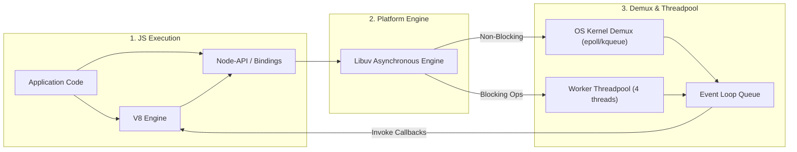

[← Back to Tech-21: Node.js Core Concepts Overview](./README.md) | [🏠 Series Catalog](../../README.md)

---

# 1. What is Node.js Architecture and How Does Non-Blocking I/O Work? 

## 1. The Core Concept & Intuition

Traditional server runtimes (such as classic Apache HTTP Server or Java Servlet containers) allocate a dedicated operating system thread for every incoming network connection or I/O request. Under high concurrency—say 50,000 simultaneous client sockets—this thread-per-connection model rapidly exhausts kernel stack memory, causes catastrophic CPU cache misses, and spends excessive clock cycles in thread context switching.

**Node.js** was designed by Ryan Dahl in 2009 to solve this concurrency bottleneck. Instead of spawning threads per request, Node.js uses a **single-threaded, event-driven, non-blocking I/O execution model**. A single main thread orchestrates execution, offloading all kernel I/O operations (sockets, pipes) and slow system tasks (file access, cryptographic hashing, DNS lookups) to asynchronous event demultiplexers and background worker pools.

---

## 2. Under the Hood: V8, Libuv, and the Non-Blocking Subsystem

The Node.js runtime consists of three foundational architectural layers:

1. **Google V8 JavaScript Engine**: Parses JavaScript source code, compiles it to machine bytecode via the Ignition interpreter, optimizes hot loops using the TurboFan optimizing compiler, and manages the V8 call stack and memory heap.
2. **C++ Bindings & Core Abstractions**: Exposes underlying C/C++ libraries (`openssl` for TLS/crypto, `llhttp` for HTTP parsing, `zlib` for compression, `c-ares` for asynchronous DNS) directly to JavaScript.
3. **Libuv C Library**: The platform abstraction engine. Libuv provides the cross-platform **Event Loop**, manages the asynchronous thread pool, and interfaces directly with OS-level event notification mechanisms: `epoll` on Linux, `kqueue` on macOS/BSD, and `IOCP` (I/O Completion Ports) on Windows.



| Architectural Dimension | Traditional Thread-per-Request (e.g., Apache / Java EE) | Node.js Single-Threaded Event Loop (Libuv) |
| :--- | :--- | :--- |
| **Concurrency Mechanism** | Multi-threaded; 1 OS thread allocated per incoming socket | Single JavaScript main thread; event demultiplexing |
| **Memory Footprint** | High (~1MB–2MB stack overhead per thread) | Extremely low (Single JS stack + small libuv socket handles) |
| **Context Switching** | Heavy CPU kernel context switching overhead | Zero CPU context switching between active socket connections |
| **I/O Strategy** | Synchronous blocking read/write calls | Asynchronous non-blocking events via OS notification APIs |
| **Ideal Workload** | Heavy CPU-bound computation & batch processing | High-throughput, I/O-intensive real-time microservices & APIs |

---

## 3. Clean Code in Action

### A. Non-Blocking High-Throughput HTTP Server
Modern Node.js web applications leverage streaming, non-blocking I/O with native modules:

```javascript
import http from 'node:http';
import { promisify } from 'node:util';

const server = http.createServer((req, res) => {
  if (req.method === 'GET' && req.url === '/health') {
    // Non-blocking, immediate response without entering worker
    // threads
    res.writeHead(200, { 'Content-Type': 'application/json' });
    res.end(JSON.stringify({
      status: 'ok',
      uptime: process.uptime()
    }));
    return;
  }

  res.writeHead(404, { 'Content-Type': 'text/plain' });
  res.end('Not Found');
});

const PORT = process.env.PORT || 3000;
server.listen(PORT, () => {
  console.log(
    `Server listening on port ${PORT} in process ${process.pid}`
  );
});
```

### B. Offloading Synchronous CPU Work to Prevent Event Loop Starvation
Because the main thread executes all JavaScript, heavy synchronous operations must never block the main loop:

```javascript
import {
  Worker, isMainThread, parentPort, workerData
} from 'node:worker_threads';

// Modern pattern: Offload CPU-heavy computation to Worker Threads
export function runCpuIntensiveTask(payload) {
  return new Promise((resolve, reject) => {
    const worker = new Worker(new URL(import.meta.url), {
      workerData: payload,
    });

    worker.on('message', resolve);
    worker.on('error', reject);
    worker.on('exit', (code) => {
      if (code !== 0) {
        reject(new Error(`Worker stopped with exit code ${code}`));
      }
    });
  });
}

// In-file worker execution pattern
if (!isMainThread) {
  const result = heavyCalculation(workerData);
  parentPort?.postMessage(result);
}

function heavyCalculation(data) {
  // Simulating heavy CPU work (e.g., cryptographic hashing / image
  // resizing)
  let count = 0;
  for (let i = 0; i < 1e7; i++) count += i;
  return { processed: true, count, input: data };
}
```

---

## 4. Common Pitfalls & Interview Traps

| Trap / Misconception | Reality |
| :--- | :--- |
| **"Node.js is completely single-threaded."** | **False!** Only JavaScript execution on the V8 call stack is single-threaded. Under the hood, Libuv maintains an asynchronous C++ thread pool (default 4 threads) for file system I/O, DNS resolution, and crypto, while network sockets run directly via OS async multiplexing (`epoll`/`kqueue`). |
| **"Asynchronous code (Promises/Callbacks) makes CPU calculations faster."** | **False!** Wrapping a CPU-intensive loop inside `new Promise()` or `async` does **not** move it off the main thread. It still monopolizes the V8 call stack and completely freezes all incoming HTTP requests until it completes. |
| **"File System operations (`fs.readFile`) use OS non-blocking kernel calls."** | Most operating systems (POSIX) do not provide truly non-blocking file system APIs. Therefore, Libuv executes file system operations synchronously inside background worker threads from the libuv threadpool. |

---

## 5. 60-Second Memory Anchor

> **"Node.js runs JavaScript on a single-threaded V8 engine, but achieves massive I/O throughput by delegating socket events to the kernel's non-blocking demultiplexers (`epoll`/`kqueue`) and offloading file/crypto tasks to the Libuv background threadpool."**

---

[← Preface](./00-preface.md) | **Next**: [Question 02 →](./02-event-loop-phases.md)
