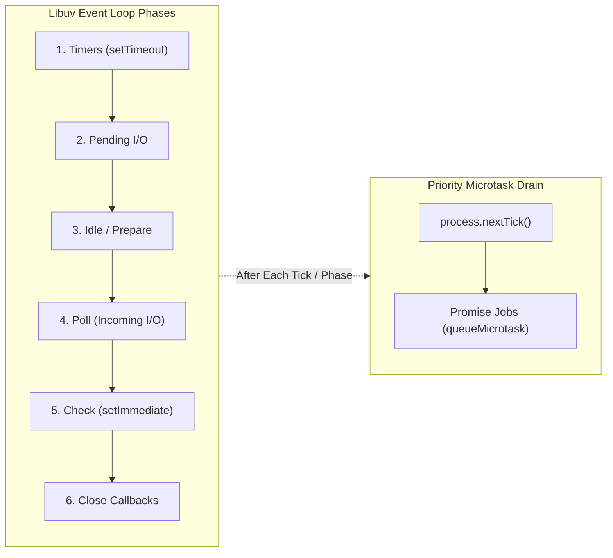

[← Back to Tech-21: Node.js Core Concepts Overview](./README.md) | [🏠 Series Catalog](../../README.md)

---

# 2. How Does the Node.js Event Loop Work and What are its Phases? 

## 1. The Core Concept & Intuition

The heart of Node.js concurrency is the **Libuv Event Loop**. Rather than polling for work in an infinite busy-wait loop, the event loop coordinates execution across discrete **phases**, each maintaining a first-in, first-out (FIFO) queue of callback handlers.

Crucially, the Node.js event loop differs from browser event loops. In Node.js, asynchronous operations are segmented into explicit phases: expired timers, completed network/file I/O, `setImmediate` check handlers, and socket close events—interleaved with high-priority **microtask queues** (`process.nextTick` and resolved Promises).

---

## 2. Under the Hood: The 6 Event Loop Phases & Microtask Priority

Whenever JavaScript execution finishes on the V8 call stack, the runtime evaluates pending work through these sequential phases:

1. **Timers Phase**: Executes callbacks scheduled by `setTimeout()` and `setInterval()` whose minimum threshold has elapsed.
2. **Pending Callbacks Phase**: Executes I/O callbacks deferred to the next loop iteration (e.g., specific TCP socket system errors like `ECONNREFUSED`).
3. **Idle, Prepare Phase**: Used exclusively internally by Libuv for subsystem coordination.
4. **Poll Phase**: Retrieves new I/O events from the OS kernel (`epoll`/`kqueue`). If no timers are scheduled and no `setImmediate` callbacks are pending, the event loop will block and wait here for incoming I/O.
5. **Check Phase**: Executes callbacks scheduled via `setImmediate()`.
6. **Close Callbacks Phase**: Executes cleanup handlers such as `socket.on('close', ...)`.

### The Microtask Drainage Subsystem
Microtasks are **not** part of Libuv; they are managed by V8 and Node.js. Whenever the call stack clears—**after every individual callback in modern Node.js**—microtasks execute immediately:
- **`process.nextTick` Queue**: Highest priority; runs before all other microtasks.
- **Promise Microtask Queue**: Handles `Promise.then()`, `catch()`, `finally()`, and `queueMicrotask()`.



| Phase / Mechanism | Target API | Trigger Moment / Priority |
| :--- | :--- | :--- |
| **Microtask (Tick)** | `process.nextTick(fn)` | Immediately after current V8 stack frame empties; before Promises |
| **Microtask (Promise)**| `Promise.resolve().then(fn)` | Immediately after `nextTick` queue drains |
| **Timers Phase** | `setTimeout(fn, ms)` | When system clock passes threshold during Timers phase |
| **Check Phase** | `setImmediate(fn)` | Specifically in the Check phase after the Poll phase completes |
| **Poll Phase** | I/O callbacks (HTTP, TCP, fs) | When the OS signals data availability or threadpool completes task |

---

## 3. Clean Code in Action

### A. Mastering Execution Order and Asynchronous Scheduling
Predicting exact execution sequencing across macro-phases and micro-queues:

```javascript
import fs from 'node:fs';

console.log('1. Synchronous Mainline');

// Scheduled in Timers phase
setTimeout(() => {
  console.log('2. setTimeout 0ms (Timers Phase)');
}, 0);

// Scheduled in Check phase
setImmediate(() => {
  console.log('3. setImmediate (Check Phase)');
});

// High-priority microtask
queueMicrotask(() => {
  console.log('4. queueMicrotask (Promise Microtask)');
});

// Highest priority nextTick queue
process.nextTick(() => {
  console.log('5. process.nextTick (Tick Microtask)');
});

console.log('6. Synchronous End');

// Expected Output:
// 1. Synchronous Mainline
// 6. Synchronous End
// 5. process.nextTick (Tick Microtask)
// 4. queueMicrotask (Promise Microtask)
// (Timers or Check phase depending on process startup timing)
```

### B. Guaranteeing `setImmediate` Order Inside I/O Callbacks
When called inside an I/O cycle (such as reading a file or handling a request), `setImmediate` is **always** executed before any `setTimeout(..., 0)` because the I/O callback executes in the Poll phase, transitioning directly into the Check phase:

```javascript
import fs from 'node:fs';

fs.readFile(new URL(import.meta.url), () => {
  console.log('--- Inside I/O Poll Phase ---');

  setTimeout(() => {
    console.log('Timer callback (Next tick Timers phase)');
  }, 0);

  setImmediate(() => {
    console.log('Immediate callback (Current tick Check phase - ALWAYS FIRST!)');
  });
});
```

---

## 4. Common Pitfalls & Interview Traps

| Trap / Misconception | Reality |
| :--- | :--- |
| **"`setTimeout(fn, 0)` is identical to `setImmediate(fn)` in top-level code."** | When called from the main script, the order is **non-deterministic** (subject to process startup clock jitter). However, inside an I/O callback, `setImmediate` is **guaranteed** to run before `setTimeout`. |
| **"Recursive `process.nextTick()` works like a non-blocking asynchronous loop."** | **Fatal Trap!** Recursive `process.nextTick` calls continuously starve the microtask queue, completely preventing the event loop from ever advancing to the Poll or Timers phases, crashing I/O throughput. |
| **"`setTimeout(fn, 1000)` guarantees execution at exactly 1000ms."** | The delay specifies the **minimum** threshold before the callback is placed in the queue. If another callback blocks the CPU for 500ms, the timer will execute at 1500ms+. |

---

## 5. 60-Second Memory Anchor

> **"The Node.js event loop cycles through 6 distinct Libuv phases—Timers, Pending, Idle, Poll, Check, and Close—draining `process.nextTick` and Promise microtask queues immediately whenever the call stack empties between callbacks."**

---

[← Question 01](./01-nodejs-architecture.md) | **Next**: [Question 03 →](./03-module-system-cjs-vs-esm.md)
