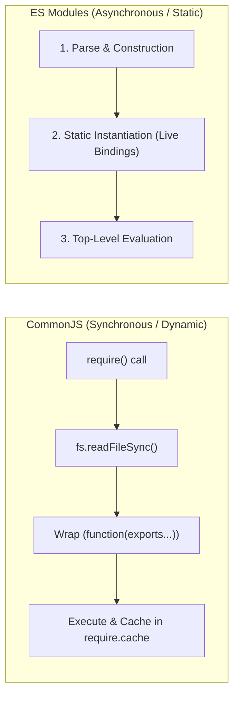

[← Back to Tech-21: Node.js Core Concepts Overview](./README.md) | [🏠 Series Catalog](../../README.md)

---

# 3. How Does the Module System Work: CommonJS vs ECMAScript Modules (ESM)? 

## 1. The Core Concept & Intuition

For over a decade, Node.js relied exclusively on **CommonJS (CJS)** (`require()` and `module.exports`). CJS is synchronous, dynamically evaluated at runtime, and tightly coupled to Node.js's native file system. 

With the standardization of **ECMAScript Modules (ESM)** in modern JavaScript (`import` and `export`), Node.js now natively supports both systems. However, ESM is not merely a syntactic facelift for CJS—it operates on a fundamentally different lifecycle: **asynchronous, static graph analysis, three-phase evaluation, and live symbol bindings**.

---

## 2. Under the Hood: Module Wrappers, Static Graphs, and Live Bindings

### CommonJS Module Wrapper
When you execute a CommonJS file, Node.js wraps your code inside an invisible function before evaluation:
```javascript
(function(exports, require, module, __filename, __dirname) {
  // Your CommonJS module code lives here
});
```
Because of this wrapper, `require()` executes synchronously on the main thread and caches the exported object directly in `require.cache`.

### ESM 3-Phase Execution Pipeline
ESM does not execute code during file discovery. Instead, it processes the dependency tree in 3 phases:
1. **Construction (Parsing)**: Locates all `import` declarations statically without executing any code. Builds the Module Graph.
2. **Instantiation**: Points export and import specifiers to the same memory slots (**live bindings**). Modifying an exported variable in Module A is instantly reflected in Module B without copying objects.
3. **Evaluation**: Executes the actual JavaScript code. Supports **Top-Level Await** (`await fetch(...)` without wrapping inside an async function).



| Feature / Behavior | CommonJS (CJS) | ECMAScript Modules (ESM) |
| :--- | :--- | :--- |
| **Loading Mechanism** | Synchronous, dynamic (can be inside `if` statements) | Asynchronous, static graph construction |
| **File Scope Globals** | `__dirname`, `__filename`, `require`, `module` | `import.meta.url`, `import.meta.filename` (Node 20.11+) |
| **Export Semantics** | Value copy (`module.exports` object reference) | **Live bindings** (references to live memory slots) |
| **Top-Level Await** | ❌ Not supported | ✅ Supported natively |
| **Interoperability** | Cannot synchronously `require()` an ESM file | Can import CJS via default import `import pkg from './cjs.cjs'` |

---

## 3. Clean Code in Action

### A. Idiomatic Modern ESM with `import.meta` and Native Paths
Writing modern, standards-compliant Node.js ESM modules:

```javascript
// file: server.js (with "type": "module" in package.json)
import path from 'node:path';
import { fileURLToPath } from 'node:url';
import fs from 'node:fs/promises';

// Idiomatic ESM replacement for __dirname and __filename
const __filename = fileURLToPath(import.meta.url);
const __dirname = path.dirname(__filename);

// Top-Level Await in action
const configPath = path.join(__dirname, 'config.json');
const rawConfig = await fs.readFile(configPath, 'utf-8');
export const config = JSON.parse(rawConfig);

console.log(`Loaded configuration for environment: ${config.env}`);
```

### B. Configuring Dual Packages in `package.json`
To distribute a package that supports both CJS and ESM consumers without the "Dual Package Hazard":

```json
{
  "name": "my-awesome-lib",
  "version": "1.0.0",
  "type": "module",
  "exports": {
    ".": {
      "import": {
        "types": "./dist/index.d.ts",
        "default": "./dist/index.js"
      },
      "require": {
        "types": "./dist/index.d.cts",
        "default": "./dist/index.cjs"
      }
    },
    "./package.json": "./package.json"
  }
}
```

---

## 4. Common Pitfalls & Interview Traps

| Trap / Misconception | Reality |
| :--- | :--- |
| **"`require()` can synchronously load an ESM module."** | **Fatal Error!** Standard CJS `require()` throws `ERR_REQUIRE_ESM` when requiring an ESM module because ESM files may contain top-level await and are inherently asynchronous. Use dynamic `await import('./module.mjs')` instead. |
| **"ESM exports are static object snapshots like CJS."** | In CJS, exporting a primitive copies its current value. In ESM, exports are **live bindings**; if the exporter changes `let count = 0` to `count++`, consuming modules immediately see the updated value! |
| **"`__dirname` and `__filename` exist in ESM."** | In pure ESM, `__dirname` and `__filename` are `undefined`. Use `import.meta.url` with `node:url`'s `fileURLToPath()`. |

---

## 5. 60-Second Memory Anchor

> **"CommonJS loads synchronously at runtime via function wrappers and cached export objects, whereas ESM builds a static dependency graph in 3 phases—Parsing, Instantiation with live memory bindings, and Evaluation with Top-Level Await support."**

---

[← Question 02](./02-event-loop-phases.md)

> ### 🎓 Looking for Questions 04 through 21 & Deep-Dive Appendices?
> You have reached the end of the free sampler for **Tech-21: Node.js Core Concepts**!
> 
> The full release contains **18 additional core interview chapters** plus **2 architectural reference appendices**, memory layouts, complete edge-case tables, and production patterns.
> 
> 📖 **[Get the Full Edition (Kindle / EPUB / PDF) →](./README.md#how-to-get-the-full-edition)**

