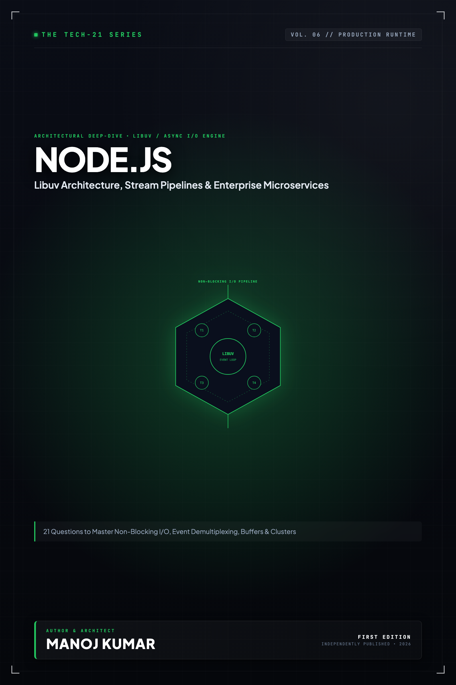

# Tech-21: Node.js Core Concepts

> **21 Questions to Master Architecture, Event Loop Internals, Streams, and Production Engineering**  
> *Author: Manoj Kumar* • *Tech-21 Series (Vol. 06)*

  

## 📖 About This Edition

This repository contains the **free public sampler** for **Tech-21: Node.js Core Concepts**, including the **Preface and Questions 01 through 03** in their entirety. Every chapter follows the strict 5-section Tech-21 mental model framework:

1. **The Core Concept & Intuition** (High-signal problem statement & architecture)
2. **Under the Hood** (Runtime execution mechanics, memory diagrams, and comparison matrices)
3. **Clean Code in Action** (Idiomatic, production-grade implementations)
4. **Common Pitfalls & Interview Traps** (Structured bug-prevention matrices)
5. **60-Second Memory Anchor** (Permanent retention punchlines)

## 📋 Complete 21-Question Syllabus

| Chapter | Status | Title |
| :--- | :---: | :--- |
| **[00-preface](./00-preface.md)** | 🟢 **Free Sampler** | [Preface](./00-preface.md) |
| **[01-nodejs-architecture](./01-nodejs-architecture.md)** | 🟢 **Free Sampler** | [1. What is Node.js Architecture and How Does Non-Blocking I/O Work?](./01-nodejs-architecture.md) |
| **[02-event-loop-phases](./02-event-loop-phases.md)** | 🟢 **Free Sampler** | [2. How Does the Node.js Event Loop Work and What are its Phases?](./02-event-loop-phases.md) |
| **[03-module-system-cjs-vs-esm](./03-module-system-cjs-vs-esm.md)** | 🟢 **Free Sampler** | [3. How Does the Module System Work: CommonJS vs ECMAScript Modules (ESM)?](./03-module-system-cjs-vs-esm.md) |
| **04-memory-management-and-gc** | 🔒 *Full Edition* | 4. How Does Node.js Manage Memory and V8 Garbage Collection? |
| **05-buffers-and-binary-data** | 🔒 *Full Edition* | 5. How Do Buffers, TypedArrays, and Binary Data Work in Node.js? |
| **06-event-emitter** | 🔒 *Full Edition* | 6. How Does the EventEmitter Work and How Do You Prevent Listener Leaks? |
| **07-streams-and-backpressure** | 🔒 *Full Edition* | 7. How Do Streams and Backpressure Work in Node.js? |
| **08-file-system-operations** | 🔒 *Full Edition* | 8. How Do File System Operations and Atomic I/O Work in Node.js? |
| **09-networking-and-http-core** | 🔒 *Full Edition* | 9. How Does Networking, HTTP Core, and HTTP/2 Work in Node.js? |
| **10-process-and-child-processes** | 🔒 *Full Edition* | 10. How Do the Process Lifecycle and Child Processes Work in Node.js? |
| **11-libuv-threadpool** | 🔒 *Full Edition* | 11. How Does the Libuv Thread Pool Work and What Causes Starvation? |
| **12-worker-threads** | 🔒 *Full Edition* | 12. How Do Worker Threads and CPU Parallelism Work in Node.js? |
| **13-cluster-and-multi-process** | 🔒 *Full Edition* | 13. How Does Clustering and Multi-Process Scaling Work in Node.js? |
| **14-async-local-storage** | 🔒 *Full Edition* | 14. How Does AsyncLocalStorage Work and How Do You Propagate Context? |
| **15-diagnostics-and-profiling** | 🔒 *Full Edition* | 15. How Do You Profile Performance, Hunt Memory Leaks, and Monitor the Event Loop? |
| **16-async-flow-and-abort-controller** | 🔒 *Full Edition* | 16. How Do You Manage Asynchronous Control Flow and Cancellation with AbortController? |
| **17-error-handling-and-graceful-shutdown** | 🔒 *Full Edition* | 17. How Do You Handle Errors and Implement Graceful Shutdowns in Production? |
| **18-native-addons-and-napi** | 🔒 *Full Edition* | 18. How Do Native C++ Addons and Node-API (N-API) Work? |
| **19-native-tooling-and-features** | 🔒 *Full Edition* | 19. How Do Modern Node.js Native Tooling, Test Runner, and Permission Models Work? |
| **20-security-best-practices** | 🔒 *Full Edition* | 20. What are the Critical Security Best Practices and Vulnerability Mitigations in Node.js? |
| **21-production-performance-tuning** | 🔒 *Full Edition* | 21. What are the Essential Performance Tuning Techniques for High-Throughput Node.js? |
| **22-appendix-event-loop-anatomy** | 🔒 *Full Edition* | Appendix A: Complete Anatomy of the Node.js Event Loop & Microtask Lifecycle |
| **23-appendix-production-checklist** | 🔒 *Full Edition* | Appendix B: Node.js Production Readiness & Hardening Reference Checklist |

---

## 🚀 How to Get the Full Edition

The complete edition unlocks **all 21 in-depth questions** and **both architectural reference appendices** (over 100+ pages of high-signal diagrams, memory layouts, and interview pitfall tables):

- 📱 **Kindle Edition**: Available on [Amazon Kindle](https://amazon.com)
- 📄 **Digital DRM-Free Bundle (EPUB + PDF)**: Instant download with high-res interior graphics
- 📦 **All-Access Pass**: Access all 15 volumes across the entire Tech-21 series

[← Return to Series Catalog](../../README.md)
