[← Back to Tech-21: OpenShift Overview](./README.md) | [🏠 Series Catalog](../../README.md)

---

# 1. How Does OpenShift Enterprise Architecture Differ from Kubernetes and How Does RHCOS Function? 

At the core of Red Hat OpenShift is a radical architectural philosophy: **the operating system itself is managed as an immutable, declarative Kubernetes resource**. Unlike standard Kubernetes clusters where host operating systems drift over time through manual SSH sessions and fragmented package managers, OpenShift couples Kubernetes directly to **Red Hat Enterprise Linux CoreOS (RHCOS)** via the **Machine Config Operator (MCO)**.

---

## 1. The Core Concept & Intuition

Think of standard DIY Kubernetes as buying an engine and mounting it onto a custom chassis that you must manually oil, repair, and upgrade. Over time, different worker nodes run different kernel patches, systemd units, and CRI versions.

OpenShift treats the entire cluster—from the Linux kernel, systemd services, SSH keys, container runtime, and Kubernetes control plane—as a single versioned unit:

```
  Traditional Kubernetes Node           OpenShift RHCOS Node
 +-------------------------------+     +-------------------------------+
 | Managed App Pods              |     | Managed App Pods              |
 +-------------------------------+     +-------------------------------+
 | Kubelet & Container Runtime   |     | Kubelet & CRI-O               |
 +-------------------------------+     +-------------------------------+
 | Host OS: Manual RPMs / SSH    |     | Host OS: Immutable OSTree     |
 | (Drift & Patch Inconsistency) |     | (Declared via MachineConfig)  |
 +-------------------------------+     +-------------------------------+
```

### The Role of RHCOS and OSTree
RHCOS uses `rpm-ostree`, a hybrid image/package system that provisions host file systems as read-only, atomic tree commits. Node configurations (kernel arguments, `/etc` files, certificates, systemd daemons) are specified declaratively in Kubernetes `MachineConfig` CRDs.

---

## 2. Under the Hood: Es Openshift Enterprise Architecture Differ

### The Machine Config Operator (MCO) Reconciliation Loop

```mermaid
graph LR
    subgraph ControlPlane ["OpenShift Control Plane"]
        CRD["MachineConfig CRD: /etc/sysctl.d, SSH Keys, Kernel Args"]
        MCO["Machine Config Operator"]
        MCC["Machine Config Controller"]
        MCP["Machine Config Pool: 'worker' or 'master'"]
    end

    subgraph NodeFleet ["RHCOS Worker Node"]
        MCD["Machine Config Daemon: MCD Pod"]
        OSTree["rpm-ostree / Ignition Engine"]
        KubeletCore["Kubelet & CRI-O Runtime"]
    end

    CRD --> MCO
    MCO --> MCC
    MCC --> MCP
    MCP -->|"Update Desired State"| MCD
    MCD -->|"Cordon & Drain Node"| NodeFleet
    MCD -->|"Apply File / Kernel Mutation"| OSTree
    OSTree -->|"Reboot Node if Required"| KubeletCore
    MCD -->|"Uncordon Node"| NodeFleet
```



### Key Architectural Components

1. **MachineConfig**: A custom resource representing the exact desired disk state (Ignition configuration, systemd services, files, kernel arguments).
2. **MachineConfigPool (MCP)**: Groups nodes (such as `master` and `worker`) into pools and coordinates rolling updates with node draining.
3. **Machine Config Daemon (MCD)**: A DaemonSet running with host privileges on every node, applying changes and managing reboots.
4. **Ignition**: The first-boot configuration system executed inside the initramfs to lay down partitions, certificates, and networking.

---

## 3. Clean Code in Action

### A. Production Configuration and Implementation
### C. Production Configuration and Implementation
### Applying Kernel Tuning & Custom Sysctl via `MachineConfig`

```yaml
apiVersion: machineconfiguration.openshift.io/v1
kind: MachineConfig
metadata:
  labels:
    machineconfiguration.openshift.io/role: worker
  name: 99-worker-kernel-and-sysctl-tuning
spec:
  config:
    ignition:
      version: 3.2.0
    storage:
      files:
        - path: /etc/sysctl.d/99-networking.conf
          mode: 420
          overwrite: true
          contents:
            source: data:text/plain;charset=utf-8;base64,bmV0LmNvcmUuc29tYXhjb25uID0gNjU1MzUKbmV0LmlwdjQudGNwX21heF9zeW5fYmFja2xvZyA9IDY1NTM1Cg==
  kernelArguments:
    - audit=0
    - nosmt=force
```

### Inspecting MachineConfigPool Status

### B. Advanced Production Pattern
```bash
# Verify the status of the node pools
oc get machineconfigpool

# Inspect current target and rendered configurations
oc get mcp worker -o jsonpath='{.status.configuration.name}'

# Watch rolling upgrades and node draining during OS configuration changes
oc get nodes -w
```

---

## 4. Common Pitfalls & Interview Traps

| Trap / Misconception | Reality |
| :--- | :--- |
| **"Direct SSH and Manual `/etc` Modification"** | SSHing directly into an RHCOS node and manually editing files in `/etc` or running `systemctl`. RHCOS root file systems are mounted read-only (`/usr`), and the Machine Config Daemon continuously reconciles `/etc` back to the active `MachineConfig` state, silently erasing manual edits upon the next reboot or MCP check. Always create and commit a `MachineConfig` CRD. |
| **"Uncoordinated Mass Node Updates"** | Creating a `MachineConfig` that alters kernel parameters across a custom pool with `maxUnavailable` set to an excessively high number. All worker nodes reboot concurrently, draining pods too rapidly and exhausting `PodDisruptionBudgets`. Configure `spec.maxUnavailable: 1` in the `MachineConfigPool` to guarantee safe rolling sequential reboots. |

---


## 5. 60-Second Memory Anchor


> **"```."**

---

[← Preface](./00-preface.md) | **Next**: [Question 02 →](./02-crio-and-container-engine-in-openshift.md)
