[← Back to Tech-21: OpenShift Overview](./README.md) | [🏠 Series Catalog](../../README.md)

---

# 1. How Does OpenShift Enterprise Architecture Differ from Kubernetes and How Does RHCOS Function? 

At the core of Red Hat OpenShift is a radical architectural philosophy: **the operating system itself is managed as an immutable, declarative Kubernetes resource**. Unlike standard Kubernetes clusters where host operating systems drift over time through manual SSH sessions, out-of-band configuration managers, and fragmented package managers, OpenShift couples Kubernetes directly to **Red Hat Enterprise Linux CoreOS (RHCOS)** via the **Machine Config Operator (MCO)**.

---

## 1. The Core Concept & Intuition

Think of upstream DIY Kubernetes as buying an engine and mounting it onto a custom chassis that you must independently oil, repair, and upgrade. Over time, different worker nodes diverge: some run outdated kernel patches, others have modified systemd units, and container runtime versions drift out of sync.

OpenShift treats the entire cluster—from the Linux kernel, systemd services, SSH keys, container runtime, and networking up to the Kubernetes control plane—as a single, versioned, atomic unit.

RHCOS powers this architecture through `rpm-ostree`, a hybrid image/package system that provisions host filesystems as read-only, atomic tree commits. The `/usr` directory is mounted strictly read-only, preventing manual binary mutations. Node configurations (kernel arguments, `/etc` files, certificates, systemd daemons) are specified declaratively as Kubernetes `MachineConfig` custom resources. When a configuration changes, the platform cordons, drains, applies the change atomically, and safely reboots each node in a coordinated rolling sequence.

---

## 2. Under the Hood: OpenShift Platform Stack, Immutable RHCOS & MachineConfig Lifecycle

### The Machine Config Operator (MCO) Reconciliation Loop

```mermaid
graph LR
    subgraph ControlPlane ["OpenShift Control Plane"]
        CRD["MachineConfig CRD: /etc/sysctl.d, SSH Keys, Kernel Args"]
        MCO["Machine Config Operator"]
        MCC["Machine Config Controller"]
        MCP["Machine Config Pool: 'worker' or 'master'"]
    end

    subgraph NodeFleet ["RHCOS Worker Node"]
        MCD["Machine Config Daemon: MCD Pod"]
        OSTree["rpm-ostree / Ignition Engine"]
        KubeletCore["Kubelet & CRI-O Runtime"]
    end

    CRD --> MCO
    MCO --> MCC
    MCC --> MCP
    MCP -->|"Update Desired State"| MCD
    MCD -->|"Cordon & Drain Node"| NodeFleet
    MCD -->|"Apply File / Kernel Mutation"| OSTree
    OSTree -->|"Reboot Node if Required"| KubeletCore
    MCD -->|"Uncordon Node"| NodeFleet
```



### Architectural Comparison: OpenShift vs. Upstream DIY Kubernetes

| Architectural Dimension | Upstream DIY Kubernetes | Red Hat OpenShift (OCP) |
| :--- | :--- | :--- |
| **Host Operating System** | Heterogeneous Linux distributions; mutable `/etc` and `/usr`; manual SSH/Ansible patching | Red Hat Enterprise Linux CoreOS (RHCOS); immutable `/usr` via `rpm-ostree`; zero manual SSH |
| **OS Lifecycle Management** | Out-of-band OS management (yum/apt, Packer images, external configuration management) | In-cluster declarative `MachineConfig` CRDs reconciled by Machine Config Operator (MCO) |
| **Default Container Runtime** | Pluggable CRI runtimes (containerd, CRI-O); often unpinned across heterogeneous nodes | Integrated, pinned CRI-O runtime hardened with SELinux Multi-Category Security (MCS) |
| **Ingress & Traffic Routing** | Bare-bones Ingress API requiring third-party ingress controllers (Nginx, Traefik) | Native `Route` API with built-in HAProxy ingress sharding, edge/re-encrypt TLS, and wildcard DNS |
| **Platform Service Delivery** | Ad-hoc Helm charts and custom manifests with manual upgrade orchestration | Native Operator Lifecycle Manager (OLM) managing 30+ core ClusterOperators via declarative subscriptions |

### Key Architectural Components

1. **MachineConfig**: A custom resource representing the exact desired disk state (Ignition configuration, systemd services, configuration files, and kernel arguments).
2. **MachineConfigPool (MCP)**: Groups nodes (such as `master` and `worker`) into pools and coordinates rolling updates with node draining and disruption budget enforcement.
3. **Machine Config Daemon (MCD)**: A privileged DaemonSet running on every node that detects rendered configuration changes, drains the node, applies filesystem changes, and triggers reboots.
4. **Ignition**: The first-boot configuration utility executed inside the initramfs to lay down storage partitions, disk encryption, certificates, and networking before systemd starts.

---

## 3. Clean Code in Action

### A. Declarative Host OS Tuning via MachineConfig

```yaml
apiVersion: machineconfiguration.openshift.io/v1
kind: MachineConfig
metadata:
  labels:
    machineconfiguration.openshift.io/role: worker
  name: 99-worker-kernel-and-sysctl-tuning
spec:
  config:
    ignition:
      version: 3.2.0
    storage:
      files:
        - path: /etc/sysctl.d/99-networking.conf
          mode: 420
          overwrite: true
          contents:
            source: data:,net.core.somaxconn%3D65535
  kernelArguments:
    - audit=0
    - nosmt=force
```

### B. MachineConfigPool Status and Rolling Node Drain Inspection

```bash
# Verify the status of node pools (check Updated, Updating, Degraded)
oc get machineconfigpool

# Inspect current target and rendered configurations for workers
oc get mcp worker -o jsonpath='{.status.configuration.name}'

# Watch rolling upgrades and node draining during OS configuration
# changes
oc get nodes -w
```

---

## 4. Common Pitfalls & Interview Traps

| Trap / Misconception | Reality |
| :--- | :--- |
| **"Direct SSH and Manual `/etc` Modification"** | SSHing directly into an RHCOS node and manually editing files in `/etc` or running `systemctl`. RHCOS root file systems are mounted read-only (`/usr`), and the Machine Config Daemon continuously reconciles `/etc` back to the active `MachineConfig` state, silently erasing manual edits upon the next reboot or MCP check. Always create and commit a `MachineConfig` CRD. |
| **"Uncoordinated Mass Node Updates"** | Creating a `MachineConfig` that alters kernel parameters across a custom pool with `maxUnavailable` set to an excessively high number. All worker nodes reboot concurrently, draining pods too rapidly and exhausting `PodDisruptionBudgets`. Configure `spec.maxUnavailable: 1` in the `MachineConfigPool` to guarantee safe rolling sequential reboots. |

---

## 5. 60-Second Memory Anchor

> **"In OpenShift, the operating system is not a separate server to manage—it is a declarative Kubernetes custom resource rendered, drained, and pivoted by the Machine Config Operator."**

---

[← Preface](./00-preface.md) | **Next**: [Question 02 →](./02-crio-and-container-engine-in-openshift.md)
