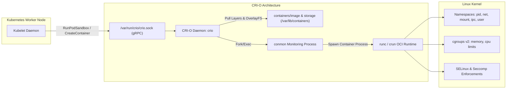

[← Back to Tech-21: OpenShift Overview](./README.md) | [🏠 Series Catalog](../../README.md)

---

# 2. How Does CRI-O Serve as the Immutable Container Engine Behind OpenShift Nodes? 

OpenShift was the first major enterprise Kubernetes distribution to completely deprecate the Docker daemon in favor of **CRI-O** as its sole, default container engine. Designed with a singular purpose—to implement the Kubernetes Container Runtime Interface (CRI) with minimal overhead—CRI-O delivers enterprise security, lightweight memory footprints, and native support for OCI image specifications.

---

## 1. The Core Concept & Intuition

Unlike legacy container engines (like Docker) that include CLI clients, background daemons, swarm managers, volume drivers, and build tools, **CRI-O is strictly an execution gateway for Kubernetes**.

```
  Legacy Docker Daemon Approach                 OpenShift CRI-O Approach
 +-------------------------------+         +-------------------------------+
 | Kubelet                       |         | Kubelet                       |
 +-------------------------------+         +-------------------------------+
                 |                                         | (gRPC)
                 v                                         v
 | dockershim -> dockerd         |         | CRI-O Engine (crio daemon)    |
 +-------------------------------+         +-------------------------------+
                 |                                         |
                 v                                         v
 | containerd -> runc            |         | conmon -> runc / crun         |
 +-------------------------------+         +-------------------------------+
                 |                                         |
                 v                                         v
 | [ Container Linux Process ]   |         | [ Container Linux Process ]   |
 +-------------------------------+         +-------------------------------+
```

### Why CRI-O?
- **Zero Extraneous Logic**: No build engines, no CLI baggage, no network bridging daemon—only pure CRI implementation.
- **`conmon` Architecture**: A lightweight C monitoring utility (`conmon`) monitors each container lifecycle, capturing standard I/O and exit codes without keeping heavy daemon processes in memory.
- **Strict OCI Compliance**: Directly supports OCI-standard images (pulled via `containers/image`) and runtime specifications (via `runc` or `crun`).

---

## 2. Under the Hood: Es Cri-o Serve As The

### Container Creation Lifecycle in CRI-O



---

## 3. Clean Code in Action

### A. Production Configuration and Implementation
### C. Production Configuration and Implementation
### Inspecting Containers via `crictl`

In OpenShift, administrators use `crictl` to interact directly with the CRI-O daemon on worker nodes without going through Kubernetes API:

```bash
# SSH into OpenShift node via oc debug
oc debug node/worker-1.cluster.corp.io

# Inside node debug shell (chroot /host)
chroot /host

# List all running containers managed by CRI-O
crictl ps

# Inspect container details and cgroup configuration
crictl inspect <container-id>

# View container logs directly from CRI-O
crictl logs <container-id>
```

### Tuning CRI-O Configuration via `ContainerRuntimeConfig`

OpenShift allows declarative configuration of CRI-O settings (such as PID limits, log sizes, and image registries) using the `ContainerRuntimeConfig` CRD:

### B. Advanced Production Pattern
```yaml
apiVersion: machineconfiguration.openshift.io/v1
kind: ContainerRuntimeConfig
metadata:
  name: hardened-crio-config
spec:
  machineConfigPoolSelector:
    matchLabels:
      pools.operator.machineconfiguration.openshift.io/worker: ""
  containerRuntimeConfig:
    pidsLimit: 4096
    maxLogSize: 10485760 # 10 MiB per container log
    logLevel: "warn"
```

---

## 4. Common Pitfalls & Interview Traps

| Trap / Misconception | Reality |
| :--- | :--- |
| **"Expecting the `docker` CLI on Nodes"** | Running `docker ps` or `docker images` on OpenShift nodes. Docker is not installed on RHCOS. Use `crictl` for runtime debugging, `podman` for standalone container management, and `skopeo` for registry operations. |
| **"Unbounded Container Process Forks (PID Exhaustion)"** | Defaulting to infinite PID limits for multi-tenant worker nodes. A rogue Java or Python application inside a tenant namespace can spawn thousands of threads (a fork bomb), exhausting the Linux kernel thread table and causing node-level kernel panics. Enforce `pidsLimit` inside `ContainerRuntimeConfig` across all worker nodes. |

---


## 5. 60-Second Memory Anchor


> **"```."**

---

[← Question 01](./01-openshift-architecture-and-rhcos.md) | **Next**: [Question 03 →](./03-operator-lifecycle-manager-olm.md)
