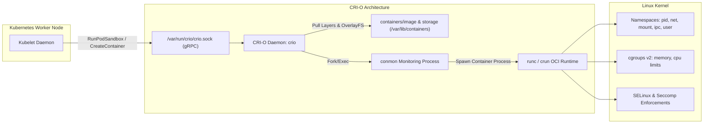

[← Back to Tech-21: OpenShift Overview](./README.md) | [🏠 Series Catalog](../../README.md)

---

# 2. How Does CRI-O Serve as the Immutable Container Engine Behind OpenShift Nodes? 

OpenShift was the first major enterprise Kubernetes distribution to completely deprecate the Docker daemon in favor of **CRI-O** as its sole, default container engine. Designed with a singular purpose—to implement the Kubernetes Container Runtime Interface (CRI) with minimal overhead—CRI-O delivers enterprise security, lightweight memory footprints, and native support for Open Container Initiative (OCI) image specifications.

---

## 1. The Core Concept & Intuition

Unlike legacy container engines like Docker that bundle developer CLI clients, background daemons, swarm managers, volume drivers, and build engines, **CRI-O is strictly an execution gateway for Kubernetes**.

In upstream Kubernetes, the Kubelet communicates over gRPC using the Container Runtime Interface. In legacy environments, this required a translation layer (`dockershim`) which forwarded commands to the monolithic Docker daemon, which called `containerd`, which spawned `runc`. CRI-O eliminates this chain: the Kubelet communicates directly over a local UNIX socket (`/var/run/crio/crio.sock`) with the lightweight CRI-O daemon.

CRI-O delegates process monitoring to **`conmon`**, an ultra-lightweight C monitoring utility. A separate `conmon` process is spawned for each container to handle standard streams (stdin, stdout, stderr), manage TTYs, monitor the container process, and record its exit code without requiring a heavyweight daemon to remain in the execution loop.

---

## 2. Under the Hood: CRI-O Architecture, Conmon & OCI Execution Lifecycle

### Container Creation Lifecycle in CRI-O



### Architectural Comparison: Container Runtimes in Kubernetes

| Architectural Dimension | CRI-O (OpenShift Default) | containerd (Standard K8s) | Docker Engine (Legacy) |
| :--- | :--- | :--- | :--- |
| **Primary Design Objective** | Exclusively Kubernetes CRI compliance; zero standalone features | General-purpose container runtime with CRI plugin | Desktop/monolithic developer tool with Swarm & build kit |
| **Daemon Overhead & Footprint** | Minimal; daemon serves gRPC socket; delegates monitoring to `conmon` | Low; runs containerd daemon and shim per container | Heavy; multi-threaded dockerd process holding state in memory |
| **Process Monitoring** | Lightweight C utility (`conmon`) tracks PID, I/O, and exit codes | Go-based `containerd-shim` per container | Monitored directly by parent dockerd process |
| **SELinux Integration** | Deep, native MCS labeling on every file and IPC channel by default | Supported via plugin configuration, often optional | Often disabled or running in permissive mode |
| **Image Management** | Uses `containers/image` and `containers/storage` (shared with Podman) | Internal containerd content store | Internal Docker graphdriver (`overlay2`) |

---

## 3. Clean Code in Action

### A. Low-Level Node Runtime Inspection with crictl

In OpenShift, administrators use `crictl` to interact directly with the CRI-O daemon on worker nodes without going through the Kubernetes API server:

```bash
# SSH into OpenShift node via oc debug
oc debug node/worker-1.cluster.corp.io

# Inside node debug shell (chroot to host filesystem)
chroot /host

# List all running containers managed by CRI-O
crictl ps

# Inspect container details, mounts, and cgroup configuration
crictl inspect <container-id>

# View container logs directly from CRI-O
crictl logs <container-id>
```

### B. Declarative CRI-O Tuning via ContainerRuntimeConfig

OpenShift allows declarative configuration of CRI-O settings (such as PID limits, log sizes, and image registries) using the `ContainerRuntimeConfig` CRD:

```yaml
apiVersion: machineconfiguration.openshift.io/v1
kind: ContainerRuntimeConfig
metadata:
  name: hardened-crio-config
spec:
  machineConfigPoolSelector:
    matchLabels:
      pools.operator.machineconfiguration.openshift.io/worker: ""
  containerRuntimeConfig:
    pidsLimit: 4096
    maxLogSize: 10485760 # 10 MiB per container log
    logLevel: "warn"
```

---

## 4. Common Pitfalls & Interview Traps

| Trap / Misconception | Reality |
| :--- | :--- |
| **"Expecting the `docker` CLI on Nodes"** | Running `docker ps` or `docker images` on OpenShift nodes. Docker is not installed on RHCOS. Use `crictl` for runtime debugging, `podman` for standalone container management, and `skopeo` for registry operations. |
| **"Unbounded Container Process Forks (PID Exhaustion)"** | Defaulting to infinite PID limits for multi-tenant worker nodes. A rogue Java or Python application inside a tenant namespace can spawn thousands of threads (a fork bomb), exhausting the Linux kernel thread table and causing node-level kernel panics. Enforce `pidsLimit` inside `ContainerRuntimeConfig` across all worker nodes. |

---

## 5. 60-Second Memory Anchor

> **"CRI-O is purpose-built solely for Kubernetes: it strips away the daemon bloat of Docker, delegating process tracking to conmon and execution to OCI runtimes under strict SELinux isolation."**

---

[← Question 01](./01-openshift-architecture-and-rhcos.md) | **Next**: [Question 03 →](./03-operator-lifecycle-manager-olm.md)
