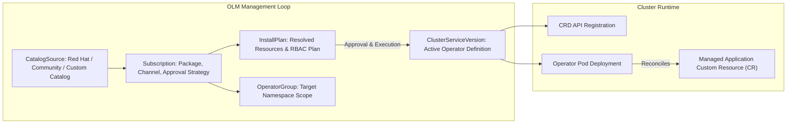

[← Back to Tech-21: OpenShift Overview](./README.md) | [🏠 Series Catalog](../../README.md)

---

# 3. How Does the Operator Lifecycle Manager (OLM) Automate Platform and Application Upgrades? 

In OpenShift, nearly all cluster services—from logging, monitoring, and service mesh to databases and AI pipelines—are delivered and managed as Kubernetes Operators. The **Operator Lifecycle Manager (OLM)** is the management engine that automates the installation, dependency resolution, RBAC provisioning, and automated continuous upgrades of Operators across the cluster.

---

## 1. The Core Concept & Intuition

Think of OLM as the **enterprise app store and package manager (`yum`/`apt`) for Kubernetes Operators**.

Instead of manually applying raw CRD definitions, ClusterRoles, and Deployment manifests for every database or observability tool, OLM provides:
- **Declarative Subscription**: You declare *what* operator and channel you want (e.g., "PostgreSQL Operator on stable-v5 channel").
- **Automated Upgrades**: OLM detects new operator versions in catalog registries and rolls them out without human intervention.
- **Dependency Resolution**: If Operator A requires a specific CRD API version from Operator B, OLM discovers, installs, and validates both.

```
 [ Operator Hub / CatalogSource ]
                |
                v (Discovers Available Versions & Channels)
       [ Subscription CRD ]
                |
                v (Generates Execution Plan)
       [ InstallPlan CRD ]
                |
                v (Deploys CRDs & Operator Controller)
 [ ClusterServiceVersion (CSV) ]
```

---

## 2. Under the Hood: Es The Operator Lifecycle Manager

### OLM Core Architecture Components



### Key OLM Custom Resource Definitions (CRDs)

| CRD | Purpose |
| :--- | :--- |
| **`CatalogSource`** | A repository of Operator metadata (CSV manifests, CRDs, package channels). |
| **`Subscription`** | Declares the intent to install an Operator from a CatalogSource across a specific update channel. |
| **`OperatorGroup`** | Selects target namespaces where the Operator will watch and reconcile custom resources. |
| **`InstallPlan`** | The generated execution plan containing CRD definitions, deployments, and ClusterRoles needed to activate the CSV. |
| **`ClusterServiceVersion` (CSV)** | The runtime manifest representing an installed Operator version, its RBAC, icons, and CRD endpoints. |

---

## 3. Clean Code in Action

### A. Production Configuration and Implementation
### C. Production Configuration and Implementation
### C. Defining an `OperatorGroup`

```yaml
apiVersion: operators.coreos.com/v1
kind: OperatorGroup
metadata:
  name: platform-operators-group
  namespace: openshift-operators-custom
spec:
  targetNamespaces:
    - openshift-operators-custom
```

### 2. Declaring a `Subscription`

### B. Advanced Production Pattern
```yaml
apiVersion: operators.coreos.com/v1alpha1
kind: Subscription
metadata:
  name: prometheus-operator-sub
  namespace: openshift-operators-custom
spec:
  channel: beta
  name: prometheus
  source: community-operators
  sourceNamespace: openshift-marketplace
  installPlanApproval: Automatic
```

### 3. Querying Operator Lifecycle with `oc`

```bash
# List available Operator catalogs
oc get catalogsources -n openshift-marketplace

# List active subscriptions
oc get subscriptions -n openshift-operators-custom

# Inspect ClusterServiceVersion (CSV) status
oc get csv -n openshift-operators-custom

# Check InstallPlan status
oc get installplan -n openshift-operators-custom
```

---

## 4. Common Pitfalls & Interview Traps

| Trap / Misconception | Reality |
| :--- | :--- |
| **"Multiple Conflicting `OperatorGroups` in a Single Namespace"** | Creating more than one `OperatorGroup` inside the same namespace. OLM fails with a conflict error because multiple OperatorGroups create ambiguous target namespace bindings for member CSVs. Ensure each namespace has at most one `OperatorGroup`. |
| **"Unpinned `Automatic` Updates for Production Databases"** | Setting `installPlanApproval: Automatic` for mission-critical database operators with breaking schema changes across major versions. OLM automatically updates the operator controller when upstream publishes a new CSV, potentially triggering unintended database cluster reboots during peak business hours. Use `installPlanApproval: Manual` for core data platforms, allowing platform engineers to review and approve `InstallPlans` during scheduled maintenance windows. |

---


## 5. 60-Second Memory Anchor


> **"```."**

---

[← Question 02](./02-crio-and-container-engine-in-openshift.md)

> ### 🎓 Looking for Questions 04 through 21 & Deep-Dive Appendices?
> You have reached the end of the free sampler for **Tech-21: OpenShift**!
> 
> The full release contains **18 additional core interview chapters** plus **2 architectural reference appendices**, memory layouts, complete edge-case tables, and production patterns.
> 
> 📖 **[Get the Full Edition (Kindle / EPUB / PDF) →](./README.md#how-to-get-the-full-edition)**

