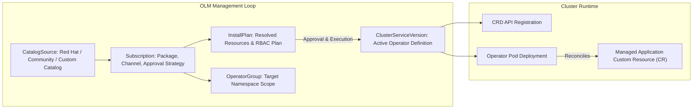

[← Back to Tech-21: OpenShift Overview](./README.md) | [🏠 Series Catalog](../../README.md)

---

# 3. How Does the Operator Lifecycle Manager (OLM) Automate Platform and Application Upgrades? 

In OpenShift, nearly all platform services—from logging, monitoring, and service mesh to databases, storage, and AI pipelines—are delivered and managed as Kubernetes Operators. The **Operator Lifecycle Manager (OLM)** is the management engine that automates the installation, dependency resolution, RBAC provisioning, and continuous automated upgrades of Operators across the cluster.

---

## 1. The Core Concept & Intuition

Think of OLM as the **enterprise app store and package manager (`yum`/`apt`) for Kubernetes Operators**.

Instead of platform engineers manually applying raw CRD manifests, RBAC ClusterRoles, and Deployment definitions for every observability tool or database, OLM provides:
- **Declarative Subscriptions**: You declare *what* operator and channel you want (e.g., "PostgreSQL Operator on stable-v5 channel").
- **Dependency Resolution Engine**: If Operator A requires a specific CRD API version provided by Operator B, OLM discovers, installs, and validates both in the correct order.
- **Controlled Upgrade Channels**: Operators define update streams (e.g., `fast`, `stable`, `eus`), allowing clusters to roll forward automatically or pause for manual approval.

---

## 2. Under the Hood: OLM Architecture, Dependency Resolution & CRD Lifecycles

### OLM Core Architecture Components



### Architectural Comparison: OLM vs. Traditional Manifest / Helm Deployment

| Management Dimension | OLM Declarative Lifecycle | Traditional Helm / Manual YAML |
| :--- | :--- | :--- |
| **Dependency Resolution** | Automated graph resolution; verifies required CRD versions across CSVs | Manual; fails at runtime if dependent CRD or operator is missing |
| **Upgrade Continuous Delivery** | Automated or Manual approval across channels (`stable`, `fast`, `eus`) | Requires manual `helm upgrade` or CI pipeline rerun |
| **RBAC Provisioning** | Automatically scopes ClusterRoles and ServiceAccounts per OperatorGroup | Manually authored and granted by cluster admin |
| **Drift Detection & Reconciliation** | OLM actively reconciles CSV deployment state against desired spec | Typically unchecked unless integrated with external GitOps |

### Key OLM Custom Resource Definitions (CRDs)

| CRD | Purpose |
| :--- | :--- |
| **`CatalogSource`** | A repository of Operator metadata (CSV manifests, CRDs, package channels). |
| **`Subscription`** | Declares the intent to install an Operator from a CatalogSource across a specific update channel. |
| **`OperatorGroup`** | Selects target namespaces where the Operator will watch and reconcile custom resources. |
| **`InstallPlan`** | The generated execution plan containing CRD definitions, deployments, and ClusterRoles needed to activate the CSV. |
| **`ClusterServiceVersion` (CSV)** | The runtime manifest representing an installed Operator version, its RBAC, icons, and CRD endpoints. |

---

## 3. Clean Code in Action

### A. Scoped OperatorGroup and Declarative Subscription

```yaml
# Step 1: Define an OperatorGroup scoping the operator to a target namespace
apiVersion: operators.coreos.com/v1
kind: OperatorGroup
metadata:
  name: platform-operators-group
  namespace: openshift-operators-custom
spec:
  targetNamespaces:
    - openshift-operators-custom
---
# Step 2: Declare the Subscription with manual approval for production safety
apiVersion: operators.coreos.com/v1alpha1
kind: Subscription
metadata:
  name: prometheus-operator-sub
  namespace: openshift-operators-custom
spec:
  channel: beta
  name: prometheus
  source: community-operators
  sourceNamespace: openshift-marketplace
  installPlanApproval: Manual
```

### B. Manual InstallPlan Approval Workflow and Operator Verification

```bash
# List available Operator catalogs
oc get catalogsources -n openshift-marketplace

# List active subscriptions and inspect target channels
oc get subscriptions -n openshift-operators-custom

# Identify pending InstallPlans requiring administrator sign-off
oc get installplan -n openshift-operators-custom

# Approve the pending InstallPlan to execute the rollout
oc patch installplan <installplan-name> -n openshift-operators-custom \
  --type merge --patch '{"spec":{"approved":true}}'

# Verify ClusterServiceVersion (CSV) reaches Succeeded phase
oc get csv -n openshift-operators-custom
```

---

## 4. Common Pitfalls & Interview Traps

| Trap / Misconception | Reality |
| :--- | :--- |
| **"Multiple Conflicting `OperatorGroups` in a Single Namespace"** | Creating more than one `OperatorGroup` inside the same namespace. OLM fails with a conflict error because multiple OperatorGroups create ambiguous target namespace bindings for member CSVs. Ensure each namespace has at most one `OperatorGroup`. |
| **"Unpinned `Automatic` Updates for Production Databases"** | Setting `installPlanApproval: Automatic` for mission-critical database operators with breaking schema changes across major versions. OLM automatically updates the operator controller when upstream publishes a new CSV, potentially triggering unintended database cluster reboots during peak business hours. Use `installPlanApproval: Manual` for core data platforms, allowing platform engineers to review and approve `InstallPlans` during scheduled maintenance windows. |

---

## 5. 60-Second Memory Anchor

> **"OLM is the automated package manager of Kubernetes: it turns static CRD deployments into continuously monitored, dependency-resolved, and safely upgradeable platform services."**

---

[← Question 02](./02-crio-and-container-engine-in-openshift.md)

> ### 🎓 Looking for Questions 04 through 21 & Deep-Dive Appendices?
> You have reached the end of the free sampler for **Tech-21: OpenShift**!
> 
> The full release contains **18 additional core interview chapters** plus **2 architectural reference appendices**, memory layouts, complete edge-case tables, and production patterns.
> 
> 📖 **[Get the Full Edition (Kindle / EPUB / PDF) →](./README.md#how-to-get-the-full-edition)**

