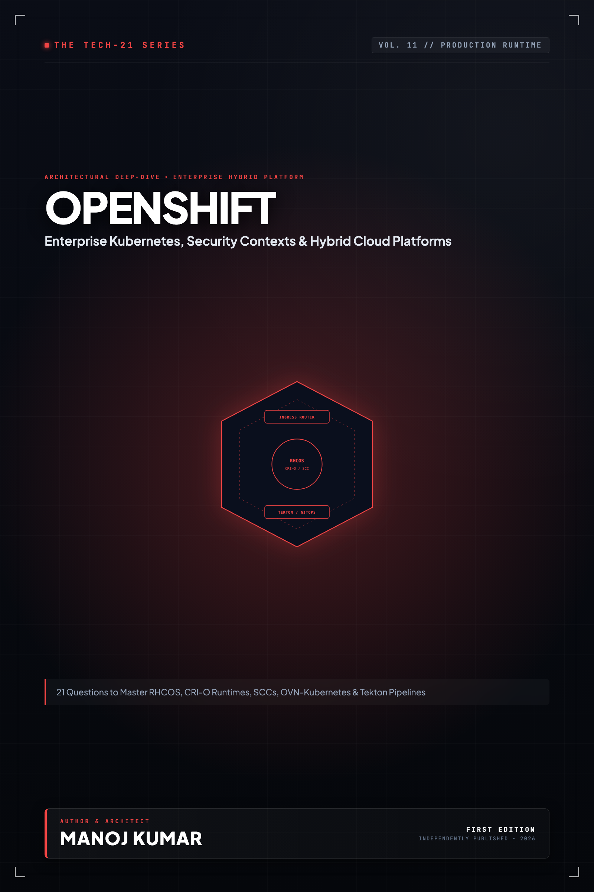

# Tech-21: OpenShift

> **21 Architectural Questions to Master Enterprise Kubernetes & Cloud-Native Platforms**  
> *Author: Manoj Kumar* • *Tech-21 Series (Vol. 11)*

  

## 📖 About This Edition

This repository contains the **free public sampler** for **Tech-21: OpenShift**, including the **Preface and Questions 01 through 03** in their entirety. Every chapter follows the strict 5-section Tech-21 mental model framework:

1. **The Core Concept & Intuition** (High-signal problem statement & architecture)
2. **Under the Hood** (Runtime execution mechanics, memory diagrams, and comparison matrices)
3. **Clean Code in Action** (Idiomatic, production-grade implementations)
4. **Common Pitfalls & Interview Traps** (Structured bug-prevention matrices)
5. **60-Second Memory Anchor** (Permanent retention punchlines)

## 📋 Complete 21-Question Syllabus

| Chapter | Status | Title |
| :--- | :---: | :--- |
| **[00-preface](./00-preface.md)** | 🟢 **Free Sampler** | [Preface](./00-preface.md) |
| **[01-openshift-architecture-and-rhcos](./01-openshift-architecture-and-rhcos.md)** | 🟢 **Free Sampler** | [1. How Does OpenShift Enterprise Architecture Differ from Kubernetes and How Does RHCOS Function?](./01-openshift-architecture-and-rhcos.md) |
| **[02-crio-and-container-engine-in-openshift](./02-crio-and-container-engine-in-openshift.md)** | 🟢 **Free Sampler** | [2. How Does CRI-O Serve as the Immutable Container Engine Behind OpenShift Nodes?](./02-crio-and-container-engine-in-openshift.md) |
| **[03-operator-lifecycle-manager-olm](./03-operator-lifecycle-manager-olm.md)** | 🟢 **Free Sampler** | [3. How Does the Operator Lifecycle Manager (OLM) Automate Platform and Application Upgrades?](./03-operator-lifecycle-manager-olm.md) |
| **04-openshift-routes-and-haproxy-ingress** | 🔒 *Full Edition* | 4. How Do OpenShift Routes and the HAProxy Ingress Sharding Layer Manage External Traffic? |
| **05-ovn-kubernetes-and-network-segmentation** | 🔒 *Full Edition* | 5. How Does OVN-Kubernetes Implement Cluster SDN, Egress IPs, and Network Isolation? |
| **06-security-context-constraints-scc** | 🔒 *Full Edition* | 6. How Do Security Context Constraints (SCC) Enforce Enterprise Pod Security in OpenShift? |
| **07-authentication-oauth-and-rbac** | 🔒 *Full Edition* | 7. How Does OpenShift OAuth Authentication Integrate with Enterprise Identity Providers and RBAC? |
| **08-projects-and-multi-tenancy-isolation** | 🔒 *Full Edition* | 8. How Do OpenShift Projects Enforce Enterprise Multi-Tenancy and Namespace Isolation? |
| **09-image-streams-and-internal-registry** | 🔒 *Full Edition* | 9. How Do ImageStreams and the Integrated OpenShift Registry Decouple Build and Deploy Triggers? |
| **10-source-to-image-s2i-builds** | 🔒 *Full Edition* | 10. How Does Source-to-Image (S2I) Transform Application Source Code into Container Images? |
| **11-openshift-builds-and-buildconfigs** | 🔒 *Full Edition* | 11. How Do BuildConfigs and Ship-to-Cluster Automation Manage Enterprise Image Builds? |
| **12-openshift-pipelines-and-tekton** | 🔒 *Full Edition* | 12. How Do OpenShift Pipelines and Tekton Automate Cloud-Native CI/CD Pipelines? |
| **13-openshift-gitops-and-argocd** | 🔒 *Full Edition* | 13. How Does OpenShift GitOps Leverage ArgoCD to Enforce Declarative Cluster State? |
| **14-openshift-monitoring-and-alerting** | 🔒 *Full Edition* | 14. How Does the Built-in Cluster Monitoring Operator Unify Prometheus, Alertmanager, and User Workload Metrics? |
| **15-openshift-logging-loki-and-vector** | 🔒 *Full Edition* | 15. How Does OpenShift Logging Collect and Stream Multi-Tenant Cluster Logs with Vector and Loki? |
| **16-openshift-serverless-and-knative** | 🔒 *Full Edition* | 16. How Does OpenShift Serverless Leverage Knative for Scale-to-Zero and CloudEvents Routing? |
| **17-openshift-service-mesh-and-ossm** | 🔒 *Full Edition* | 17. How Does Red Hat OpenShift Service Mesh Implement Mutual TLS and Envoy Traffic Control? |
| **18-openshift-storage-and-odf** | 🔒 *Full Edition* | 18. How Does OpenShift Data Foundation (ODF) Provide Software-Defined Persistent Storage? |
| **19-advanced-cluster-management-rhacm** | 🔒 *Full Edition* | 19. How Does Red Hat Advanced Cluster Management (RHACM) Govern Fleet-Wide Multi-Cluster Deployments? |
| **20-openshift-virtualization-and-kubevirt** | 🔒 *Full Edition* | 20. How Does OpenShift Virtualization (KubeVirt) Run Virtual Machines Alongside Containers? |
| **21-cluster-upgrades-and-machine-config-pools** | 🔒 *Full Edition* | 21. How Do MachineConfigPools and the MCO Execute Coordinated Zero-Downtime Cluster Node Upgrades? |
| **22-appendix-openshift-oc-cli-cheatsheet** | 🔒 *Full Edition* | Appendix A: OpenShift oc CLI Reference Cheatsheet |
| **23-appendix-production-openshift-reference-architecture** | 🔒 *Full Edition* | Appendix B: Production OpenShift Reference Architecture |

---

## 🚀 How to Get the Full Edition

The complete edition unlocks **all 21 in-depth questions** and **both architectural reference appendices** (over 100+ pages of high-signal diagrams, memory layouts, and interview pitfall tables):

- 📱 **Kindle Edition**: Available on [Amazon Kindle](https://amazon.com)
- 📄 **Digital DRM-Free Bundle (EPUB + PDF)**: Instant download with high-res interior graphics
- 📦 **All-Access Pass**: Access all 15 volumes across the entire Tech-21 series

[← Return to Series Catalog](../../README.md)
