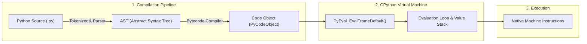

[← Back to Tech-21: Python Mastery & Internals Overview](./README.md) | [🏠 Series Catalog](../../README.md)

---

# 1. How Does the Python Execution Model and CPython Virtual Machine Work? 

## 1. The Core Concept & Intuition

Python is often described as an "interpreted language", but standard Python (**CPython**, the reference implementation written in C) is actually a **bytecode-compiled virtual machine runtime**.

When you execute a Python script (`python main.py`), Python first compiles your human-readable source code into an intermediate format called **Python Bytecode** (`.pyc` cached files) and then executes that bytecode inside the **Python Virtual Machine (PyVM)** evaluation loop.

---

## 2. Under the Hood: The CPython Virtual Machine



| Execution Stage | Input Data Structure | Output Data Structure | Primary Component |
| :--- | :--- | :--- | :--- |
| **Tokenizing & Parsing** | UTF-8 Source String (`.py`) | Parse Tree / CST | Peg Parser (`Parser/pegen.c`) |
| **AST Transformation** | Parse Tree | Abstract Syntax Tree (`ast.AST`) | `Python/ast.c` |
| **Bytecode Generation** | AST | Bytecode Instructions (`.pyc`) | `Python/compile.c` |
| **Evaluation Loop** | Bytecode Sequence | Machine Execution / Side Effects | `Python/ceval.c` |

---

## 3. Clean Code in Action

### A. Inspecting Bytecode with the dis Module
Python provides the built-in `dis` module to inspect bytecode instructions directly:

```python
import dis

def calculate_discount(price: float, discount: float) -> float:
    final_price = price * (1.0 - discount)
    return final_price

# Disassemble the function into PyVM bytecode:
dis.dis(calculate_discount)
```

### B. Emitted PyVM Bytecode Analysis
```text
  2           0 LOAD_FAST                0 (price)
              2 LOAD_CONST               1 (1.0)
              4 LOAD_FAST                1 (discount)
              6 BINARY_OP               10 (-)
              8 BINARY_OP                5 (*)
             10 STORE_FAST               2 (final_price)

  3          12 LOAD_FAST                2 (final_price)
             14 RETURN_VALUE
```

---

## 4. Common Pitfalls & Interview Traps

| Trap / Misconception | Reality |
| :--- | :--- |
| **"Python runs raw text line-by-line without compilation."** | Python compiles entire files into bytecode before executing. If there is a syntax error anywhere in the file, execution fails before line 1 runs! |
| **"`.pyc` files contain machine code."** | `.pyc` files contain platform-independent **Python Bytecode**, not native x86/ARM machine code. |

---

## 5. 60-Second Memory Anchor

> **"CPython compiles Python source code into bytecode instructions cached in `__pycache__` (`.pyc`). The Python Virtual Machine executes these opcodes sequentially using a stack-based evaluation loop in C."**

---

[← Preface](./00-preface.md) | **Next**: [Question 02 →](./02-everything-is-an-object-and-memory-model.md)
